# Guía para abrir el diseño EcoAccess_BD.dmd en Oracle SQL Developer

Esta guía se comprobó el 15/11/2026 en Oracle SQL Developer 26.2.0.186.2220 (Windows, en español). Su Data Modeler integrado es la versión 24.3.1. Cada paso muestra la ventana real y lo que debe verse.

El diseño tiene dos partes que **siempre van juntas** en la misma carpeta: el archivo `EcoAccess_BD.dmd` y la carpeta `EcoAccess_BD/`. El `.dmd` solo es el índice; las tablas, columnas y diagramas están en la carpeta.

| Qué abrir | Dónde está |
|---|---|
| Original editable de la entrega | `02_MODELOS_DE_DATOS/05_DATA_MODELER_EDITABLE/EcoAccess_BD.dmd` |
| Copia de consulta (para la galería) | `19_MODELOS_VISUALES/05_DATA_MODELER/04_ABRIR_DMD/COPIA_DE_CONSULTA_DMD/EcoAccess_BD.dmd` |

Las dos copias tienen el mismo modelo: `verificar_dmd.ps1` confirma 19 tablas, 173 columnas y 38 FK en cada una.

## 1. Abrir el programa

1. Abre SQL Developer con doble clic en su acceso directo del escritorio o en `C:\Oracle\sqldeveloper-26.2.0.186.2220-x64\sqldeveloper\sqldeveloper.exe`.
2. Espera a que aparezca la **Página de bienvenida**. No necesitas conectarte a la base de datos para ver el diseño.

## 2. Abrir el diseño

1. Haz clic en el menú **Archivo**.
2. Pasa el ratón por **Data Modeler**; se abre un submenú.
3. Haz clic en **Abrir**.

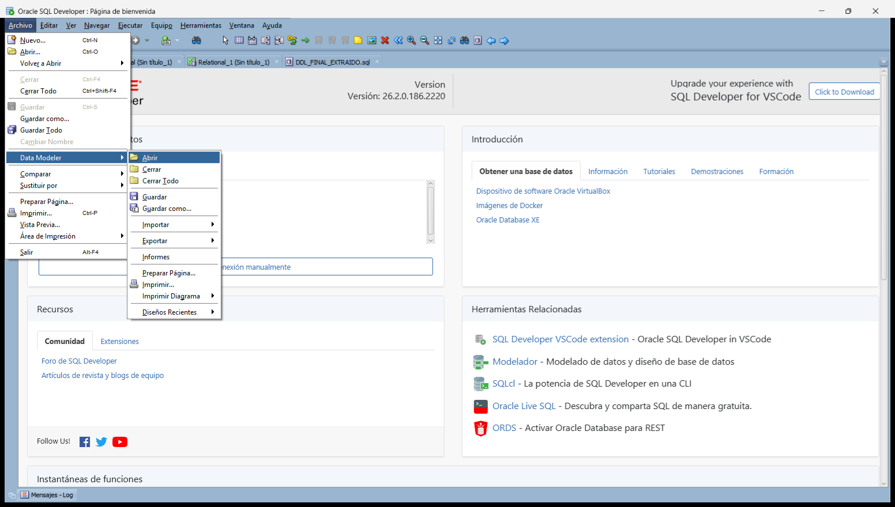

4. En la ventana **Abrir Diseño**, escribe la ruta completa del archivo en **Nombre de Archivo** o busca la carpeta con los iconos de la izquierda.
5. Pulsa **Abrir**.

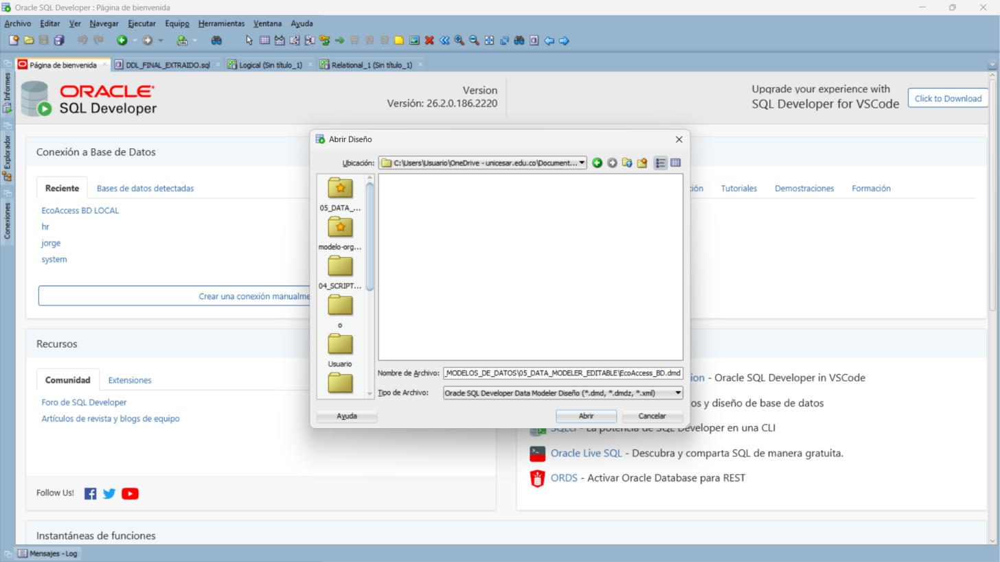

**Resultado:** se abren las pestañas *Logical*, *Relational_1* y las cinco subvistas *M1* a *M5*. En **Mensajes – Log** aparece «Abrir Diseño: 'EcoAccess_BD'». Si el programa pregunta qué modelos abrir, deja marcado `Relational_1` y acepta.

## 3. Mostrar el navegador del diseño (Explorador)

1. Menú **Ver → Data Modeler → Explorador**. En ese mismo submenú están **Ajustar Pantalla**, **Acercar** y **Alejar**.

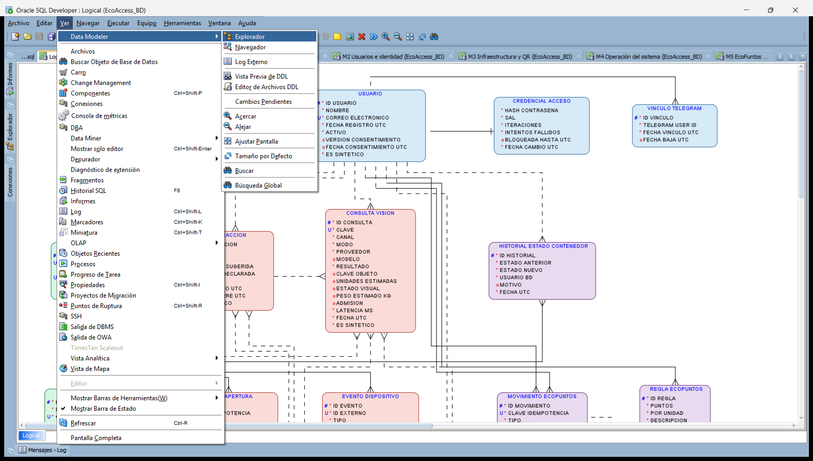

2. En el Explorador, despliega **EcoAccess_BD → Modelos Relacionales → Relational_1**. Debe decir **Tablas [19]**, **Vistas [9]**, **Claves Ajenas [38]** y **Subvistas [5]**.
3. Despliega **Subvistas**: aparecen M1 Catálogos base, M2 Usuarios e identidad, M3 Infraestructura y QR, M4 Operación del sistema y M5 EcoPuntos y auditoría. Doble clic en una de ellas la abre.

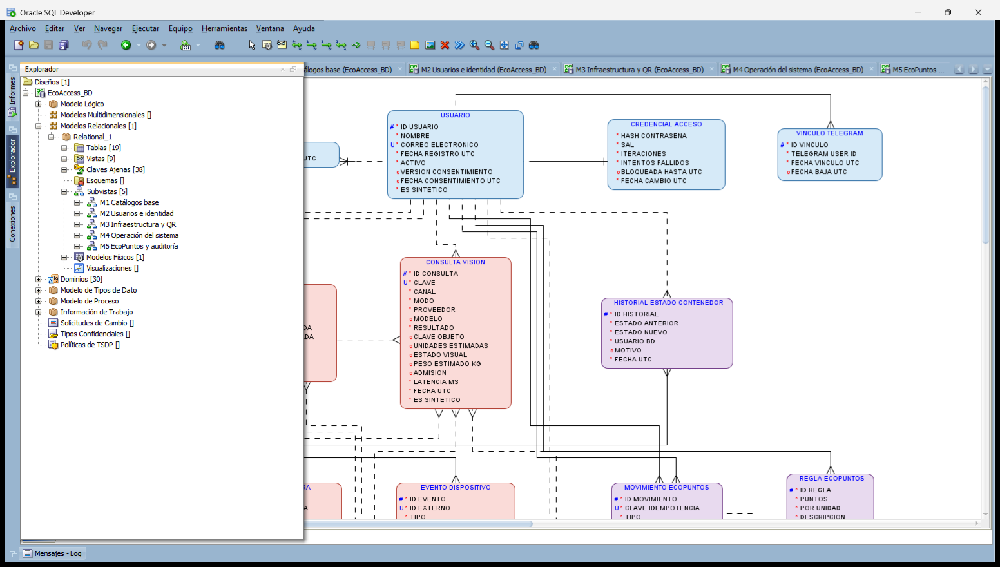

## 4. Abrir el modelo lógico y el relacional

- Pestaña **Logical (EcoAccess_BD)**: el modelo lógico, con las 9 vistas en verde abajo.
- Pestaña **Relational_1 (EcoAccess_BD)**: el modelo relacional completo.
- Para ver el diagrama entero: **Ver → Data Modeler → Ajustar Pantalla**.
- Para trabajar con más espacio: **doble clic en la pestaña** del diagrama la maximiza; otro doble clic la devuelve a su tamaño.

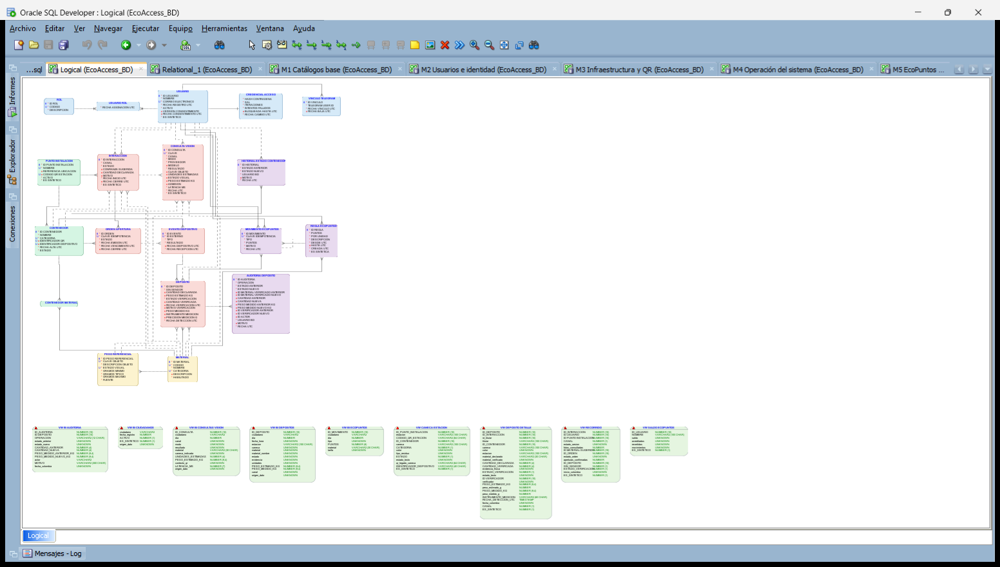

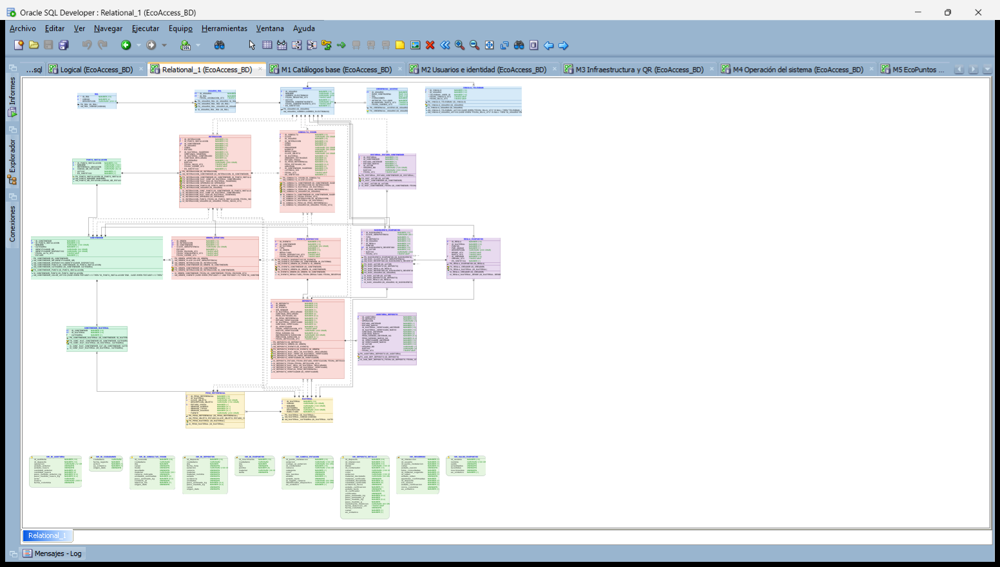

## 5. Abrir cada subvista

Haz clic en la pestaña de la subvista y luego en **Ver → Data Modeler → Ajustar Pantalla**. La subvista M1 muestra, además de MATERIAL y PESO_REFERENCIAL, las tablas de otros módulos que los referencian, para que se vean sus FK.

| Subvista | Captura |
|---|---|
| M1 Catálogos base | `08_CAPTURAS_REALES/SQL_DEVELOPER/07_subvista_M1_catalogos.png` |
| M2 Usuarios e identidad | `08_CAPTURAS_REALES/SQL_DEVELOPER/08_subvista_M2_usuarios.png` |
| M3 Infraestructura y QR | `08_CAPTURAS_REALES/SQL_DEVELOPER/09_subvista_M3_infraestructura.png` |
| M4 Operación del sistema | `08_CAPTURAS_REALES/SQL_DEVELOPER/10_subvista_M4_operacion.png` |
| M5 EcoPuntos y auditoría | `08_CAPTURAS_REALES/SQL_DEVELOPER/11_subvista_M5_ecopuntos_auditoria.png` |

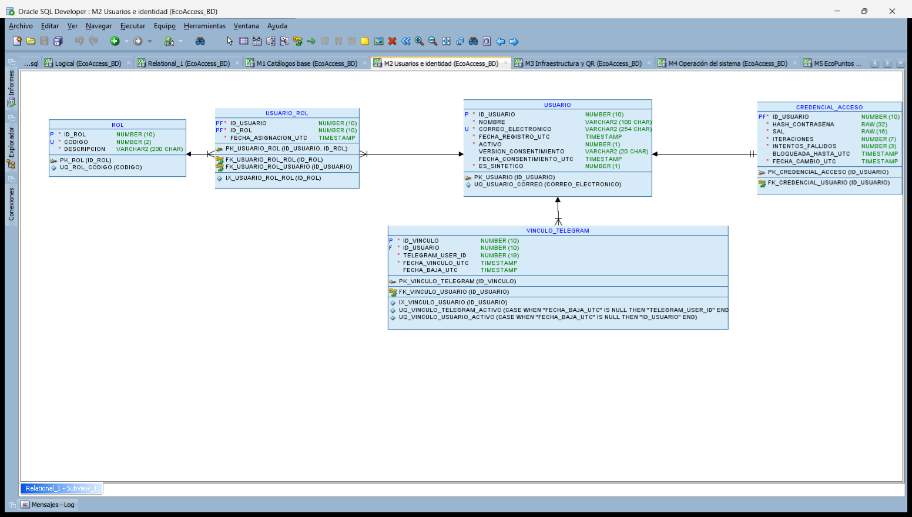

## 6. Ampliar y reducir

- **Ver → Data Modeler → Acercar / Alejar**, o los iconos de lupa de la barra de herramientas.
- **Ajustar Pantalla** muestra todo el diagrama de una vez.
- La rueda del ratón desplaza el diagrama; las barras de desplazamiento también.

## 7. Leer PK, FK y cardinalidades

En cada caja de tabla:

- **P** = clave primaria (PK). **F** = clave foránea (FK). **PF** = columna que es PK y FK a la vez. **U** = única.
- Un **asterisco rojo** marca una columna obligatoria (NOT NULL).
- En la parte baja de la caja se listan las restricciones: `PK_…`, `FK_…`, `UQ_…` e índices `IX_…`.

En las líneas:

- La línea va de la tabla **hija** (la que guarda la FK) a la tabla **padre**; la flecha apunta al padre.
- **Línea continua:** FK obligatoria. **Línea discontinua:** FK opcional (alguna columna admite NULL).
- Una FK cuya columna también es PK o única es 1:0..1; las demás son 1:N.

Para ver una relación concreta, haz **clic en la línea**: quedan marcados sus extremos en azul.

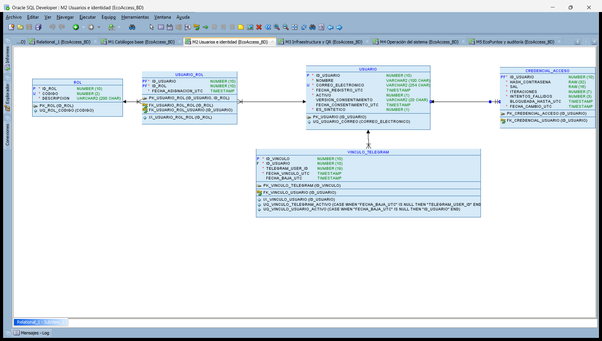

**Doble clic en la línea** abre sus propiedades: nombre, tabla padre, tabla hija, regla de borrado (NO ACTION) y columnas asociadas. Cierra con **Cancelar** para no cambiar nada.

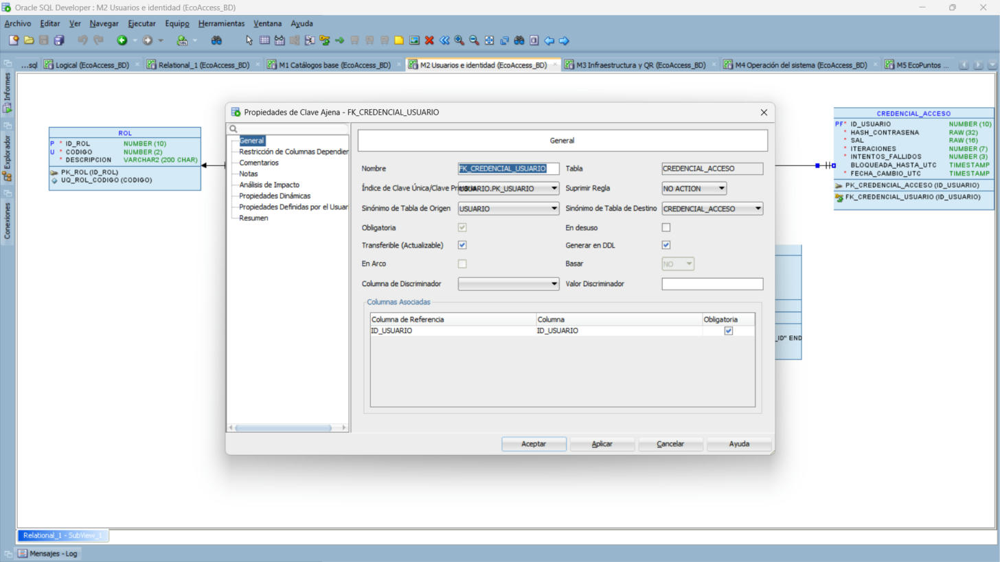

## 8. Ver los atributos de una tabla

**Doble clic en el título de la tabla** → sección **Columnas**. Se ven el nombre, el tipo de dato, si es clave primaria u obligatoria y el comentario del diccionario. Cierra con **Cancelar**.

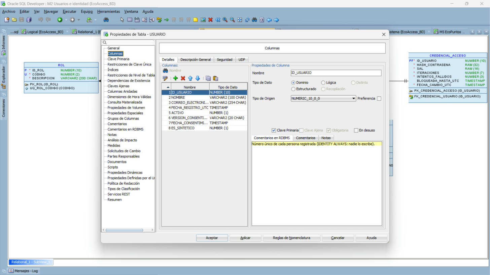

Al terminar, vuelve a la pestaña **Relational_1** para dejar el modelo general a la vista.

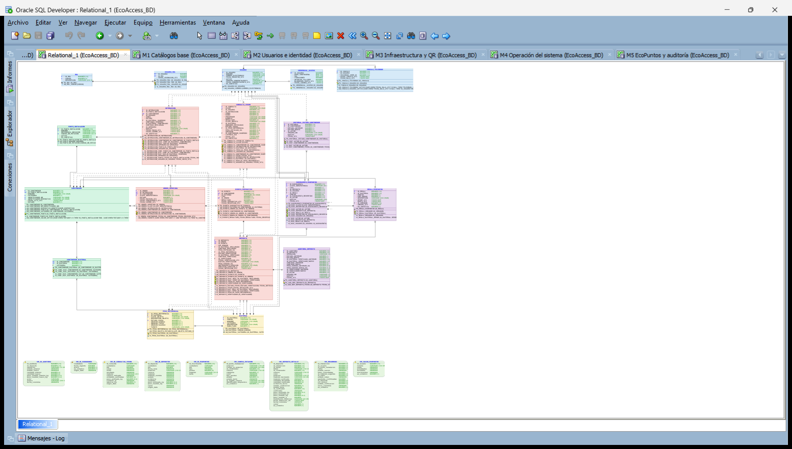

## 9. Guardar una copia sin dañar el diseño original

- Para estudiar **no hace falta guardar**. Cierra con **Archivo → Data Modeler → Cerrar**; si no cambiaste nada, no pregunta.
- Si moviste cajas y quieres conservar el cambio sin tocar el original: **Archivo → Data Modeler → Guardar como…** y elige otra carpeta y otro nombre, por ejemplo `EcoAccess_BD_practica.dmd`. Data Modeler crea su propia carpeta acompañante.
- No borres tablas ni columnas en Data Modeler: el diseño debe seguir coincidiendo con Oracle. Después de cualquier cambio, comprueba con:

```
pwsh -File 02_MODELOS_DE_DATOS\08_HERRAMIENTAS_DE_GENERACION\verificar_dmd.ps1 -Dmd <ruta del .dmd>
```

Debe informar 19 tablas, 173 columnas y 38 FK.

## 10. Si el DMD no abre

| Lo que pasa | Qué revisar |
|---|---|
| Se abre vacío o dice que no encuentra objetos | Falta la carpeta `EcoAccess_BD/` junto al `.dmd`. Copia las dos cosas juntas. |
| El archivo no aparece en la ventana Abrir | En **Tipo de Archivo** debe estar «Oracle SQL Developer Data Modeler Diseño (*.dmd…)». |
| No aparece el submenú Data Modeler | Asegúrate de usar el menú **Archivo** de la ventana principal, no el de una hoja de trabajo. |
| Al cerrar pregunta si se desea guardar | Algo cambió. Elige **Cerrar Sin Guardar** si no quieres conservarlo. |
| OneDrive muestra el archivo con una nube | Haz clic derecho → **Mantener siempre en este dispositivo** antes de abrirlo. |

## Lo que no requiere contraseña y lo que sí

Abrir el diseño, recorrer los diagramas y ver propiedades **no** necesita conexión. Ver las 19 tablas dentro de Oracle (panel **Conexiones → EcoAccess BD LOCAL**) sí la necesita: SQL Developer pide la contraseña de `ECOACCESS_BD` y la debe escribir la persona dueña de la cuenta.
