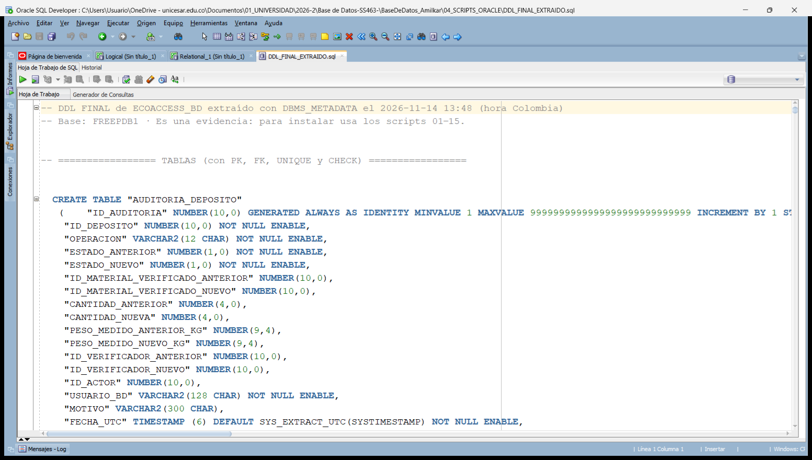
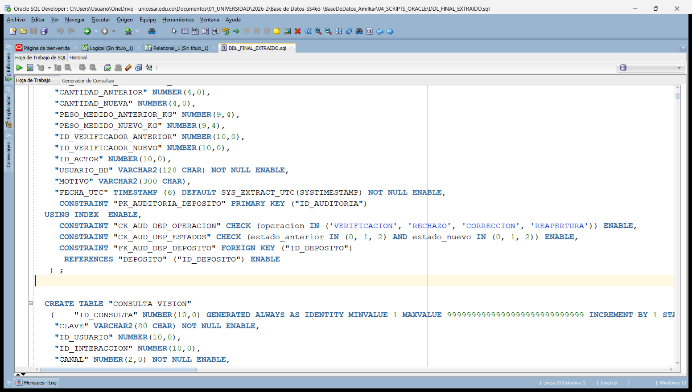
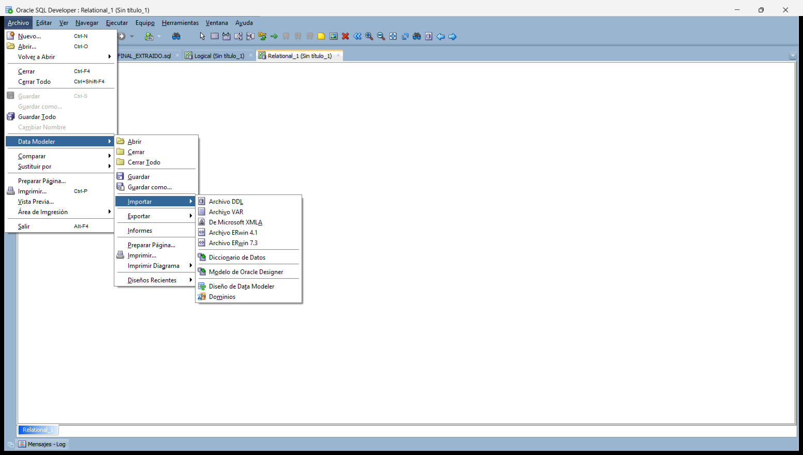
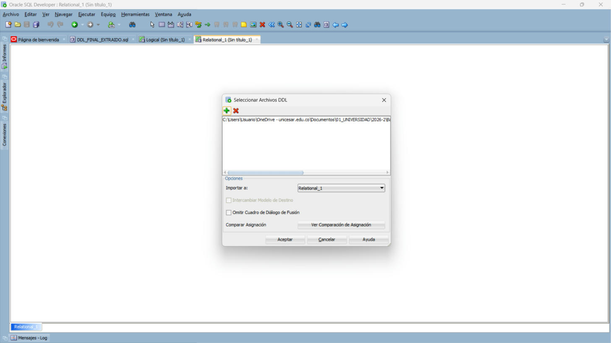
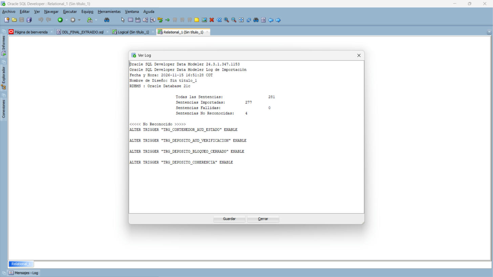
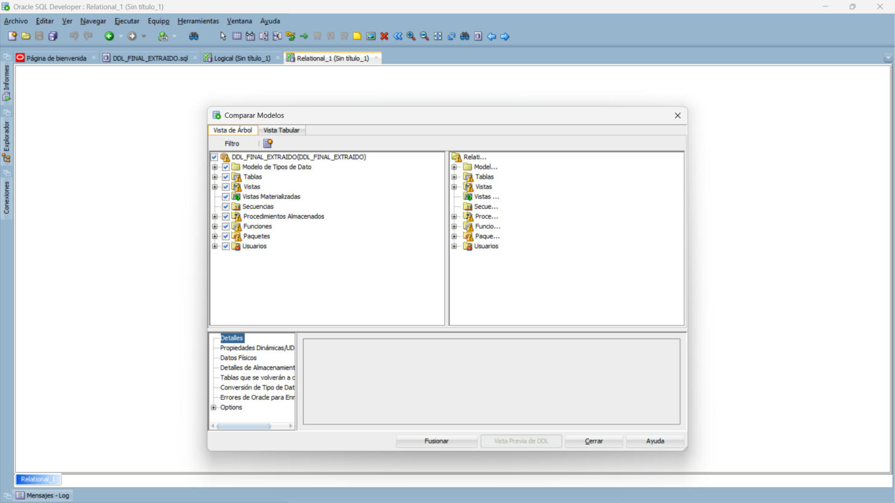
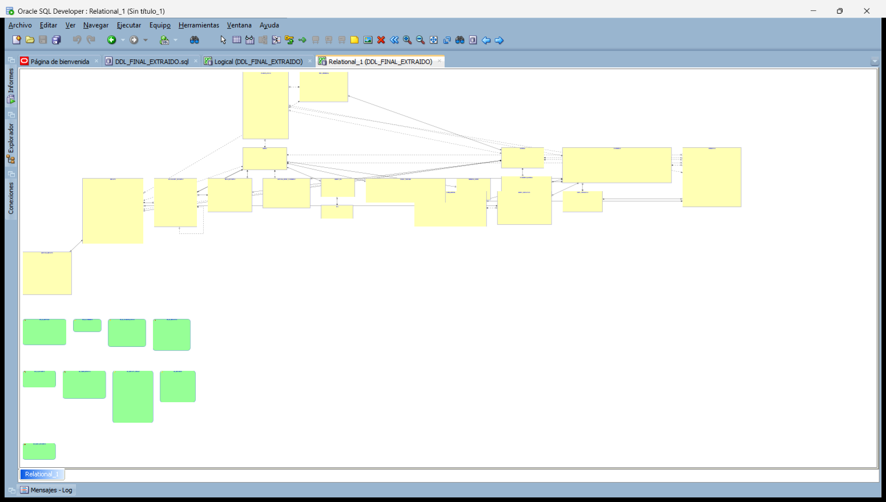
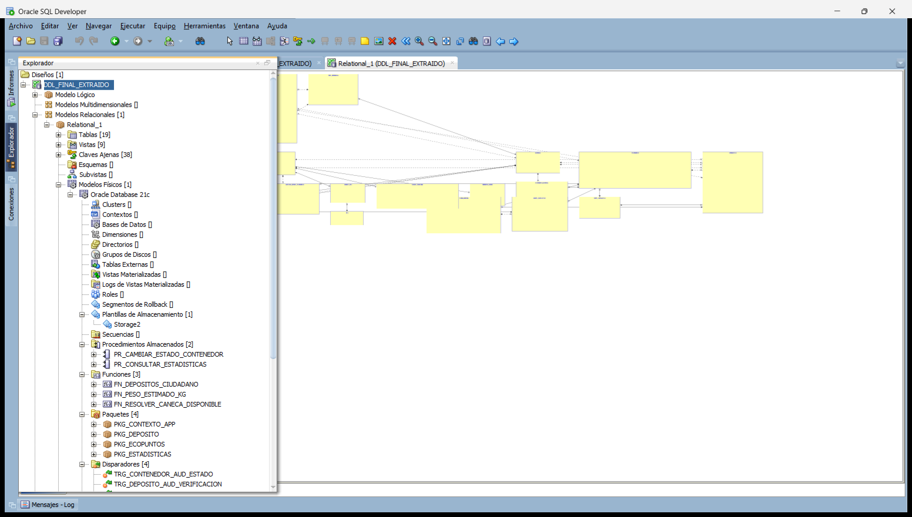
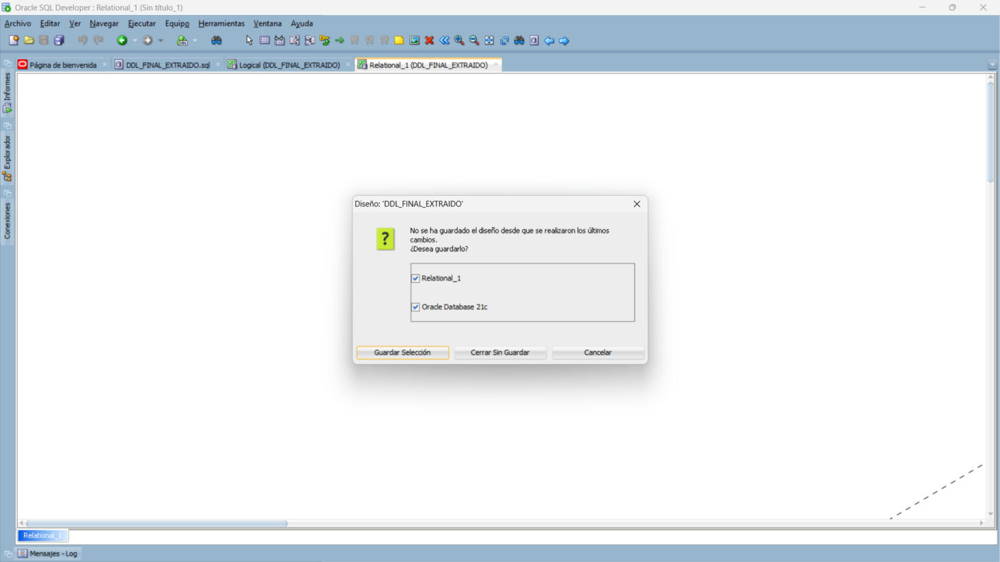

# Cómo ver el DDL y cómo generar un modelo a partir de él

`DDL_FINAL_EXTRAIDO.sql` es **código SQL**, no un diagrama. Oracle lo extrajo de sí mismo con `DBMS_METADATA` el 14/11/2026 desde el esquema `ECOACCESS_BD`. Describe el modelo físico: las 19 tablas con sus columnas, PK, FK, UNIQUE y CHECK; las 9 vistas; los paquetes, funciones y procedimientos, y los 4 disparadores.

- Original: `04_SCRIPTS_ORACLE/DDL_FINAL_EXTRAIDO.sql`.
- Copia en esta carpeta: `DDL_FINAL_EXTRAIDO.sql` (mismo SHA-256; ver `09_GUIAS_Y_VERIFICACIONES/ORIGENES_Y_HASHES.csv`).

**No lo ejecutes para estudiar el modelo.** Las 19 tablas ya existen en Oracle, y ejecutar el DDL fallaría o intentaría crearlas otra vez. Para instalar el esquema se usan los scripts `01` a `15`, no este archivo.

**Importar no es ejecutar.** Importar el DDL en Data Modeler solo lee el texto y dibuja un diagrama. No se conecta a Oracle y no cambia ningún dato.

## Opción A. Ver el DDL como código

Comprobado el 15/11/2026 en SQL Developer 26.2.

1. Abre SQL Developer y haz clic en la pestaña **Página de bienvenida**. Así el menú Archivo abre archivos comunes y no diseños de Data Modeler.
2. **Archivo → Abrir…**
3. En **Nombre de Archivo** escribe la ruta de `DDL_FINAL_EXTRAIDO.sql` y pulsa **Abrir**.
4. El archivo se abre en una pestaña de código. **No pulses Ejecutar** (F5 o el triángulo verde) ni elijas conexión.

Cómo leerlo:

| Busca | Qué significa | Ejemplo en el archivo |
|---|---|---|
| `CREATE TABLE "…"` | Una tabla y sus columnas con tipo, NOT NULL y DEFAULT | `CREATE TABLE "AUDITORIA_DEPOSITO"` |
| `CONSTRAINT "PK_…" PRIMARY KEY` | La clave primaria | `PK_AUDITORIA_DEPOSITO PRIMARY KEY ("ID_AUDITORIA")` |
| `CONSTRAINT "FK_…" FOREIGN KEY … REFERENCES` | Una de las 38 claves foráneas: columna de la hija y tabla padre | `FK_AUD_DEP_DEPOSITO FOREIGN KEY ("ID_DEPOSITO") REFERENCES "DEPOSITO"` |
| `CONSTRAINT "CK_…" CHECK (…)` | Una regla sobre los valores | `CK_AUD_DEP_ESTADOS` |
| `CONSTRAINT "UQ_…" UNIQUE` | Un valor que no se puede repetir | `UQ_USUARIO_CORREO` |
| `GENERATED ALWAYS AS IDENTITY` | Número automático de la PK | `ID_AUDITORIA` |

Para buscar dentro del archivo usa **Ctrl+F** (por ejemplo, `FOREIGN KEY`).

## Opción B. Generar un modelo relacional desde el DDL, en un diseño de prueba

Comprobado el 15/11/2026 en SQL Developer 26.2, con Data Modeler integrado 24.3.1.

1. Cierra el diseño académico si está abierto: **Archivo → Data Modeler → Cerrar**. SQL Developer deja un diseño nuevo y vacío llamado **Sin título_1**. La importación se hace ahí, nunca en `EcoAccess_BD`.
2. **Archivo → Data Modeler → Importar → Archivo DDL**.

3. En **Seleccionar Archivos DDL** pulsa el **+** verde, elige `DDL_FINAL_EXTRAIDO.sql` y deja **Importar a: Relational_1** (del diseño sin título). Pulsa **Aceptar**.

4. En **Sitios de Base de Datos** elige **Oracle Database 21c**, la más reciente de la lista (no aparece 23ai ni 26ai), y pulsa **Aceptar**.
5. Se abre el **log de importación**. Resultado real: **281 sentencias, 277 importadas, 0 fallidas y 4 no reconocidas**. Las 4 no reconocidas son los `ALTER TRIGGER … ENABLE` de los cuatro disparadores. Data Modeler no las convierte en objetos del diagrama, pero los disparadores sí se importan dentro del modelo físico.

6. Pulsa **Cerrar**. En **Comparar Modelos** pulsa **Fusionar**. Solo afecta al diseño de prueba.

7. Revisa el resultado con **Ver → Data Modeler → Ajustar Pantalla** y con el **Explorador**: **Tablas [19]**, **Vistas [9]** y **Claves Ajenas [38]**, igual que el diseño académico. En el modelo físico aparecen 2 procedimientos, 3 funciones, 4 paquetes y 4 disparadores.

8. Cierra el diseño de prueba **sin guardar**: **Archivo → Data Modeler → Cerrar → Cerrar Sin Guardar**.

Después de la prueba se comprobó que `02_MODELOS_DE_DATOS/05_DATA_MODELER_EDITABLE` quedó idéntico, con 0 archivos cambiados.

## Diferencias entre el DMD organizado y el diagrama generado desde el DDL

| Aspecto | `EcoAccess_BD.dmd` (organizado) | Diseño generado desde el DDL |
|---|---|---|
| Tablas, columnas y FK | 19 tablas, 173 columnas y 38 FK | Las mismas 19 tablas y 38 FK |
| Disposición | Cajas ordenadas por módulo, colores por módulo, líneas sin cruces innecesarios | Disposición automática: cajas amarillas sin orden de módulos, algunas superpuestas y líneas cruzadas |
| Subvistas | 5 (M1 a M5) | Ninguna (`Subvistas []`) |
| Modelo lógico | Ordenado por módulos | Se crea de forma automática |
| Para qué sirve | Estudiar, exponer y exportar | Comprobar que el DDL y el diseño describen las mismas tablas y relaciones |

La importación sirve para comparar; el diseño de la entrega sigue siendo `EcoAccess_BD.dmd`.
