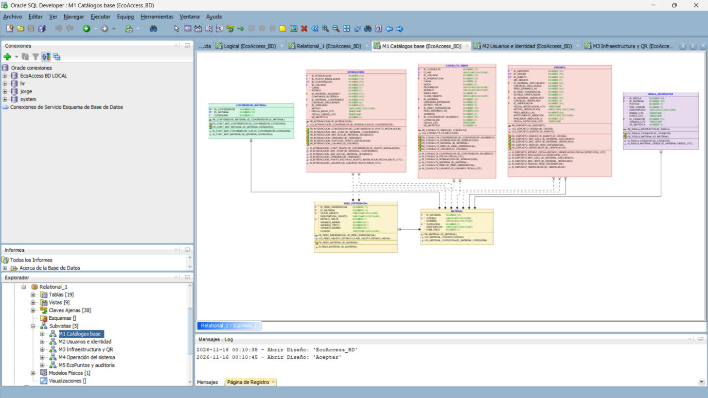
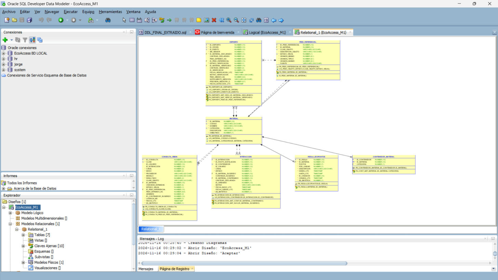

# Módulo M1 · M1 Catálogos base

| Dato | Valor |
|---|---|
| Subvista equivalente en el modelo completo | **M1 Catálogos base** (`../../01_DMD_MODELO_COMPLETO/EcoAccess_BD.dmd` → Relational_1 → Subvistas) |
| Diseño independiente | [`EcoAccess_M1.dmd`](EcoAccess_M1.dmd) + carpeta `EcoAccess_M1/` (van juntos) |
| Tablas del módulo | MATERIAL, PESO_REFERENCIAL |
| Tablas de contexto (de otros módulos, para que las FK tengan destino) | CONTENEDOR_MATERIAL, INTERACCION, CONSULTA_VISION, DEPOSITO, REGLA_ECOPUNTOS |
| Total en el diseño | 7 tablas, 81 columnas, 10 FK |
| DDL de origen | [`../../04_DDL_POR_MODULOS/M1_CATALOGOS/DDL_M1_CATALOGOS.sql`](../../04_DDL_POR_MODULOS/M1_CATALOGOS/DDL_M1_CATALOGOS.sql) (solo para importar; no ejecutar sobre ECOACCESS_BD) |
| PDF y PNG de la subvista | [`DMD_M1_catalogos_base.pdf`](../../../02_MODELOS_DE_DATOS/05_DATA_MODELER_EDITABLE/EXPORTACIONES_DMD/DMD_M1_catalogos_base.pdf) · [`DMD_M1_catalogos_base.png`](../../../02_MODELOS_DE_DATOS/05_DATA_MODELER_EDITABLE/EXPORTACIONES_DMD/DMD_M1_catalogos_base.png) |

## Cómo abrirlo

SQL Developer → **Archivo → Data Modeler → Abrir** → `EcoAccess_M1.dmd` → **Abrir**. Para ver tablas y FK: **Ver → Data Modeler → Explorador** → Relational_1. Guía completa: [`05_GUIA_SQL_DEVELOPER`](../../05_GUIA_SQL_DEVELOPER/GUIA_ABRIR_MODELOS.md).

La distribución del diagrama es la automática de la importación; la subvista del modelo completo tiene la distribución acomodada por el equipo.

## Capturas reales

| Subvista en el modelo completo | Diseño independiente reabierto |
|---|---|
|  |  |