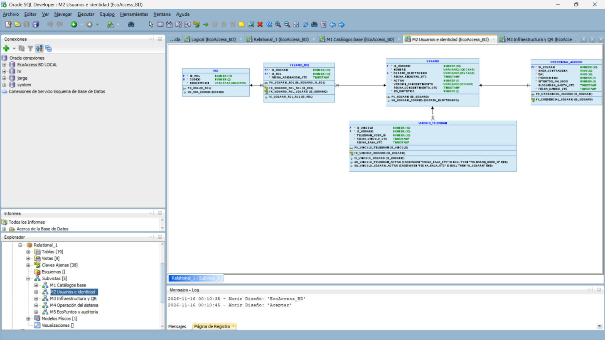
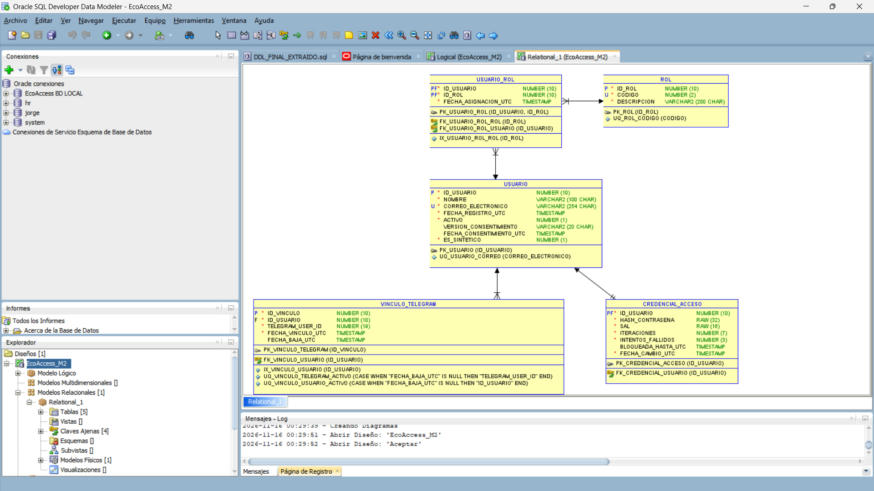

# Módulo M2 · M2 Usuarios e identidad

| Dato | Valor |
|---|---|
| Subvista equivalente en el modelo completo | **M2 Usuarios e identidad** (`../../01_DMD_MODELO_COMPLETO/EcoAccess_BD.dmd` → Relational_1 → Subvistas) |
| Diseño independiente | [`EcoAccess_M2.dmd`](EcoAccess_M2.dmd) + carpeta `EcoAccess_M2/` (van juntos) |
| Tablas del módulo | ROL, USUARIO_ROL, USUARIO, CREDENCIAL_ACCESO, VINCULO_TELEGRAM |
| Tablas de contexto (de otros módulos, para que las FK tengan destino) | (ninguna) |
| Total en el diseño | 5 tablas, 26 columnas, 4 FK |
| DDL de origen | [`../../04_DDL_POR_MODULOS/M2_USUARIOS/DDL_M2_USUARIOS.sql`](../../04_DDL_POR_MODULOS/M2_USUARIOS/DDL_M2_USUARIOS.sql) (solo para importar; no ejecutar sobre ECOACCESS_BD) |
| PDF y PNG de la subvista | [`DMD_M2_usuarios_identidad.pdf`](../../../02_MODELOS_DE_DATOS/05_DATA_MODELER_EDITABLE/EXPORTACIONES_DMD/DMD_M2_usuarios_identidad.pdf) · [`DMD_M2_usuarios_identidad.png`](../../../02_MODELOS_DE_DATOS/05_DATA_MODELER_EDITABLE/EXPORTACIONES_DMD/DMD_M2_usuarios_identidad.png) |

## Cómo abrirlo

SQL Developer → **Archivo → Data Modeler → Abrir** → `EcoAccess_M2.dmd` → **Abrir**. Para ver tablas y FK: **Ver → Data Modeler → Explorador** → Relational_1. Guía completa: [`05_GUIA_SQL_DEVELOPER`](../../05_GUIA_SQL_DEVELOPER/GUIA_ABRIR_MODELOS.md).

La distribución del diagrama es la automática de la importación; la subvista del modelo completo tiene la distribución acomodada por el equipo.

## Capturas reales

| Subvista en el modelo completo | Diseño independiente reabierto |
|---|---|
|  |  |