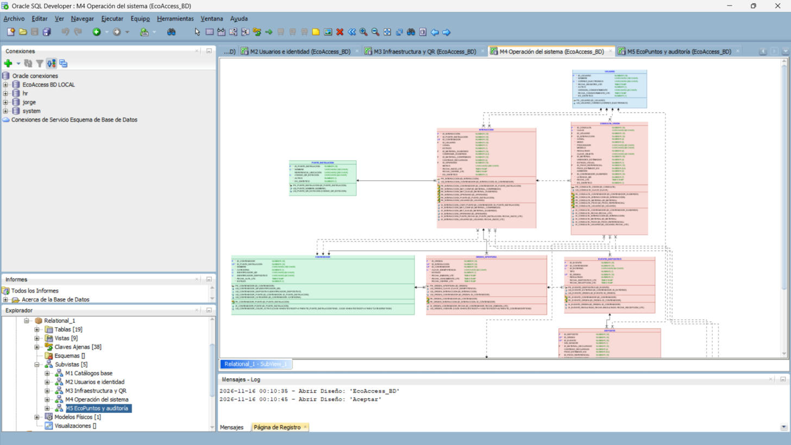
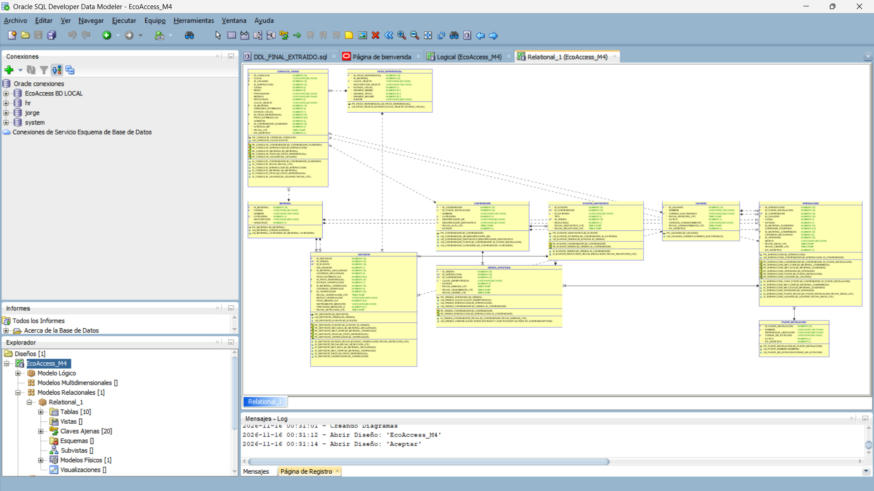

# Módulo M4 · M4 Operación del sistema

| Dato | Valor |
|---|---|
| Subvista equivalente en el modelo completo | **M4 Operación del sistema** (`../../01_DMD_MODELO_COMPLETO/EcoAccess_BD.dmd` → Relational_1 → Subvistas) |
| Diseño independiente | [`EcoAccess_M4.dmd`](EcoAccess_M4.dmd) + carpeta `EcoAccess_M4/` (van juntos) |
| Tablas del módulo | INTERACCION, CONSULTA_VISION, ORDEN_APERTURA, EVENTO_DISPOSITIVO, DEPOSITO |
| Tablas de contexto (de otros módulos, para que las FK tengan destino) | USUARIO, PUNTO_INSTALACION, CONTENEDOR, PESO_REFERENCIAL, MATERIAL |
| Total en el diseño | 10 tablas, 106 columnas, 20 FK |
| DDL de origen | [`../../04_DDL_POR_MODULOS/M4_OPERACION/DDL_M4_OPERACION.sql`](../../04_DDL_POR_MODULOS/M4_OPERACION/DDL_M4_OPERACION.sql) (solo para importar; no ejecutar sobre ECOACCESS_BD) |
| PDF y PNG de la subvista | [`DMD_M4_operacion.pdf`](../../../02_MODELOS_DE_DATOS/05_DATA_MODELER_EDITABLE/EXPORTACIONES_DMD/DMD_M4_operacion.pdf) · [`DMD_M4_operacion.png`](../../../02_MODELOS_DE_DATOS/05_DATA_MODELER_EDITABLE/EXPORTACIONES_DMD/DMD_M4_operacion.png) |

## Cómo abrirlo

SQL Developer → **Archivo → Data Modeler → Abrir** → `EcoAccess_M4.dmd` → **Abrir**. Para ver tablas y FK: **Ver → Data Modeler → Explorador** → Relational_1. Guía completa: [`05_GUIA_SQL_DEVELOPER`](../../05_GUIA_SQL_DEVELOPER/GUIA_ABRIR_MODELOS.md).

La distribución del diagrama es la automática de la importación; la subvista del modelo completo tiene la distribución acomodada por el equipo.

## Capturas reales

| Subvista en el modelo completo | Diseño independiente reabierto |
|---|---|
|  |  |