# Guía para abrir los modelos de EcoAccess en Oracle SQL Developer

**Universidad Popular del Cesar · Base de Datos · Profesor Amílkar**
**Integrantes:** Jorge Alfonso Gutiérrez Thomas, Heyder Hedrey Canchila de Ángel y Saray Marcela Cadena Palomino

Probado con **Oracle SQL Developer 26.2** (incluye Data Modeler 24.3.1 integrado). Todas las capturas son reales y se tomaron abriendo los archivos desde esta carpeta 20.

**No hace falta conectarse a la base de datos para abrir un modelo.** El archivo `.dmd` se abre sin contraseña.

---

## 0. Qué vas a abrir

| Archivo | Qué contiene |
|---|---|
| [`../01_DMD_MODELO_COMPLETO/EcoAccess_BD.dmd`](../01_DMD_MODELO_COMPLETO/EcoAccess_BD.dmd) | El modelo completo: lógico, relacional general (Relational_1) y las 5 subvistas M1–M5. 19 tablas, 173 atributos y 38 FK. |
| [`../02_DMD_MODELOS_INDIVIDUALES/`](../02_DMD_MODELOS_INDIVIDUALES/LEEME.md) | Un diseño independiente por módulo (M1 a M5), creado importando el DDL de cada módulo. |

> **Regla de oro:** el archivo `EcoAccess_BD.dmd` y la carpeta `EcoAccess_BD` que está a su lado son **una sola cosa**. El `.dmd` es solo el índice; los diagramas, las tablas y las relaciones están dentro de la carpeta. Si copias, mueves o envías el modelo, lleva **los dos juntos**. Si separas el `.dmd` de su carpeta, SQL Developer abre un diseño vacío.

---

## 1. Abrir el diseño completo

### Paso 1. Menú Archivo → Data Modeler → Abrir

Abre SQL Developer. En la barra de menús haz clic en **Archivo**, apunta a **Data Modeler** y haz clic en **Abrir…**.

Qué debes observar: se despliega el submenú de Data Modeler con las opciones Abrir, Importar, Guardar, etc. Si no aparece el diálogo al primer clic, vuelve a hacer clic en **Abrir**.

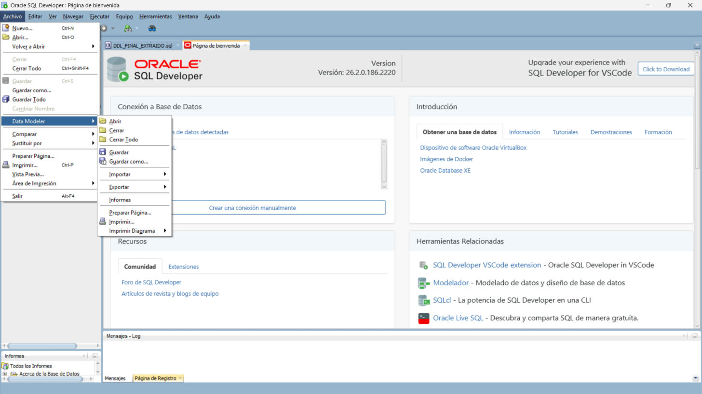

### Paso 2. Elegir el archivo `.dmd`

En el diálogo **Abrir Archivo de Diseño**, navega hasta `BaseDeDatos_Amilkar\20_ABRIR_MODELOS_EN_ORACLE\01_DMD_MODELO_COMPLETO`. Selecciona `EcoAccess_BD.dmd` (no entres en la carpeta `EcoAccess_BD`) y pulsa **Abrir**.

Qué debes observar: en la lista aparecen la carpeta `EcoAccess_BD` y el archivo `EcoAccess_BD.dmd`, uno al lado del otro.

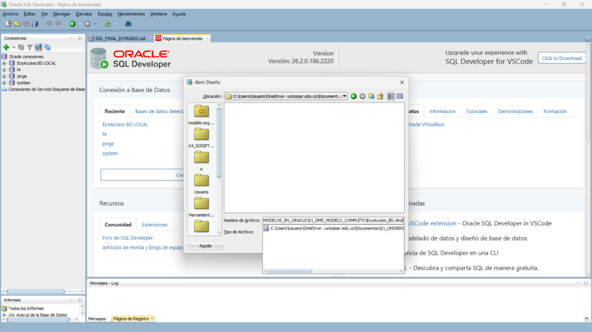

Si SQL Developer pregunta si quieres cerrar o guardar un diseño anterior («Sin título_1»), puedes responder **No** sin perder nada.

### Paso 3. Comprobar que se abrió

Arriba, en el área de edición, aparecen pestañas nuevas:

- **Logical** (modelo lógico)
- **Relational_1** (modelo relacional completo)
- Una pestaña por subvista: **M1 Catálogos base**, **M2 Usuarios e identidad**, **M3 Infraestructura y QR**, **M4 Operación del sistema** y **M5 EcoPuntos y auditoría**

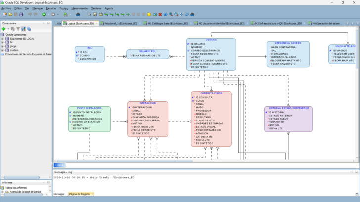

---

## 2. Mostrar el Explorador del modelo

### Paso 4. Ver → Data Modeler → Explorador

Si a la izquierda no ves el panel **Explorador**, haz clic en **Ver** → **Data Modeler** → **Explorador**.

En ese mismo submenú están **Ajustar Pantalla**, **Acercar** y **Alejar**, que sirven para el zoom.

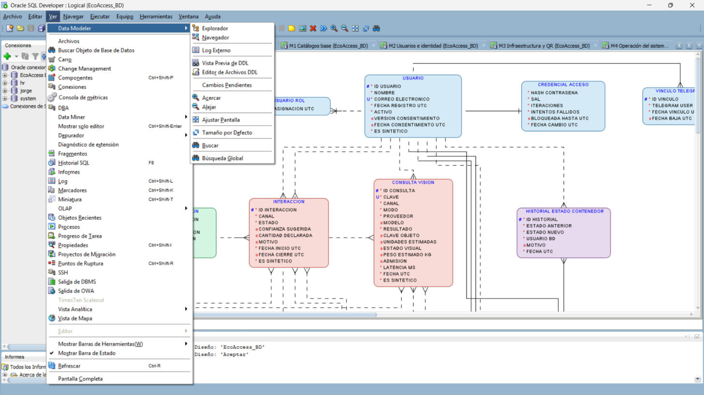

Qué debes observar en el Explorador: **Diseños → EcoAccess_BD → Modelos Relacionales → Relational_1**, y dentro de este:

- **Tablas [19]**
- **Claves Ajenas [38]**
- **Subvistas [5]**

---

## 3. Abrir cada subvista (M1 a M5)

### Paso 5. Clic derecho → Mostrar Diagrama

En el Explorador, despliega **Relational_1 → Subvistas [5]**. Haz **clic derecho** sobre la subvista y elige **Mostrar Diagrama**.

> Ojo: el **doble clic** abre las *propiedades* de la subvista, no el diagrama. Para ver el dibujo usa clic derecho → **Mostrar Diagrama**, o haz clic en la pestaña de la subvista arriba.

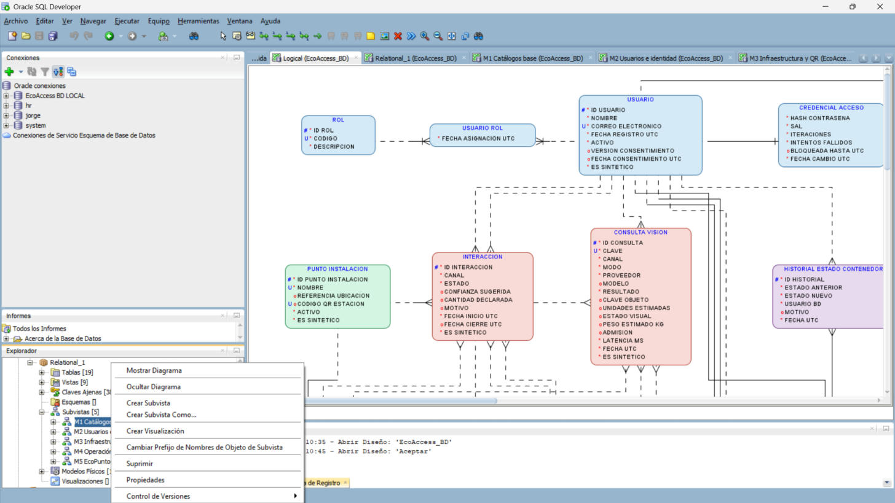

### Paso 6. Las 5 subvistas

| Subvista | Tablas propias | Captura |
|---|---|---|
| **M1 Catálogos base** | MATERIAL, PESO_REFERENCIAL | 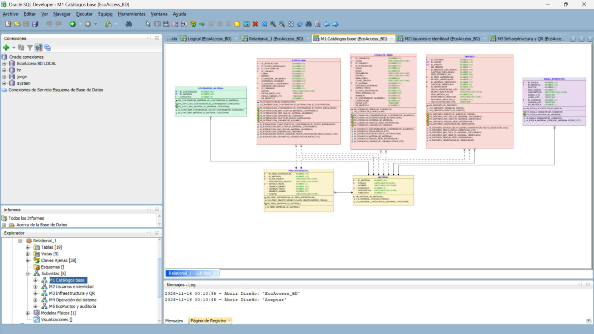 |
| **M2 Usuarios e identidad** | USUARIO, ROL, USUARIO_ROL, CREDENCIAL_ACCESO, VINCULO_TELEGRAM | 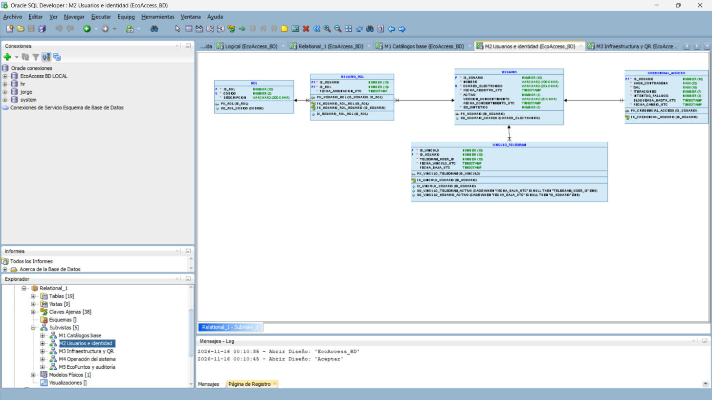 |
| **M3 Infraestructura y QR** | PUNTO_INSTALACION, CONTENEDOR, CONTENEDOR_MATERIAL | 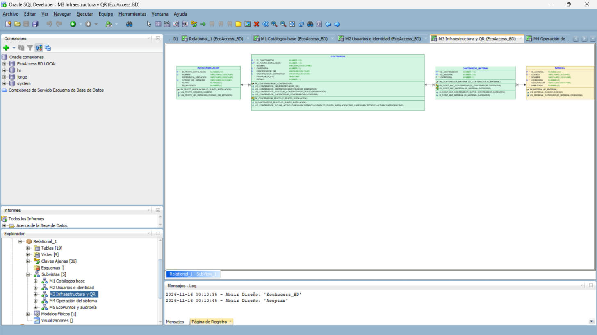 |
| **M4 Operación del sistema** | INTERACCION, ORDEN_APERTURA, EVENTO_DISPOSITIVO, DEPOSITO, CONSULTA_VISION | 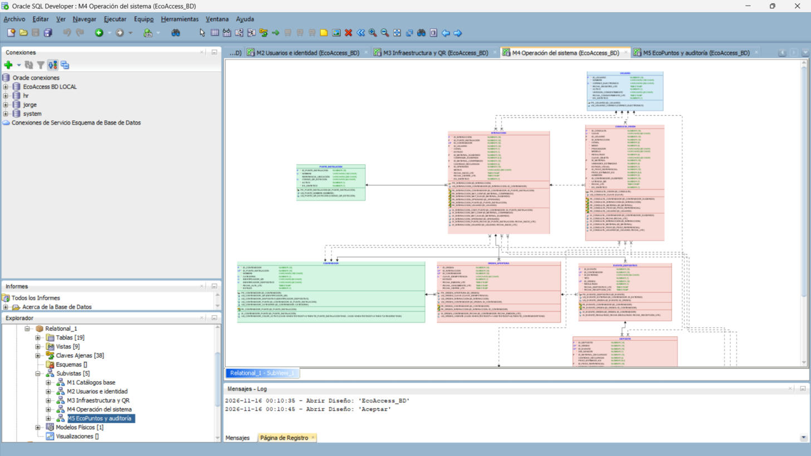 |
| **M5 EcoPuntos y auditoría** | REGLA_ECOPUNTOS, MOVIMIENTO_ECOPUNTOS, AUDITORIA_DEPOSITO, HISTORIAL_ESTADO_CONTENEDOR | 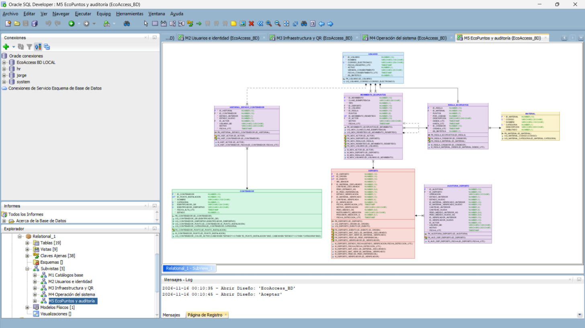 |

Cada subvista muestra también, como contexto, las tablas de otros módulos con las que se relaciona, para que se vean sus FK.

### Paso 7. Volver al modelo completo

Haz **clic derecho** sobre **Relational_1** en el Explorador → **Mostrar**, o haz clic en la pestaña **Relational_1**. Se ven las 19 tablas.

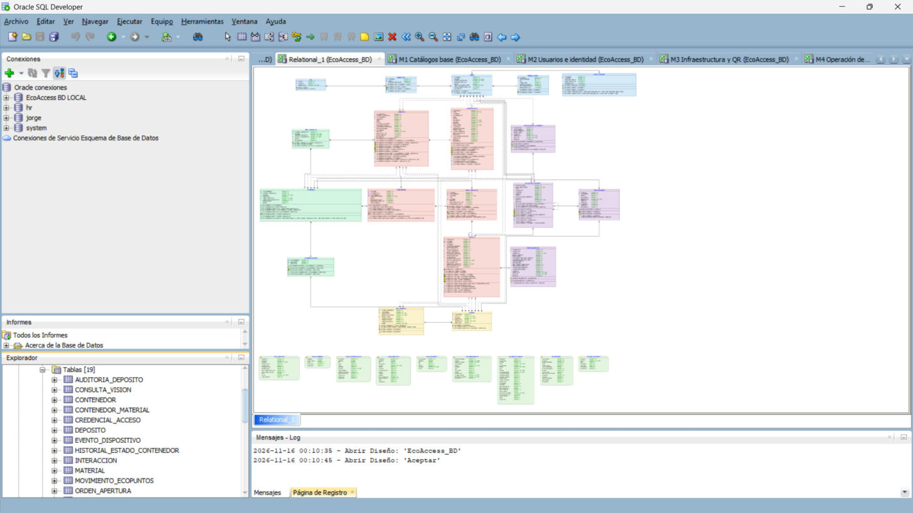

---

## 4. Zoom y ajuste

| Quiero… | Cómo |
|---|---|
| Ver todo el diagrama en la pantalla | **Ver → Data Modeler → Ajustar Pantalla**, o el botón de ajustar de la barra de herramientas. |
| Acercar o alejar | **Ver → Data Modeler → Acercar / Alejar**, o **Ctrl + rueda del ratón** sobre el diagrama. |
| Moverme por el diagrama | Barras de desplazamiento, o arrastrar con la rueda presionada. |

Si el diagrama se ve muy pequeño (como M4, que tiene 10 tablas), acércate hasta leer los nombres de las columnas.

---

## 5. Cómo leer el diagrama: PK, FK y cardinalidad

| Qué ves | Qué significa |
|---|---|
| **P** junto a una columna (o una llave) | Columna de la **clave primaria**. |
| **F** junto a una columna | Columna que es **clave ajena** (apunta a otra tabla). |
| **PF** | La columna es a la vez parte de la PK y FK (tablas puente, por ejemplo USUARIO_ROL). |
| **U** | Columna con restricción única. |
| `*` delante de la columna | NOT NULL (obligatoria). |
| Línea entre dos tablas | Una FK. El extremo con **pata de gallo** (tres rayitas) es el lado **muchos** (la tabla hija); el extremo liso es el lado **uno** (la tabla padre). |
| Línea continua / discontinua | Relación identificadora / no identificadora (la FK forma parte de la PK o no). |
| Círculo o rayita en el extremo | Opcional (0) u obligatoria (1). |

**Ejemplo:** CREDENCIAL_ACCESO → USUARIO. Muchas credenciales pueden pertenecer a un usuario; cada credencial pertenece a uno solo.

### Ver las propiedades de una FK o de una tabla

- **Doble clic sobre una línea (FK):** abre sus propiedades: nombre de la FK, tabla hija, tabla padre, columnas y si es obligatoria.
- **Doble clic sobre una tabla:** abre sus propiedades. En **Columnas** se ve la PK, el tipo de dato y si es obligatoria.
- Cierra las propiedades con **Cancelar** para no modificar el modelo.

| Relación seleccionada | Propiedades de la FK | Tabla USUARIO con su PK |
|---|---|---|
| 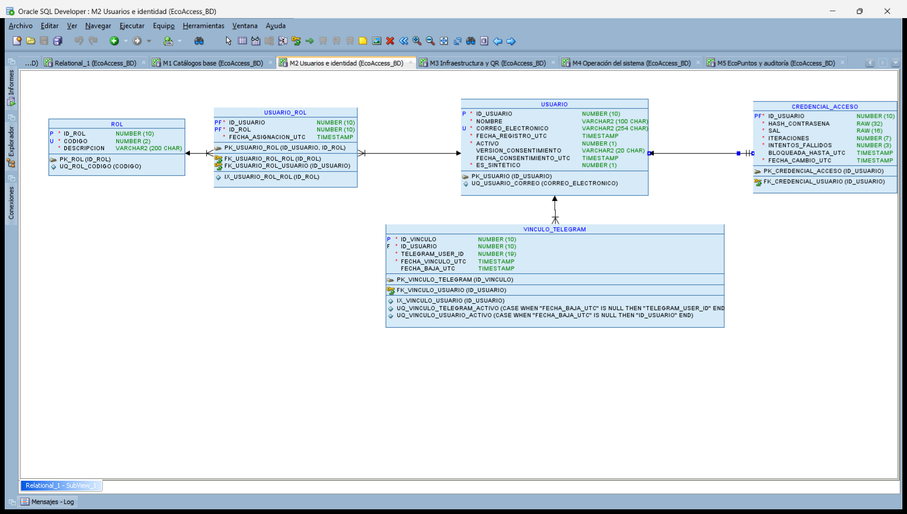 | 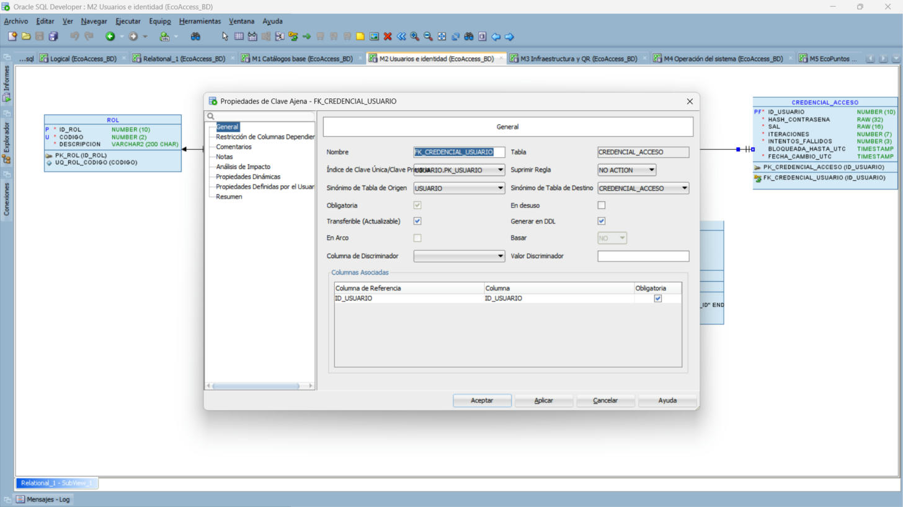 | 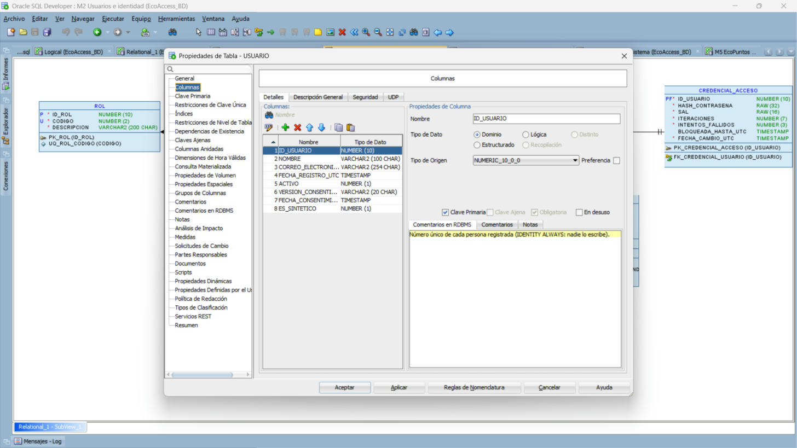 |

Estas tres capturas son de la carpeta 19 y muestran el mismo modelo abierto en SQL Developer.

---

## 6. Abrir un diseño por módulo

Repite los pasos 1 a 3 eligiendo, por ejemplo, `../02_DMD_MODELOS_INDIVIDUALES/M4_OPERACION/EcoAccess_M4.dmd`. Cada uno es un **diseño independiente**: solo contiene las tablas del módulo y sus tablas de contexto.

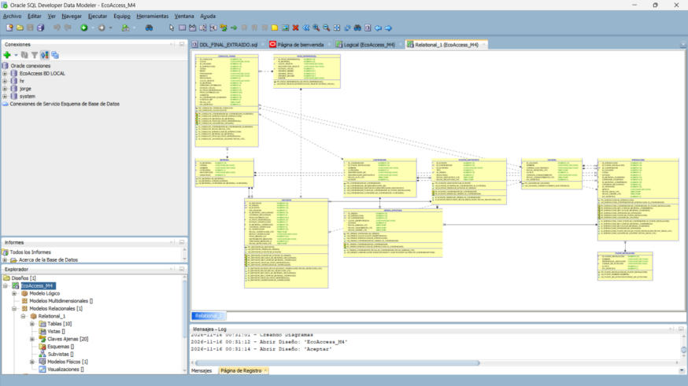

---

## 7. Cerrar sin modificar

**Archivo → Data Modeler → Cerrar Todo**. Si pregunta si deseas guardar los cambios, responde **No**: así el modelo académico queda intacto.

## 8. Problemas frecuentes

| Problema | Causa y solución |
|---|---|
| El diseño se abre vacío | Se copió el `.dmd` sin su carpeta. Copia los dos juntos. |
| No veo el Explorador | **Ver → Data Modeler → Explorador**. |
| Doble clic en la subvista abre una ventana de propiedades | Es normal. Usa clic derecho → **Mostrar Diagrama**. |
| Aviso de versión del diseño | El diseño se guardó con Data Modeler 24.3.1. Si tu versión es más nueva, ábrelo igual y no guardes. |
| Pide conexión | No hace falta para abrir un `.dmd`. Cancela el diálogo de conexión. |
