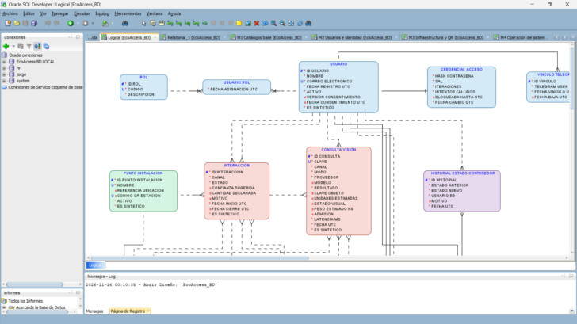

# Guía de Data Modeler para los modelos de EcoAccess

**Universidad Popular del Cesar · Base de Datos · Profesor Amílkar**
**Integrantes:** Jorge Alfonso Gutiérrez Thomas, Heyder Hedrey Canchila de Ángel y Saray Marcela Cadena Palomino

## Qué es Data Modeler y dónde está

**Oracle SQL Developer Data Modeler** es la herramienta de Oracle para dibujar y mantener modelos lógicos y relacionales. Viene de dos formas:

| Forma | Dónde se abre | ¿Se usó en esta entrega? |
|---|---|---|
| **Integrada en SQL Developer** (versión 24.3.1 dentro de SQL Developer 26.2) | Menú **Archivo → Data Modeler** y **Ver → Data Modeler** | **Sí.** Todos los pasos y capturas de la carpeta 20 se hicieron así. |
| Programa independiente (`datamodeler64W.exe`, también 24.3.1) | Ejecutable propio | No. Por decisión del equipo, todo se hizo dentro de SQL Developer. El formato `.dmd` es el mismo, así que los archivos también abren allí. |

Por eso esta guía describe **Data Modeler dentro de SQL Developer**. Los menús son los mismos de la [guía de SQL Developer](../05_GUIA_SQL_DEVELOPER/GUIA_ABRIR_MODELOS.md); aquí se explica qué hay dentro de un diseño.

## 1. Partes de un diseño

Abre `../01_DMD_MODELO_COMPLETO/EcoAccess_BD.dmd` con **Archivo → Data Modeler → Abrir** y muestra el Explorador con **Ver → Data Modeler → Explorador**.

| Nodo del Explorador | Qué es | En EcoAccess |
|---|---|---|
| **Modelo Lógico** | Entidades, atributos y relaciones, sin detalles de Oracle. | Las 19 entidades del MER (pestaña **Logical**). |
| **Modelos Relacionales → Relational_1** | Tablas, columnas, PK, FK e índices, ya en términos de Oracle. | 19 tablas, 173 columnas y 38 FK. |
| **Subvistas** | Diagramas parciales del mismo modelo relacional. Si se cambia una tabla en una subvista, cambia en todo el modelo. | M1 a M5. |
| **Dominios** | Tipos reutilizables. | — |

## 2. Subvista o diseño independiente: la diferencia

| | Subvista (dentro de `EcoAccess_BD.dmd`) | Diseño por módulo (`EcoAccess_M1.dmd` … `EcoAccess_M5.dmd`) |
|---|---|---|
| Qué es | Una *ventana* sobre el modelo completo. | Un diseño **aparte**, con sus propias tablas. |
| Cómo se creó | Por el equipo, en el modelo académico. | Importando el DDL del módulo (`04_DDL_POR_MODULOS`) en un diseño nuevo y guardándolo. |
| Si cambio algo | Cambia el modelo completo. | Solo cambia ese diseño. |
| Para qué sirve | Exponer el modelo por partes. | Estudiar un módulo solo, sin riesgo de tocar el modelo completo. |

Los cinco diseños independientes se comprobaron reabriéndolos:

| Diseño | Tablas | Columnas | FK | Captura |
|---|---|---|---|---|
| EcoAccess_M1 | 7 | 81 | 10 | [ver](../08_CAPTURAS_PASO_A_PASO/C_REABRIR_DMD_POR_MODULO/01_EcoAccess_M1_reabierto_7_tablas_10_fk.jpg) |
| EcoAccess_M2 | 5 | 26 | 4 | [ver](../08_CAPTURAS_PASO_A_PASO/C_REABRIR_DMD_POR_MODULO/02_EcoAccess_M2_reabierto_5_tablas_4_fk.jpg) |
| EcoAccess_M3 | 4 | 23 | 3 | [ver](../08_CAPTURAS_PASO_A_PASO/C_REABRIR_DMD_POR_MODULO/03_EcoAccess_M3_reabierto_4_tablas_3_fk.jpg) |
| EcoAccess_M4 | 10 | 106 | 20 | [ver](../08_CAPTURAS_PASO_A_PASO/C_REABRIR_DMD_POR_MODULO/04_EcoAccess_M4_reabierto_10_tablas_20_fk.jpg) |
| EcoAccess_M5 | 8 | 86 | 10 | [ver](../08_CAPTURAS_PASO_A_PASO/C_REABRIR_DMD_POR_MODULO/05_EcoAccess_M5_reabierto_8_tablas_10_fk.jpg) |

Cada diseño por módulo trae las tablas **propias** del módulo y las tablas de **contexto** (de otros módulos) que hacen falta para que sus FK tengan a dónde apuntar. Por eso M4 tiene 10 tablas: 5 propias y 5 de contexto.

La distribución de las tablas en estos diagramas es la **automática** de Data Modeler al importar; puede verse más apretada que la de las subvistas, que el equipo acomodó a mano.

## 3. Propiedades útiles

| Doble clic en… | Pestañas que conviene mirar |
|---|---|
| Una tabla | **Columnas** (tipo, PK, obligatoria), **Claves Primarias**, **Claves Ajenas**, **Restricciones de Control** (los CHECK) y **Comentarios**. |
| Una relación (línea) | **General** (tabla padre e hija, columnas) y la opción de obligatoria u opcional. |

Cierra siempre con **Cancelar** si solo estabas mirando.

## 4. Ver el DDL que genera el modelo (referencia; este paso no se usó en las pruebas de la carpeta 20)

Con el diseño abierto: **Archivo → Data Modeler → Exportar → Archivo DDL** → elige **Relational_1** → **Generar** → se muestra el editor de DDL. **Ciérralo sin guardar**: el DDL oficial ya está en `../03_DDL_MODELO_COMPLETO/DDL_FINAL_EXTRAIDO.sql`, extraído de la base real.

## 5. No hacer

- No guardes cambios sobre `01_DMD_MODELO_COMPLETO/EcoAccess_BD.dmd` si solo estás practicando: usa **Guardar como** en otra carpeta.
- No separes el `.dmd` de su carpeta.
- No renombres un PDF o una imagen a `.dmd`: un `.dmd` solo es válido si Data Modeler lo crea.
