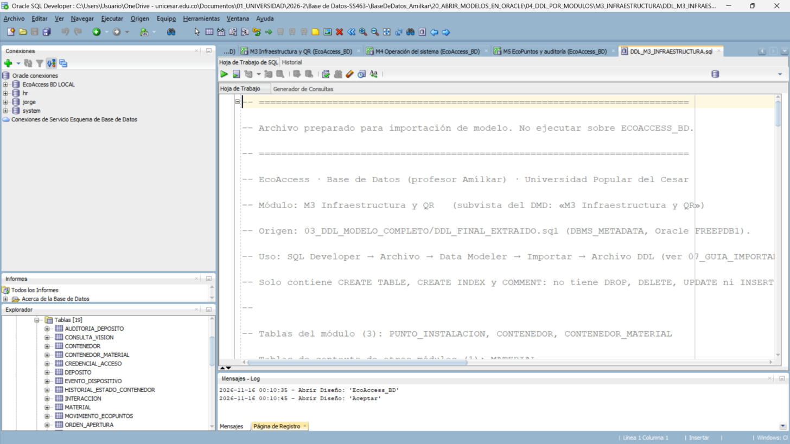
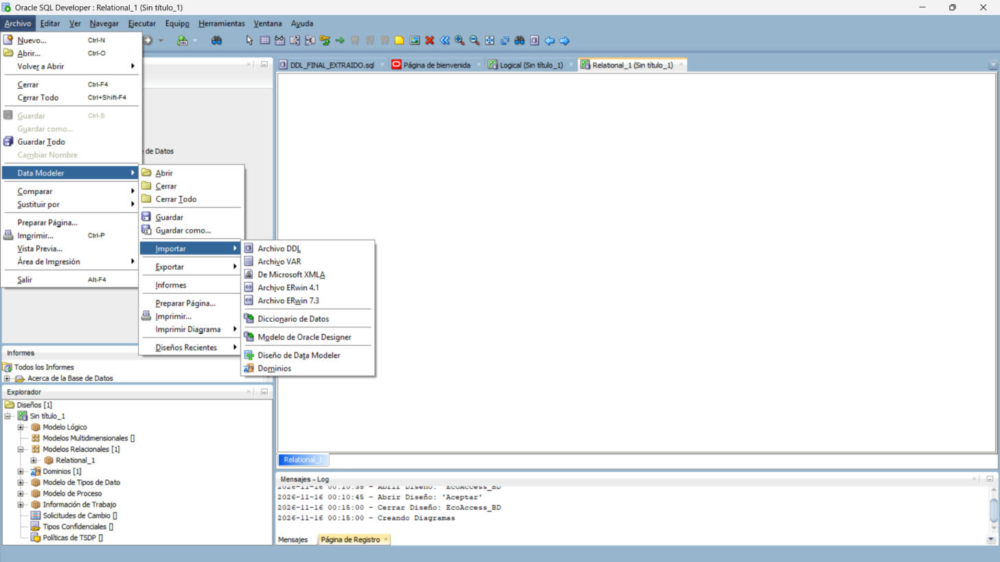
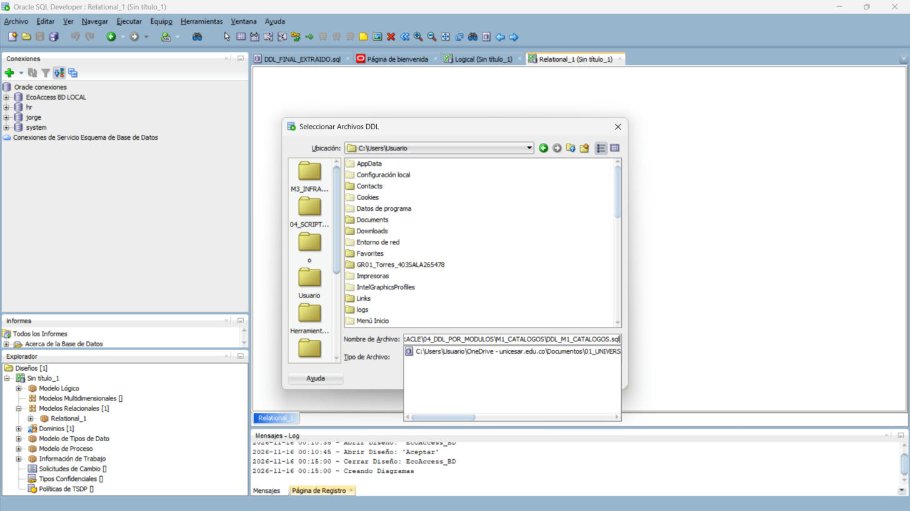
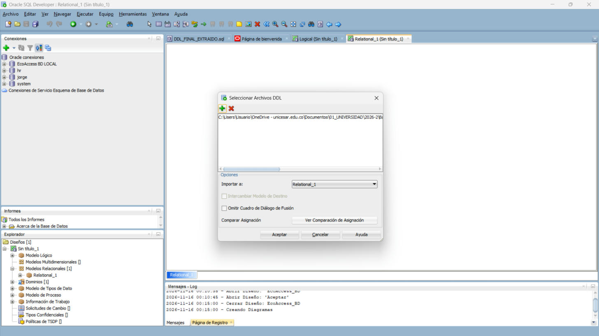
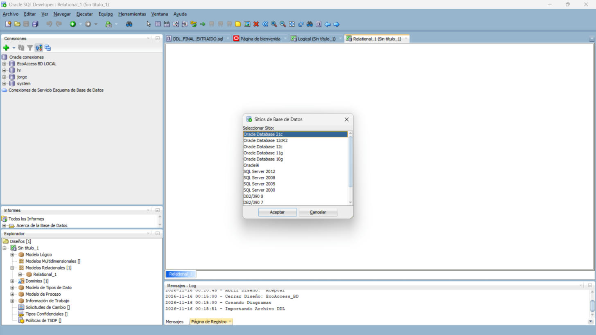
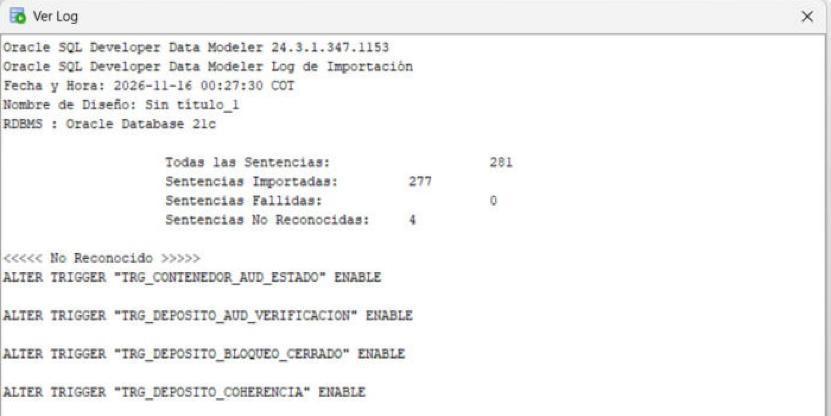
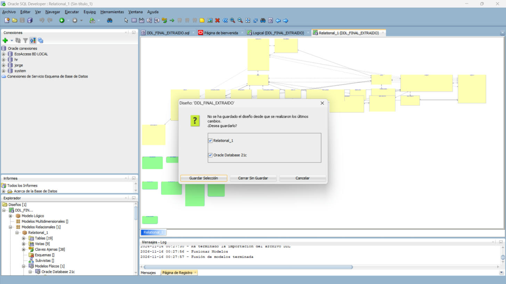

# Guía para abrir e importar el DDL de EcoAccess paso a paso

**Universidad Popular del Cesar · Base de Datos · Profesor Amílkar**
**Integrantes:** Jorge Alfonso Gutiérrez Thomas, Heyder Hedrey Canchila de Ángel y Saray Marcela Cadena Palomino

Probado en **SQL Developer 26.2** (Data Modeler 24.3.1 integrado). Capturas reales en [`../08_CAPTURAS_PASO_A_PASO/B_IMPORTAR_DDL`](../08_CAPTURAS_PASO_A_PASO/B_IMPORTAR_DDL).

## Archivos

| Archivo | Contenido |
|---|---|
| [`../03_DDL_MODELO_COMPLETO/DDL_FINAL_EXTRAIDO.sql`](../03_DDL_MODELO_COMPLETO/DDL_FINAL_EXTRAIDO.sql) | DDL completo extraído de ECOACCESS_BD con DBMS_METADATA: 19 tablas y 38 FK. Idéntico (mismo hash) a `04_SCRIPTS_ORACLE/DDL_FINAL_EXTRAIDO.sql`. |
| [`../04_DDL_POR_MODULOS/M1_CATALOGOS/DDL_M1_CATALOGOS.sql`](../04_DDL_POR_MODULOS/M1_CATALOGOS/DDL_M1_CATALOGOS.sql) … M5 | Un DDL por módulo, generado desde el DDL completo por `../09_VERIFICACIONES/generar_ddl_por_modulos.ps1`. |

### Advertencia de los DDL por módulo

Cada archivo empieza con:

> «Archivo preparado para importación de modelo. No ejecutar sobre ECOACCESS_BD»

Son para **importar en Data Modeler**, no para ejecutar. Si se ejecutaran sobre ECOACCESS_BD fallarían (las tablas ya existen), y no deben ejecutarse en ningún otro esquema sin revisarlos.

Las cabeceras dicen:

- qué tablas son del módulo y cuáles son de contexto;
- qué FK se incluyen;
- qué FK se quitaron de las tablas de contexto porque apuntan a tablas que no están en el archivo.

**Ninguno** contiene DROP, DELETE, UPDATE, INSERT ni TRUNCATE (comprobado por `verificar_carpeta20.ps1`).

| Módulo | Tablas del módulo | Tablas de contexto | FK incluidas | FK quitadas del contexto | Índices | Comentarios |
|---|---|---|---|---|---|---|
| M1 | 2 | 5 | 10 | 11 | 1 | 17 |
| M2 | 5 | 0 | 4 | 0 | 4 | 31 |
| M3 | 3 | 1 | 3 | 0 | 4 | 20 |
| M4 | 5 | 5 | 20 | 2 | 22 | 74 |
| M5 | 4 | 4 | 10 | 6 | 9 | 50 |

---

## Procedimiento A — Abrir el DDL como texto (solo leer)

1. **Archivo → Abrir…** (el Abrir normal, no el de Data Modeler).
2. Elige el `.sql`, por ejemplo `04_DDL_POR_MODULOS/M3_INFRAESTRUCTURA/DDL_M3_INFRAESTRUCTURA.sql` → **Abrir**.
3. Se abre en una hoja de trabajo con colores de sintaxis. Observa:
   - `CREATE TABLE` con sus columnas;
   - `CONSTRAINT … PRIMARY KEY`, `CHECK` y `FOREIGN KEY … REFERENCES`;
   - los `CREATE INDEX`;
   - los `COMMENT ON`.
4. **No pulses F5 ni Ctrl+Enter.** Cierra la pestaña sin guardar.

Más capturas del DDL completo abierto como código: [`23_ddl_abierto_como_codigo_create_table.png`](../../19_MODELOS_VISUALES/08_CAPTURAS_REALES/SQL_DEVELOPER/23_ddl_abierto_como_codigo_create_table.png) y [`24_ddl_pk_check_fk_references.png`](../../19_MODELOS_VISUALES/08_CAPTURAS_REALES/SQL_DEVELOPER/24_ddl_pk_check_fk_references.png).

---

## Procedimiento B — Importar el DDL en un diseño NUEVO

Este procedimiento **no toca** el diseño académico `EcoAccess_BD.dmd`: se trabaja sobre un diseño vacío.

### B1. Empezar con un diseño vacío

**Archivo → Data Modeler → Cerrar Todo** (responde **No** si pregunta si guardar). Queda el diseño «Sin título».

### B2. Archivo → Data Modeler → Importar → Archivo DDL

### B3. Elegir el archivo

En el diálogo **Seleccionar Archivos DDL**:

1. Pulsa **+**.
2. Busca el DDL del módulo y pulsa **Abrir**.
3. Si la lista ya tenía archivos de una importación anterior, quítalos con la **X** para que quede solo el que quieres.
4. Pulsa **Aceptar**.

### B4. Sitio de base de datos

En **Sitios de Base de Datos** elige **Oracle Database 21c** (la versión más reciente de Oracle que ofrece la lista de Data Modeler 24.3.1; la base real es Oracle 23ai Free) → **Aceptar**.

### B5. Revisar el log

Aparece el **log de importación**:

- **Instrucciones** importadas;
- **fallidas**, que deben ser 0;
- **no reconocidas**.

Pulsa **Ver Log** para leer el detalle y luego **Cerrar**.

### B6. Comparar modelos → Fusionar

Data Modeler muestra **Comparar Modelos** con todo lo nuevo marcado. Pulsa **Fusionar**: las tablas pasan al diseño y se dibuja el diagrama.

### B7. Resultado obtenido en la prueba real

| DDL importado | Instrucciones | Importadas | Fallidas | No reconocidas | Resultado | Capturas |
|---|---|---|---|---|---|---|
| M1 | 25 | 25 | 0 | 0 | 7 tablas, 10 FK | [log](../08_CAPTURAS_PASO_A_PASO/B_IMPORTAR_DDL/05_M1_log_25_importadas_0_fallidas.jpg) · [diagrama](../08_CAPTURAS_PASO_A_PASO/B_IMPORTAR_DDL/06_M1_diagrama_generado.jpg) |
| M2 | 40 | 40 | 0 | 0 | 5 tablas, 4 FK | [log](../08_CAPTURAS_PASO_A_PASO/B_IMPORTAR_DDL/07_M2_log_40_importadas_0_fallidas.jpg) · [diagrama](../08_CAPTURAS_PASO_A_PASO/B_IMPORTAR_DDL/08_M2_diagrama_generado.jpg) |
| M3 | 28 | 28 | 0 | 0 | 4 tablas, 3 FK | [log](../08_CAPTURAS_PASO_A_PASO/B_IMPORTAR_DDL/09_M3_log_28_importadas_0_fallidas.jpg) · [diagrama](../08_CAPTURAS_PASO_A_PASO/B_IMPORTAR_DDL/10_M3_diagrama_generado.jpg) |
| M4 | 106 | 106 | 0 | 0 | 10 tablas, 20 FK | [log](../08_CAPTURAS_PASO_A_PASO/B_IMPORTAR_DDL/11_M4_log_106_importadas_0_fallidas.jpg) · [diagrama](../08_CAPTURAS_PASO_A_PASO/B_IMPORTAR_DDL/12_M4_diagrama_generado.jpg) |
| M5 | 67 | 67 | 0 | 0 | 8 tablas, 10 FK | [log](../08_CAPTURAS_PASO_A_PASO/B_IMPORTAR_DDL/13_M5_log_67_importadas_0_fallidas.jpg) · [diagrama](../08_CAPTURAS_PASO_A_PASO/B_IMPORTAR_DDL/14_M5_diagrama_generado.jpg) |
| **Completo** | 281 | 277 | 0 | **4** | 19 tablas, 38 FK | [log](../08_CAPTURAS_PASO_A_PASO/B_IMPORTAR_DDL/15_DDL_completo_log_281_277_0_fallidas_4_no_reconocidas.jpg) · [explorador](../08_CAPTURAS_PASO_A_PASO/B_IMPORTAR_DDL/16_DDL_completo_explorador_19_tablas_38_fk.jpg) |

### Las 4 instrucciones no reconocidas del DDL completo

Son las 4 líneas `ALTER TRIGGER … ENABLE` que DBMS_METADATA agrega después de cada disparador:

- `TRG_CONTENEDOR_AUD_ESTADO`
- `TRG_DEPOSITO_BLOQUEO_CERRADO`
- `TRG_DEPOSITO_COHERENCIA`
- `TRG_DEPOSITO_AUD_VERIFICACION`

Data Modeler no modela el estado «habilitado» de un trigger, así que las marca como no reconocidas. **No afectan** tablas, columnas, PK ni FK: el resultado tiene las 19 tablas y las 38 FK. El código de los triggers está en `04_SCRIPTS_ORACLE/08_triggers.sql`.

Al importar el DDL completo, las vistas se importan (Explorador: **Vistas [9]**), pero no aparecen subvistas. Es lo esperado: las subvistas M1–M5 se dibujan a mano y solo existen en `EcoAccess_BD.dmd`.

### B8. Guardar o descartar

| Si quiero… | Hago |
|---|---|
| Solo probar | **Archivo → Data Modeler → Cerrar Todo** → **No** (no guardar). Así se cerró el diseño de prueba del DDL completo.  |
| Conservarlo | **Archivo → Data Modeler → Guardar como** → una carpeta **nueva** (nunca encima de `01_DMD_MODELO_COMPLETO`). Así se crearon `02_DMD_MODELOS_INDIVIDUALES/Mx/EcoAccess_Mx.dmd`. La carpeta debe existir antes de guardar; si no, aparece «No se puede acceder al directorio». |

## Problemas encontrados y su solución

| Problema | Solución |
|---|---|
| El diálogo recordaba archivos de una importación anterior. | Quitarlos con la **X** antes de **Aceptar**. |
| «No se puede acceder al directorio» al guardar. | Crear la carpeta destino antes de usar Guardar como. |
| Los diálogos de Java tardan en repintarse. | Esperar un momento antes de concluir que un clic no funcionó. |
