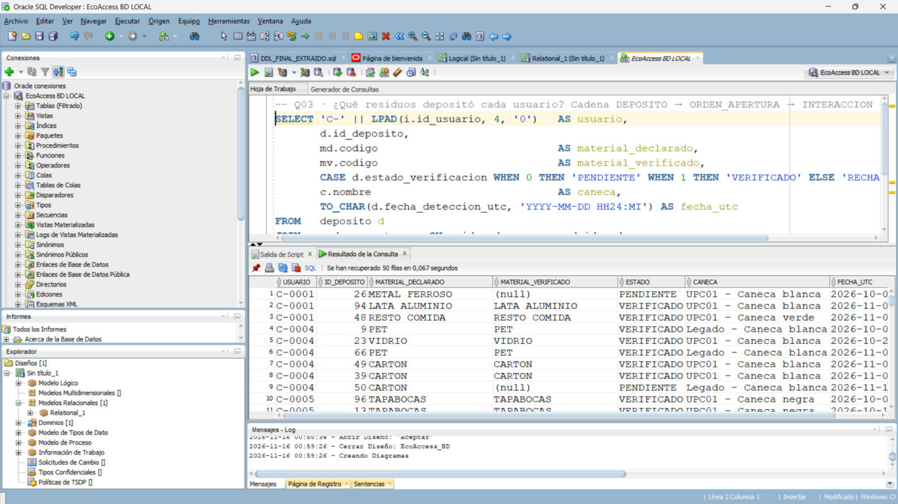
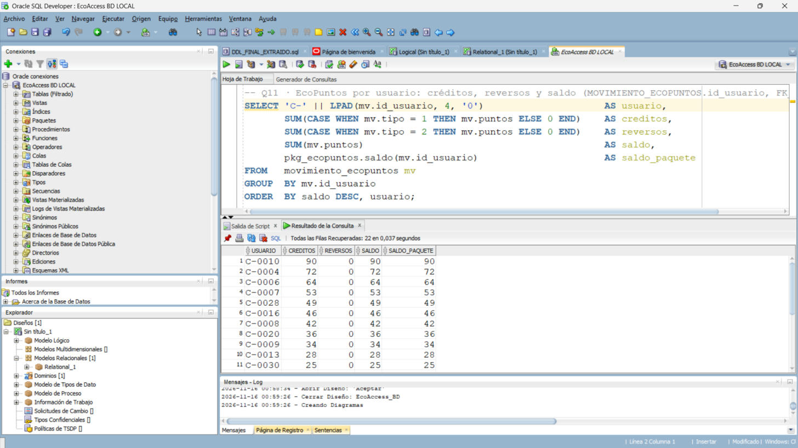

# ¿Qué residuos deposita cada usuario? — consultas SQL de EcoAccess

**EcoAccess · Base de Datos · Profesor Amílkar · Universidad Popular del Cesar**  
Integrantes: Jorge Alfonso Gutiérrez Thomas · Heyder Hedrey Canchila de Ángel · Saray Marcela Cadena Palomino

## Antes de empezar: cómo se sabe de quién es un depósito

La tabla `DEPOSITO` **no tiene una columna `id_usuario`**. El dueño (titular) de un depósito se encuentra siguiendo las claves foráneas reales:

```text
DEPOSITO.id_orden ──► ORDEN_APERTURA.id_interaccion ──► INTERACCION.id_usuario ──► USUARIO
        (FK_DEPOSITO_EVENTO + FK_EVENTO_ORDEN)   (FK_ORDEN_INTERACCION)   (FK_INTERACCION_USUARIO)
```

| No confundir | con | Por qué |
|---|---|---|
| Una foto consultada (`CONSULTA_VISION`) | un depósito (`DEPOSITO`) | La foto solo orienta; el depósito es lo que entró a la caneca. |
| `cantidad_declarada` | `cantidad_verificada` | La primera la dice la persona; la segunda la comprueba el operario. |
| `peso_estimado_kg` | `peso_medido_kg` | El estimado sale del catálogo; el medido, de una báscula (puede quedar vacío). |
| Depósito pendiente (estado 0) | depósito con EcoPuntos | Los puntos se acreditan solo al verificar (estado 1). |

**Cómo ejecutar:** en SQL Developer abre la conexión **EcoAccess BD LOCAL**, abre un archivo `Qnn_*.sql` (Archivo → Abrir) y pulsa **Ctrl+Enter** sobre la consulta. Para ejecutar las 15 de una vez, abre `00_EJECUTAR_TODAS_SOLO_SELECT.sql` y pulsa **F5**. Todas son SELECT: no cambian datos.

## Q01 · ¿Qué usuarios están registrados y qué roles tienen?

Archivo: [`Q01_usuarios_registrados_y_roles.sql`](Q01_usuarios_registrados_y_roles.sql)

```sql
SELECT u.id_usuario,
       'C-' || LPAD(u.id_usuario, 4, '0')                       AS seudonimo,
       u.activo,
       u.es_sintetico,
       TO_CHAR(u.fecha_registro_utc, 'YYYY-MM-DD')               AS fecha_registro,
       LISTAGG(r.descripcion, ', ') WITHIN GROUP (ORDER BY r.codigo) AS roles
FROM   usuario u
LEFT   JOIN usuario_rol ur ON ur.id_usuario = u.id_usuario
LEFT   JOIN rol r          ON r.id_rol      = ur.id_rol
GROUP  BY u.id_usuario, u.activo, u.es_sintetico, u.fecha_registro_utc
ORDER  BY u.id_usuario;
```

| Parte | Explicación |
|---|---|
| JOIN | USUARIO → USUARIO_ROL → ROL (LEFT JOIN: también aparece quien no tenga rol). |
| Claves foráneas usadas | FK_USUARIO_ROL_USUARIO, FK_USUARIO_ROL_ROL |
| WHERE | Ninguno: se listan todas las personas. |
| Agregación | GROUP BY por persona y LISTAGG para unir sus roles en un solo texto. |
| Cómo interpretar el resultado | Una fila por persona. No se muestran nombre ni correo: se usa el seudónimo C-0001, igual que en Power BI. es_sintetico = 1 indica dato de demostración. |

**Resultado real en Oracle (datos sintéticos):**

```text
ID_USUARIO SEUDON  ACTIVO ES_SINTETICO FECHA_REGI
---------- ------ ---------- ------------ ----------
ROLES  
--------------------
  1 C-0001  1  1 2026-08-03 
Ciudadano, Operario  

  2 C-0002  1  1 2026-08-03 
Operario  

  3 C-0003  1  1 2026-07-14 
Administrador  

  4 C-0004  1  1 2026-09-06 
Ciudadano  

  5 C-0005  1  1 2026-08-25 
Ciudadano  

  6 C-0006  1  1 2026-09-15 
Ciudadano  

  7 C-0007  1  1 2026-09-12 
Ciudadano  

  8 C-0008  1  1 2026-08-13 
Ciudadano  

… (137 líneas más en RESULTADOS_ESPERADOS.txt)
```

## Q02 · ¿Cuántos usuarios han realizado interacciones (sesiones QR)?

Archivo: [`Q02_cuantos_usuarios_con_interacciones.sql`](Q02_cuantos_usuarios_con_interacciones.sql)

```sql
SELECT COUNT(*)                        AS interacciones,
       COUNT(i.id_usuario)             AS interacciones_con_usuario,
       COUNT(*) - COUNT(i.id_usuario)  AS interacciones_de_visitante,
       COUNT(DISTINCT i.id_usuario)    AS usuarios_distintos
FROM   interaccion i;
```

| Parte | Explicación |
|---|---|
| JOIN | Ninguno: se cuenta sobre INTERACCION. |
| Claves foráneas usadas | INTERACCION.id_usuario es FK a USUARIO (FK_INTERACCION_USUARIO) y admite NULL. |
| WHERE | Ninguno. |
| Agregación | COUNT(*) cuenta filas; COUNT(columna) no cuenta los NULL; COUNT(DISTINCT) cuenta personas distintas. |
| Cómo interpretar el resultado | La diferencia entre COUNT(*) y COUNT(id_usuario) son las sesiones de visitantes sin cuenta. |

**Resultado real en Oracle (datos sintéticos):**

```text
INTERACCIONES INTERACCIONES_CON_USUARIO INTERACCIONES_DE_VISITANTE USUARIOS_DISTINTOS
------------- -------------------- -------------------- ------------------
  130  130  0  31
```

## Q03 · ¿Qué residuos ha depositado cada usuario?

Archivo: [`Q03_residuos_depositados_por_cada_usuario.sql`](Q03_residuos_depositados_por_cada_usuario.sql)

```sql
SELECT 'C-' || LPAD(i.id_usuario, 4, '0')   AS usuario,
       d.id_deposito,
       md.codigo                            AS material_declarado,
       mv.codigo                            AS material_verificado,
       CASE d.estado_verificacion WHEN 0 THEN 'PENDIENTE' WHEN 1 THEN 'VERIFICADO' ELSE 'RECHAZADO' END AS estado,
       c.nombre                             AS caneca,
       TO_CHAR(d.fecha_deteccion_utc, 'YYYY-MM-DD HH24:MI') AS fecha_utc
FROM   deposito d
JOIN   orden_apertura o ON o.id_orden       = d.id_orden
JOIN   interaccion i    ON i.id_interaccion = o.id_interaccion
JOIN   contenedor c     ON c.id_contenedor  = o.id_contenedor
JOIN   material md      ON md.id_material   = d.id_material_declarado
LEFT   JOIN material mv ON mv.id_material   = d.id_material_verificado
WHERE  i.id_usuario IS NOT NULL
ORDER  BY i.id_usuario, d.fecha_deteccion_utc;
```

| Parte | Explicación |
|---|---|
| JOIN | DEPOSITO → ORDEN_APERTURA → INTERACCION (titular) y → CONTENEDOR; MATERIAL dos veces (declarado y verificado, con alias md y mv). |
| Claves foráneas usadas | FK_DEPOSITO_EVENTO (id_evento, id_orden), FK_EVENTO_ORDEN, FK_ORDEN_INTERACCION, FK_ORDEN_CONTENEDOR, FK_DEPOSITO_MAT_DECL, FK_DEPOSITO_MAT_VERIF |
| WHERE | i.id_usuario IS NOT NULL: solo depósitos de personas identificadas. |
| Agregación | Ninguna: es un listado. |
| Cómo interpretar el resultado | DEPOSITO no tiene id_usuario: el dueño se obtiene de la sesión (INTERACCION) de la orden que abrió la caneca. El material verificado sale vacío mientras el depósito está pendiente o si fue rechazado. |

**Resultado real en Oracle (datos sintéticos):**

```text
USUARI ID_DEPOSITO MATERIAL_DECLARADO  MATERIAL_VERIFICADO  ESTADO  CANECA  FECHA_UTC  
------ ----------- -------------------- -------------------- ---------- -------------------- ----------------
C-0001  26 METAL_FERROSO  PENDIENTE  UPC01 - Caneca blanca  2026-10-04 09:53
C-0001  94 LATA_ALUMINIO  LATA_ALUMINIO  VERIFICADO UPC01 - Caneca blanca  2026-11-08 05:18
C-0001  48 RESTO_COMIDA  RESTO_COMIDA  VERIFICADO UPC01 - Caneca verde  2026-11-09 18:43
C-0004  9 PET  PET  VERIFICADO Legado - Caneca blanca  2026-10-04 20:15
C-0004  23 VIDRIO  VIDRIO  VERIFICADO UPC01 - Caneca blanca  2026-10-24 21:58
C-0004  66 PET  PET  VERIFICADO Legado - Caneca blanca  2026-11-03 06:45
C-0004  49 CARTON  CARTON  VERIFICADO UPC01 - Caneca blanca  2026-11-06 06:01
C-0004  39 CARTON  CARTON  VERIFICADO UPC01 - Caneca blanca  2026-11-08 21:44
C-0004  50 CARTON  PENDIENTE  Legado - Caneca blanca  2026-11-10 20:05
C-0005  96 TAPABOCAS  TAPABOCAS  VERIFICADO UPC01 - Caneca negra  2026-10-08 07:25
C-0005  13 TAPABOCAS  TAPABOCAS  VERIFICADO UPC01 - Caneca negra  2026-10-18 17:26
C-0005  32 TETRAPAK  TETRAPAK  VERIFICADO UPC01 - Caneca blanca  2026-10-27 21:27
C-0005  52 CARTON  PENDIENTE  UPC01 - Caneca blanca  2026-11-11 07:39
C-0006  63 RESTO_FRUTA_VERDURA  RECHAZADO  UPC01 - Caneca verde  2026-10-04 01:44
C-0006  90 HOJAS_PODA  HOJAS_PODA  VERIFICADO UPC01 - Caneca verde  2026-10-17 14:54
C-0006  28 LATA_ALUMINIO  LATA_ALUMINIO  VERIFICADO UPC01 - Caneca blanca  2026-10-21 08:19
C-0006  93 METAL_FERROSO  RECHAZADO  UPC01 - Caneca blanca  2026-10-25 03:09
C-0006  25 RESTO_FRUTA_VERDURA  RESTO_FRUTA_VERDURA  VERIFICADO UPC01 - Caneca verde  2026-10-30 09:37
C-0006  84 RESTO_COMIDA  RESTO_COMIDA  VERIFICADO UPC01 - Caneca verde  2026-11-03 11:42
C-0006  88 BORRA_CAFE  BORRA_CAFE  VERIFICADO UPC01 - Caneca verde  2026-11-06 09:12
C-0006  16 PET  PET  VERIFICADO UPC01 - Caneca blanca  2026-11-06 18:49
C-0006  33 PAPEL  SERVILLETA_USADA  VERIFICADO UPC01 - Caneca blanca  2026-11-08 09:34
C-0006  4 LATA_ALUMINIO  LATA_ALUMINIO  VERIFICADO UPC01 - Caneca blanca  2026-11-08 11:58
C-0006  24 PET  PET  VERIFICADO UPC01 - Caneca blanca  2026-11-09 11:47
C-0007  17 PLASTICO_RIGIDO  PLASTICO_RIGIDO  VERIFICADO UPC01 - Caneca blanca  2026-10-08 22:35
C-0007  30 PAPEL  PAPEL  VERIFICADO UPC01 - Caneca blanca  2026-10-11 21:09
… (81 líneas más en RESULTADOS_ESPERADOS.txt)
```

**Captura real en SQL Developer:**



## Q04 · ¿Qué material deposita con mayor frecuencia cada usuario?

Archivo: [`Q04_material_mas_frecuente_por_usuario.sql`](Q04_material_mas_frecuente_por_usuario.sql)

```sql
SELECT usuario, material, depositos
FROM  (SELECT 'C-' || LPAD(i.id_usuario, 4, '0') AS usuario,
              m.codigo                           AS material,
              COUNT(*)                           AS depositos,
              ROW_NUMBER() OVER (PARTITION BY i.id_usuario ORDER BY COUNT(*) DESC, m.codigo) AS puesto
       FROM   deposito d
       JOIN   orden_apertura o ON o.id_orden       = d.id_orden
       JOIN   interaccion i    ON i.id_interaccion = o.id_interaccion
       JOIN   material m       ON m.id_material    = d.id_material_declarado
       WHERE  i.id_usuario IS NOT NULL
       GROUP  BY i.id_usuario, m.codigo)
WHERE  puesto = 1
ORDER  BY depositos DESC, usuario;
```

| Parte | Explicación |
|---|---|
| JOIN | Igual que Q03, con MATERIAL por el material declarado. |
| Claves foráneas usadas | FK_DEPOSITO_MAT_DECL, FK_ORDEN_INTERACCION |
| WHERE | Afuera: puesto = 1 (el más frecuente). Adentro: solo usuarios identificados. |
| Agregación | GROUP BY usuario y material; ROW_NUMBER() OVER (PARTITION BY usuario ...) numera los materiales de cada persona. |
| Cómo interpretar el resultado | Se usa el material DECLARADO porque existe en todos los depósitos; el verificado solo existe en los verificados. |

**Resultado real en Oracle (datos sintéticos):**

```text
USUARIO  MATERIAL  DEPOSITOS
------------------ -------------------- ----------
C-0004  CARTON  3
C-0013  METAL_FERROSO  3
C-0005  TAPABOCAS  2
C-0006  LATA_ALUMINIO  2
C-0008  CARTON  2
C-0009  PAPEL  2
C-0010  CARTON  2
C-0012  PLASTICO_RIGIDO  2
C-0016  PAPEL  2
C-0023  PAPEL  2
C-0001  LATA_ALUMINIO  1
C-0007  LATA_ALUMINIO  1
C-0011  CARTON  1
C-0014  CARTON  1
C-0015  CARTON_CONTAMINADO  1
C-0017  METAL_FERROSO  1
C-0018  VIDRIO  1
C-0019  BORRA_CAFE  1
C-0020  LATA_ALUMINIO  1
C-0021  SERVILLETA_USADA  1
C-0022  ICOPOR_SUCIO  1
C-0024  PAPEL  1
C-0025  PLASTICO_RIGIDO  1
C-0027  EMPAQUE_METALIZADO  1
C-0028  PAPEL  1
C-0029  CARTON  1
… (7 líneas más en RESULTADOS_ESPERADOS.txt)
```

## Q05 · ¿Cuántos depósitos tiene cada usuario y en qué estado?

Archivo: [`Q05_depositos_por_usuario_y_estado.sql`](Q05_depositos_por_usuario_y_estado.sql)

```sql
SELECT 'C-' || LPAD(i.id_usuario, 4, '0')                       AS usuario,
       COUNT(*)                                                 AS depositos,
       SUM(CASE WHEN d.estado_verificacion = 0 THEN 1 ELSE 0 END) AS pendientes,
       SUM(CASE WHEN d.estado_verificacion = 1 THEN 1 ELSE 0 END) AS verificados,
       SUM(CASE WHEN d.estado_verificacion = 2 THEN 1 ELSE 0 END) AS rechazados
FROM   deposito d
JOIN   orden_apertura o ON o.id_orden       = d.id_orden
JOIN   interaccion i    ON i.id_interaccion = o.id_interaccion
WHERE  i.id_usuario IS NOT NULL
GROUP  BY i.id_usuario
ORDER  BY depositos DESC, usuario;
```

| Parte | Explicación |
|---|---|
| JOIN | DEPOSITO → ORDEN_APERTURA → INTERACCION. |
| Claves foráneas usadas | FK_DEPOSITO_EVENTO, FK_EVENTO_ORDEN, FK_ORDEN_INTERACCION |
| WHERE | Solo usuarios identificados. |
| Agregación | GROUP BY usuario; SUM(CASE ...) cuenta por estado en una sola consulta (tabla dinámica). |
| Cómo interpretar el resultado | pendientes + verificados + rechazados = depositos en cada fila. |

**Resultado real en Oracle (datos sintéticos):**

```text
USUARI  DEPOSITOS PENDIENTES VERIFICADOS RECHAZADOS
------ ---------- ---------- ----------- ----------
C-0006  11  0  9  2
C-0008  8  3  5  0
C-0013  7  1  5  1
C-0004  6  1  5  0
C-0009  5  1  3  1
C-0010  5  1  4  0
C-0011  5  0  5  0
C-0012  5  2  2  1
C-0005  4  1  3  0
C-0007  4  0  4  0
C-0016  4  1  3  0
C-0017  4  0  3  1
C-0019  4  1  2  1
C-0022  4  1  3  0
C-0001  3  1  2  0
C-0015  3  0  2  1
C-0028  3  0  3  0
C-0030  3  1  2  0
C-0020  2  0  1  1
C-0023  2  1  1  0
C-0029  2  0  1  1
C-0034  2  0  2  0
C-0014  1  0  1  0
C-0018  1  0  1  0
C-0021  1  0  1  0
C-0024  1  0  0  1
… (7 líneas más en RESULTADOS_ESPERADOS.txt)
```

## Q06 · ¿Cuáles depósitos están pendientes de verificación?

Archivo: [`Q06_depositos_pendientes.sql`](Q06_depositos_pendientes.sql)

```sql
SELECT d.id_deposito,
       'C-' || LPAD(i.id_usuario, 4, '0') AS usuario,
       m.codigo                            AS material_declarado,
       d.cantidad_declarada,
       ROUND((CAST(SYS_EXTRACT_UTC(SYSTIMESTAMP) AS DATE) - CAST(d.fecha_deteccion_utc AS DATE)), 1) AS dias_esperando
FROM   deposito d
JOIN   orden_apertura o ON o.id_orden       = d.id_orden
JOIN   interaccion i    ON i.id_interaccion = o.id_interaccion
JOIN   material m       ON m.id_material    = d.id_material_declarado
WHERE  d.estado_verificacion = 0
ORDER  BY d.fecha_deteccion_utc;
```

| Parte | Explicación |
|---|---|
| JOIN | DEPOSITO → ORDEN_APERTURA → INTERACCION; DEPOSITO → MATERIAL. |
| Claves foráneas usadas | FK_ORDEN_INTERACCION, FK_DEPOSITO_MAT_DECL |
| WHERE | estado_verificacion = 0 (PENDIENTE). |
| Agregación | Ninguna; se calcula cuántos días lleva esperando. |
| Cómo interpretar el resultado | Un depósito pendiente todavía NO tiene EcoPuntos: los puntos se acreditan solo al verificar. |

**Resultado real en Oracle (datos sintéticos):**

```text
ID_DEPOSITO USUARI MATERIAL_DECLARADO  CANTIDAD_DECLARADA DIAS_ESPERANDO
----------- ------ -------------------- ------------------ --------------
  22 C-0027 EMPAQUE_METALIZADO  3  47,2
  83 C-0023 PAPEL  1  45
  26 C-0001 METAL_FERROSO  3  42,8
  2 C-0008 CARTON  3  36,9
  78 C-0030 TETRAPAK  3  35,3
  56 C-0012 PLASTICO_RIGIDO  2  20,2
  89 C-0008 CARTON  2  18,6
  12 C-0022 ICOPOR_SUCIO  2  9,8
  8 C-0010 CASCARA_HUEVO  1  7,4
  19 C-0016 CARTON  1  6
  18 C-0012 ICOPOR_SUCIO  3  5,9
  72 C-0009 CASCARA_HUEVO  1  5,6
  21 C-0008 VIDRIO  2  5,5
  50 C-0004 CARTON  1  5,4
  79 C-0019 PAPEL  1  5
  52 C-0005 CARTON  3  4,9
  103 C-0013 METAL_FERROSO  3  4,9

17 filas seleccionadas.
```

## Q07 · ¿Cuáles depósitos fueron verificados y por quién?

Archivo: [`Q07_depositos_verificados.sql`](Q07_depositos_verificados.sql)

```sql
SELECT d.id_deposito,
       'C-' || LPAD(i.id_usuario, 4, '0')    AS titular,
       'C-' || LPAD(d.id_verificador, 4, '0') AS verificador,
       mv.codigo                             AS material_verificado,
       d.cantidad_verificada,
       TO_CHAR(d.fecha_verificacion_utc, 'YYYY-MM-DD HH24:MI') AS verificado_utc
FROM   deposito d
JOIN   orden_apertura o ON o.id_orden       = d.id_orden
JOIN   interaccion i    ON i.id_interaccion = o.id_interaccion
JOIN   material mv      ON mv.id_material   = d.id_material_verificado
WHERE  d.estado_verificacion = 1
ORDER  BY d.fecha_verificacion_utc;
```

| Parte | Explicación |
|---|---|
| JOIN | DEPOSITO → ORDEN_APERTURA → INTERACCION (titular); DEPOSITO → MATERIAL (verificado). |
| Claves foráneas usadas | FK_DEPOSITO_VERIFICADOR (DEPOSITO.id_verificador → USUARIO), FK_DEPOSITO_MAT_VERIF |
| WHERE | estado_verificacion = 1 (VERIFICADO). |
| Agregación | Ninguna. |
| Cómo interpretar el resultado | El titular y el verificador siempre son personas distintas: el disparador 2 lo garantiza (ORA-20101). |

**Resultado real en Oracle (datos sintéticos):**

```text
ID_DEPOSITO TITULA VERIFI MATERIAL_VERIFICADO  CANTIDAD_VERIFICADA VERIFICADO_UTC  
----------- ------ ------ -------------------- ------------------- ----------------
  1 C-0008 C-0001 CARTON_CONTAMINADO  1 2026-11-11 15:47
  4 C-0006 C-0001 LATA_ALUMINIO  1 2026-11-11 15:47
  6 C-0013 C-0002 METAL_FERROSO  2 2026-11-11 15:47
  7 C-0018 C-0002 VIDRIO  1 2026-11-11 15:47
  9 C-0004 C-0001 PET  1 2026-11-11 15:47
  11 C-0008 C-0001 RESTO_COMIDA  1 2026-11-11 15:47
  13 C-0005 C-0002 TAPABOCAS  2 2026-11-11 15:47
  14 C-0011 C-0001 ICOPOR_SUCIO  2 2026-11-11 15:47
  15 C-0007 C-0002 LATA_ALUMINIO  2 2026-11-11 15:47
  16 C-0006 C-0002 PET  1 2026-11-11 15:47
  17 C-0007 C-0001 PLASTICO_RIGIDO  1 2026-11-11 15:47
  20 C-0017 C-0001 METAL_FERROSO  1 2026-11-11 15:47
  23 C-0004 C-0002 VIDRIO  1 2026-11-11 15:47
  24 C-0006 C-0002 PET  2 2026-11-11 15:47
  25 C-0006 C-0001 RESTO_FRUTA_VERDURA  1 2026-11-11 15:47
  27 C-0020 C-0001 LATA_ALUMINIO  3 2026-11-11 15:47
  28 C-0006 C-0002 LATA_ALUMINIO  1 2026-11-11 15:47
  29 C-0022 C-0002 METAL_FERROSO  1 2026-11-11 15:47
  30 C-0007 C-0002 PAPEL  3 2026-11-11 15:47
  31 C-0008 C-0001 TETRAPAK  3 2026-11-11 15:47
  32 C-0005 C-0002 TETRAPAK  1 2026-11-11 15:47
  33 C-0006 C-0002 SERVILLETA_USADA  1 2026-11-11 15:47
  34 C-0029 C-0001 CARTON  3 2026-11-11 15:47
  35 C-0009 C-0002 PAPEL  2 2026-11-11 15:47
  36 C-0007 C-0002 VIDRIO  3 2026-11-11 15:47
  38 C-0034 C-0001 ICOPOR_SUCIO  3 2026-11-11 15:47
… (52 líneas más en RESULTADOS_ESPERADOS.txt)
```

## Q08 · ¿Cuáles depósitos fueron rechazados y por qué?

Archivo: [`Q08_depositos_rechazados.sql`](Q08_depositos_rechazados.sql)

```sql
SELECT d.id_deposito,
       'C-' || LPAD(i.id_usuario, 4, '0')    AS titular,
       md.codigo                             AS material_declarado,
       'C-' || LPAD(d.id_verificador, 4, '0') AS verificador,
       d.motivo_verificacion
FROM   deposito d
JOIN   orden_apertura o ON o.id_orden       = d.id_orden
JOIN   interaccion i    ON i.id_interaccion = o.id_interaccion
JOIN   material md      ON md.id_material   = d.id_material_declarado
WHERE  d.estado_verificacion = 2
ORDER  BY d.id_deposito;
```

| Parte | Explicación |
|---|---|
| JOIN | Igual que Q07, con el material declarado. |
| Claves foráneas usadas | FK_ORDEN_INTERACCION, FK_DEPOSITO_MAT_DECL |
| WHERE | estado_verificacion = 2 (RECHAZADO). |
| Agregación | Ninguna. |
| Cómo interpretar el resultado | Un rechazo no da EcoPuntos y exige motivo (CHECK de DEPOSITO). |

**Resultado real en Oracle (datos sintéticos):**

```text
ID_DEPOSITO TITULA MATERIAL_DECLARADO  VERIFI
----------- ------ -------------------- ------
MOTIVO_VERIFICACION  
--------------------
  3 C-0017 TAPABOCAS  C-0001 
Revisión de la caneca: no se encontró el residuo declarado (simulación)  

  10 C-0042 BORRA_CAFE  C-0001 
Revisión de la caneca: no se encontró el residuo declarado (simulación)  

  37 C-0019 LATA_ALUMINIO  C-0002 
Revisión de la caneca: no se encontró el residuo declarado (simulación)  

  53 C-0012 PAPEL  C-0002 
Revisión de la caneca: no se encontró el residuo declarado (simulación)  

  54 C-0013 VIDRIO  C-0002 
Revisión de la caneca: no se encontró el residuo declarado (simulación)  

  58 C-0024 PAPEL  C-0001 
Revisión de la caneca: no se encontró el residuo declarado (simulación)  

  63 C-0006 RESTO_FRUTA_VERDURA  C-0001 
Revisión de la caneca: no se encontró el residuo declarado (simulación)  

  64 C-0009 PLASTICO_RIGIDO  C-0001 
Revisión de la caneca: no se encontró el residuo declarado (simulación)  

… (14 líneas más en RESULTADOS_ESPERADOS.txt)
```

## Q09 · ¿Cuántas unidades se declararon y cuántas se verificaron por usuario?

Archivo: [`Q09_unidades_declaradas_vs_verificadas.sql`](Q09_unidades_declaradas_vs_verificadas.sql)

```sql
SELECT 'C-' || LPAD(i.id_usuario, 4, '0')                             AS usuario,
       SUM(NVL(d.cantidad_declarada, 0))                              AS unidades_declaradas,
       SUM(CASE WHEN d.estado_verificacion = 1 THEN NVL(d.cantidad_verificada, 0) ELSE 0 END) AS unidades_verificadas
FROM   deposito d
JOIN   orden_apertura o ON o.id_orden       = d.id_orden
JOIN   interaccion i    ON i.id_interaccion = o.id_interaccion
WHERE  i.id_usuario IS NOT NULL
GROUP  BY i.id_usuario
ORDER  BY unidades_verificadas DESC, usuario;
```

| Parte | Explicación |
|---|---|
| JOIN | DEPOSITO → ORDEN_APERTURA → INTERACCION. |
| Claves foráneas usadas | FK_ORDEN_INTERACCION |
| WHERE | Solo usuarios identificados. |
| Agregación | SUM con NVL (un NULL no suma) y SUM(CASE) para contar solo lo verificado. |
| Cómo interpretar el resultado | Declarado = lo que dijo la persona; verificado = lo que comprobó el operario. No son lo mismo y no se mezclan. |

**Resultado real en Oracle (datos sintéticos):**

```text
USUARI UNIDADES_DECLARADAS UNIDADES_VERIFICADAS
------ ------------------- --------------------
C-0006  14  10
C-0004  10  9
C-0007  9  9
C-0010  10  9
C-0016  10  9
C-0011  8  8
C-0013  14  8
C-0008  15  7
C-0028  7  7
C-0009  9  6
C-0034  6  6
C-0005  8  5
C-0012  12  4
C-0030  7  4
C-0014  3  3
C-0017  7  3
C-0019  7  3
C-0020  4  3
C-0021  3  3
C-0022  6  3
C-0025  3  3
C-0029  6  3
C-0035  3  3
C-0001  6  2
C-0015  4  2
C-0018  1  1
… (7 líneas más en RESULTADOS_ESPERADOS.txt)
```

## Q10 · ¿Qué peso se estimó y qué peso se midió por usuario?

Archivo: [`Q10_peso_estimado_vs_medido.sql`](Q10_peso_estimado_vs_medido.sql)

```sql
SELECT 'C-' || LPAD(i.id_usuario, 4, '0') AS usuario,
       ROUND(SUM(d.peso_estimado_kg), 3)  AS kg_estimados,
       COUNT(d.peso_medido_kg)            AS depositos_con_bascula,
       ROUND(SUM(d.peso_medido_kg), 3)    AS kg_medidos
FROM   deposito d
JOIN   orden_apertura o ON o.id_orden       = d.id_orden
JOIN   interaccion i    ON i.id_interaccion = o.id_interaccion
WHERE  i.id_usuario IS NOT NULL
GROUP  BY i.id_usuario
ORDER  BY kg_estimados DESC NULLS LAST, usuario;
```

| Parte | Explicación |
|---|---|
| JOIN | DEPOSITO → ORDEN_APERTURA → INTERACCION. |
| Claves foráneas usadas | FK_ORDEN_INTERACCION (y FK_DEPOSITO_PESO explica de dónde sale el estimado) |
| WHERE | Solo usuarios identificados. |
| Agregación | SUM por columna separada: nunca se suma estimado + medido. |
| Cómo interpretar el resultado | kg_medidos queda vacío si nunca hubo báscula: el sistema no inventa pesos. |

**Resultado real en Oracle (datos sintéticos):**

```text
USUARI KG_ESTIMADOS DEPOSITOS_CON_BASCULA KG_MEDIDOS
------ ------------ -------------------- ----------
C-0008  1,532  0  
C-0013  1,411  1 ,415  
C-0004  1,018  1 ,211  
C-0028 ,666  1 ,01  
C-0007 ,655  1 ,561  
C-0009 ,645  1 ,543  
C-0010 ,564  0  
C-0029 ,525  1 ,411  
C-0006 ,505  1 ,013  
C-0005 ,404  1 ,031  
C-0014 ,36  0  
C-0001 ,343  0  
C-0019 ,307  1 ,019  
C-0011 ,299  0  
C-0017 ,297  1 ,146  
C-0015 ,28  0  
C-0018 ,2  0  
C-0016 ,192  1 ,046  
C-0022 ,139  0  
C-0030 ,138  0  
C-0012 ,085  0  
C-0032 ,056  0  
C-0034 ,051  1 ,015  
C-0020 ,044  0  
C-0025 ,036  0  
C-0042 ,02  0  
… (7 líneas más en RESULTADOS_ESPERADOS.txt)
```

## Q11 · ¿Cuántos EcoPuntos se acreditaron a cada usuario?

Archivo: [`Q11_ecopuntos_acreditados_por_usuario.sql`](Q11_ecopuntos_acreditados_por_usuario.sql)

```sql
SELECT 'C-' || LPAD(mv.id_usuario, 4, '0')                     AS usuario,
       SUM(CASE WHEN mv.tipo = 1 THEN mv.puntos ELSE 0 END)    AS creditos,
       SUM(CASE WHEN mv.tipo = 2 THEN mv.puntos ELSE 0 END)    AS reversos,
       SUM(mv.puntos)                                          AS saldo
FROM   movimiento_ecopuntos mv
GROUP  BY mv.id_usuario
ORDER  BY saldo DESC, usuario;
```

| Parte | Explicación |
|---|---|
| JOIN | Ninguno: MOVIMIENTO_ECOPUNTOS ya tiene id_usuario. |
| Claves foráneas usadas | FK_MOV_USUARIO (MOVIMIENTO_ECOPUNTOS.id_usuario → USUARIO) |
| WHERE | Ninguno. |
| Agregación | SUM(CASE) por tipo (1 crédito, 2 reverso) y SUM total = saldo. |
| Cómo interpretar el resultado | El saldo no se guarda en ninguna columna: es la suma de los movimientos (igual que VW_SALDO_ECOPUNTOS y PKG_ECOPUNTOS.saldo). |

**Resultado real en Oracle (datos sintéticos):**

```text
USUARI   CREDITOS   REVERSOS  SALDO
------ ---------- ---------- ----------
C-0010  90  0  90
C-0004  72  0  72
C-0006  64  0  64
C-0007  53  0  53
C-0028  49  0  49
C-0016  46  0  46
C-0008  42  0  42
C-0020  36  0  36
C-0009  34  0  34
C-0013  28  0  28
C-0030  25  0  25
C-0011  19  0  19
C-0022  17  0  17
C-0014  15  0  15
C-0019  15  0  15
C-0029  15  0  15
C-0001  12  0  12
C-0005  10  0  10
C-0017  40  -30  10
C-0032  10  0  10
C-0018  8  0  8
C-0023  5  0  5

22 filas seleccionadas.
```

**Captura real en SQL Developer:**



## Q12 · ¿Qué movimientos de EcoPuntos fueron reversados?

Archivo: [`Q12_movimientos_reversados.sql`](Q12_movimientos_reversados.sql)

```sql
SELECT rv.id_movimiento                     AS id_reverso,
       rv.id_movimiento_revertido           AS id_credito_anulado,
       'C-' || LPAD(rv.id_usuario, 4, '0')  AS usuario,
       cr.puntos                            AS puntos_del_credito,
       rv.puntos                            AS puntos_del_reverso,
       rv.motivo
FROM   movimiento_ecopuntos rv
JOIN   movimiento_ecopuntos cr ON cr.id_movimiento = rv.id_movimiento_revertido
WHERE  rv.tipo = 2
ORDER  BY rv.id_movimiento;
```

| Parte | Explicación |
|---|---|
| JOIN | MOVIMIENTO_ECOPUNTOS consigo misma (auto-JOIN): rv = reverso, cr = crédito original. |
| Claves foráneas usadas | FK_MOV_REVERTIDO (id_movimiento_revertido → id_movimiento de la misma tabla) |
| WHERE | tipo = 2 (reverso). |
| Agregación | Ninguna. |
| Cómo interpretar el resultado | Un reverso nunca borra: agrega un movimiento negativo que apunta al crédito anulado. Si no hay filas, no se ha revertido ningún crédito. |

**Resultado real en Oracle (datos sintéticos):**

```text
ID_REVERSO ID_CREDITO_ANULADO USUARI PUNTOS_DEL_CREDITO PUNTOS_DEL_REVERSO
---------- ------------------ ------ ------------------ ------------------
MOTIVO  
--------------------
  47  2 C-0017  30  -30 
Corrección: Revisión de cámara: solo se depositó 1 unidad (simulación)
```

## Q13 · ¿Qué usuarios utilizaron una caneca determinada?

Archivo: [`Q13_que_usuario_uso_una_caneca.sql`](Q13_que_usuario_uso_una_caneca.sql)

```sql
DEFINE id_caneca = 12
SELECT c.id_contenedor,
       c.nombre                             AS caneca,
       'C-' || LPAD(i.id_usuario, 4, '0')   AS usuario,
       COUNT(DISTINCT o.id_orden)           AS aperturas,
       COUNT(d.id_deposito)                 AS depositos
FROM   contenedor c
JOIN   orden_apertura o ON o.id_contenedor  = c.id_contenedor
JOIN   interaccion i    ON i.id_interaccion = o.id_interaccion
LEFT   JOIN deposito d  ON d.id_orden       = o.id_orden
WHERE  c.id_contenedor = &id_caneca
AND    i.id_usuario IS NOT NULL
GROUP  BY c.id_contenedor, c.nombre, i.id_usuario
ORDER  BY depositos DESC, usuario;
```

| Parte | Explicación |
|---|---|
| JOIN | CONTENEDOR → ORDEN_APERTURA → INTERACCION; LEFT JOIN DEPOSITO (una orden puede no terminar en depósito). |
| Claves foráneas usadas | FK_ORDEN_CONTENEDOR, FK_ORDEN_INTERACCION, FK_DEPOSITO_EVENTO |
| WHERE | c.id_contenedor = &id_caneca (variable de sustitución: cambia el 12 en DEFINE por otra caneca). |
| Agregación | GROUP BY caneca y usuario; COUNT(DISTINCT orden) = aperturas; COUNT(deposito) = depósitos. |
| Cómo interpretar el resultado | Abrir la caneca (orden) no es lo mismo que depositar: por eso se cuentan por separado. |

**Resultado real en Oracle (datos sintéticos):**

```text
ID_CONTENEDOR CANECA  USUARI  APERTURAS  DEPOSITOS
------------- -------------------- ------ ---------- ----------
  12 UPC01 - Caneca verde  C-0006  5  5
  12 UPC01 - Caneca verde  C-0008  2  2
  12 UPC01 - Caneca verde  C-0001  1  1
  12 UPC01 - Caneca verde  C-0009  1  1
  12 UPC01 - Caneca verde  C-0010  1  1
  12 UPC01 - Caneca verde  C-0011  1  1
  12 UPC01 - Caneca verde  C-0015  1  1
  12 UPC01 - Caneca verde  C-0017  2  1
  12 UPC01 - Caneca verde  C-0019  1  1
  12 UPC01 - Caneca verde  C-0042  1  1
  12 UPC01 - Caneca verde  C-0012  1  0

11 filas seleccionadas.
```

## Q14 · ¿Qué cambios fueron registrados en la auditoría de depósitos?

Archivo: [`Q14_cambios_registrados_en_auditoria.sql`](Q14_cambios_registrados_en_auditoria.sql)

```sql
SELECT a.id_auditoria,
       a.id_deposito,
       'C-' || LPAD(i.id_usuario, 4, '0')   AS titular,
       a.operacion,
       a.estado_anterior || ' -> ' || a.estado_nuevo AS estado,
       'C-' || LPAD(a.id_actor, 4, '0')     AS actor,
       a.usuario_bd,
       TO_CHAR(a.fecha_utc, 'YYYY-MM-DD HH24:MI') AS fecha_utc
FROM   auditoria_deposito a
JOIN   deposito d       ON d.id_deposito    = a.id_deposito
JOIN   orden_apertura o ON o.id_orden       = d.id_orden
JOIN   interaccion i    ON i.id_interaccion = o.id_interaccion
ORDER  BY a.fecha_utc, a.id_auditoria;
```

| Parte | Explicación |
|---|---|
| JOIN | AUDITORIA_DEPOSITO → DEPOSITO → ORDEN_APERTURA → INTERACCION. |
| Claves foráneas usadas | FK_AUD_DEP_DEPOSITO, FK_ORDEN_INTERACCION |
| WHERE | Ninguno. |
| Agregación | Ninguna. |
| Cómo interpretar el resultado | Cada fila la escribió el disparador 3 (TRG_DEPOSITO_AUD_VERIFICACION) con los valores :OLD y :NEW. El actor es quien verificó o corrigió; el titular es el dueño del depósito. |

**Resultado real en Oracle (datos sintéticos):**

```text
ID_AUDITORIA ID_DEPOSITO TITULA OPERACION  ESTADO  ACTOR
------------ ----------- ------ ------------ -------------------- ------
USUARIO_BD  FECHA_UTC  
-------------------- ----------------
  1  1 C-0008 VERIFICACION 0 -> 1  C-0001 
ECOACCESS_BD  2026-11-11 15:47

  2  2 C-0008 RECHAZO  0 -> 2  C-0002 
ECOACCESS_BD  2026-11-11 15:47

  3  3 C-0017 RECHAZO  0 -> 2  C-0001 
ECOACCESS_BD  2026-11-11 15:47

  4  4 C-0006 VERIFICACION 0 -> 1  C-0001 
ECOACCESS_BD  2026-11-11 15:47

  5  5 C-0017 VERIFICACION 0 -> 1  C-0002 
ECOACCESS_BD  2026-11-11 15:47

  6  6 C-0013 VERIFICACION 0 -> 1  C-0002 
ECOACCESS_BD  2026-11-11 15:47

  7  7 C-0018 VERIFICACION 0 -> 1  C-0002 
ECOACCESS_BD  2026-11-11 15:47

  8  9 C-0004 VERIFICACION 0 -> 1  C-0001 
ECOACCESS_BD  2026-11-11 15:47

… (256 líneas más en RESULTADOS_ESPERADOS.txt)
```

## Q15 · ¿Cuántas fotos consultó cada usuario frente a cuántos depósitos hizo?

Archivo: [`Q15_fotos_consultadas_vs_depositos.sql`](Q15_fotos_consultadas_vs_depositos.sql)

```sql
SELECT u.id_usuario,
       'C-' || LPAD(u.id_usuario, 4, '0') AS usuario,
       (SELECT COUNT(*) FROM consulta_vision cv WHERE cv.id_usuario = u.id_usuario) AS fotos_consultadas,
       (SELECT COUNT(*)
        FROM   deposito d
        JOIN   orden_apertura o ON o.id_orden       = d.id_orden
        JOIN   interaccion i    ON i.id_interaccion = o.id_interaccion
        WHERE  i.id_usuario = u.id_usuario)                                       AS depositos
FROM   usuario u
ORDER  BY fotos_consultadas DESC, u.id_usuario
FETCH  FIRST 15 ROWS ONLY;
```

| Parte | Explicación |
|---|---|
| JOIN | Subconsultas escalares correlacionadas: una sobre CONSULTA_VISION y otra sobre la cadena del depósito. |
| Claves foráneas usadas | FK_CONSULTA_USUARIO, FK_ORDEN_INTERACCION |
| WHERE | Dentro de cada subconsulta: el mismo usuario de la fila externa. |
| Agregación | COUNT(*) en cada subconsulta. |
| Cómo interpretar el resultado | Una foto consultada a la IA (CONSULTA_VISION) NO es un depósito. Una persona puede consultar muchas fotos y depositar pocas veces. |

**Resultado real en Oracle (datos sintéticos):**

```text
ID_USUARIO USUARIO  FOTOS_CONSULTADAS  DEPOSITOS
---------- ------------------ ----------------- ----------
  8 C-0008  15  8
  6 C-0006  14  11
  9 C-0009  9  5
  12 C-0012  9  5
  19 C-0019  9  4
  4 C-0004  8  6
  5 C-0005  7  4
  7 C-0007  7  4
  10 C-0010  7  5
  13 C-0013  7  7
  15 C-0015  6  3
  16 C-0016  6  4
  17 C-0017  6  4
  22 C-0022  6  4
  11 C-0011  5  5

15 filas seleccionadas.
```

