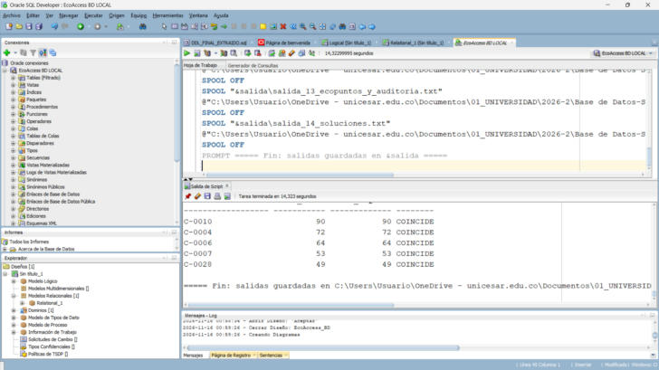
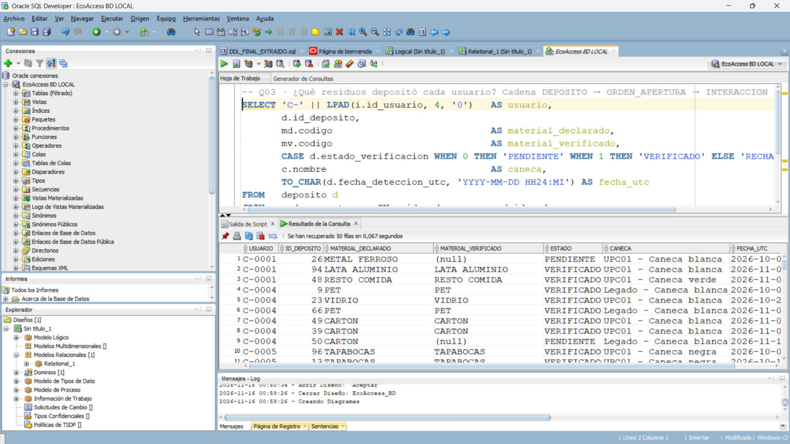
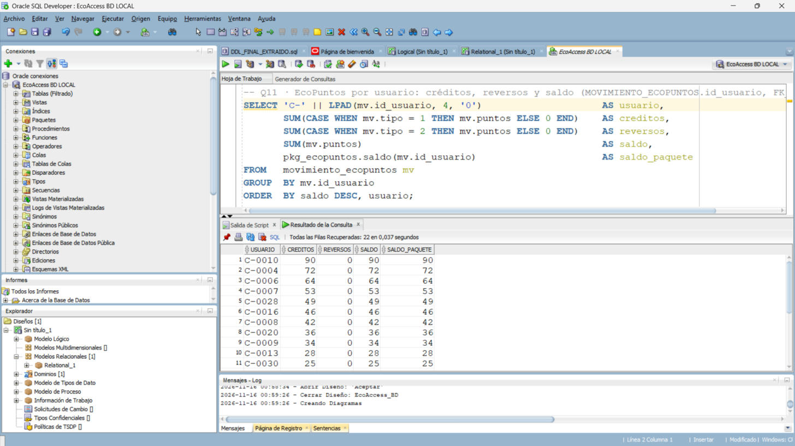
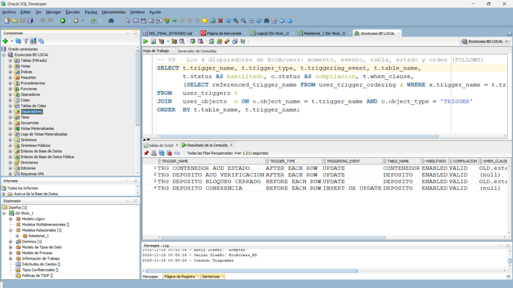
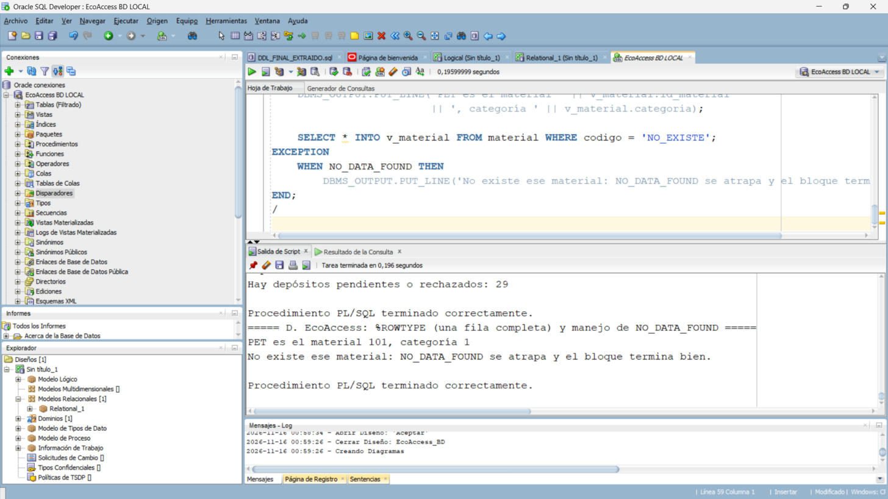

# 15 · Resultados reales y capturas

Todo lo de esta carpeta salió de **ejecutar los scripts en Oracle**, el 16/11/2026:

- Conexión EcoAccess BD LOCAL, con el usuario ECOACCESS_BD en `localhost:1521/FREEPDB1`.
- Se usó **SQL Developer 26.2**, con F5 (Ejecutar script).
- El script 10 se ejecutó en ECOACCESS_PRACTICAS.

Los datos son **sintéticos**.

## Cómo se generaron

1. En SQL Developer, con la conexión EcoAccess BD LOCAL, se abrió [`00_EJECUTAR_TODO_Y_GUARDAR_SALIDAS.sql`](00_EJECUTAR_TODO_Y_GUARDAR_SALIDAS.sql).
2. Se cambió la ruta de `DEFINE salida` por la de esta carpeta.
3. Se pulsó **F5**. El script llama a cada tema y guarda su salida con `SPOOL`. La ejecución completa tardó unos 15 segundos.
4. Todos los scripts llamados son de **solo lectura**: no hay INSERT, UPDATE, DELETE ni COMMIT, y los procedimientos que modifican datos no se llaman.
5. Se revisó cada salida: **0 errores** ORA-, PLS- o SP2-.

Para repetirlo en otro PC, haz los mismos tres pasos. Las salidas nuevas reemplazan a las anteriores.

## Salidas

| Tema | Archivo | Lo más importante de la salida |
|---|---|---|
| 01 | [`salida_01_primeros_comandos.txt`](salida_01_primeros_comandos.txt) | Usuario ECOACCESS_BD, PDB FREEPDB1, 19 tablas, 0 objetos inválidos. Objetos: 3 funciones, 81 índices, 4 paquetes con su cuerpo, 2 procedimientos, 16 secuencias, 4 triggers y 9 vistas. |
| 02 | [`salida_02_select_basico.txt`](salida_02_select_basico.txt) | 3 roles, 21 materiales, estados 0/1/2 y 4 canecas. |
| 03 | [`salida_03_where_join_group_by.txt`](salida_03_where_join_group_by.txt) | 105 depósitos: PENDIENTE 17, VERIFICADO 76, RECHAZADO 12. |
| 04 | [`salida_04_bloques_y_variables.txt`](salida_04_bloques_y_variables.txt) | Mensajes de DBMS_OUTPUT; NO_DATA_FOUND atrapado. |
| 05 | [`salida_05_cursores.txt`](salida_05_cursores.txt) | 5 materiales orgánicos, 4 canecas en servicio y 17 pendientes. |
| 06 | [`salida_06_procedimientos.txt`](salida_06_procedimientos.txt) | 2 procedimientos VALID; P_RESULTADO es OUT REF CURSOR; resumen de 30 días. |
| 07 | [`salida_07_funciones.txt`](salida_07_funciones.txt) | 3 funciones VALID; peso estimado; NULL con datos inválidos; caneca resuelta; cursor de un ciudadano. |
| 08 | [`salida_08_paquetes.txt`](salida_08_paquetes.txt) | 4 paquetes con su cuerpo, VALID; 18 subprogramas; 3 personas del personal; el saldo del paquete coincide con la suma; 7 materiales con tarifa vigente. |
| 09 | [`salida_09_triggers_consulta.txt`](salida_09_triggers_consulta.txt) | 4 disparadores ENABLED y VALID; FOLLOWS; historial y auditoría (76 VERIFICACION, 13 RECHAZO, 1 REAPERTURA y 1 CORRECCION). |
| 10 | [`salida_10_consultar_practicas.txt`](salida_10_consultar_practicas.txt) | En ECOACCESS_PRACTICAS: 7 disparadores de las prácticas y las secuencias de P01. |
| 11 | [`salida_11_secuencias_y_pk.txt`](salida_11_secuencias_y_pk.txt) | 19 PK; 16 IDENTITY (11 ALWAYS y 5 BY DEFAULT); 3 PK sin IDENTITY; DEPOSITO de 1 a 105 sin huecos. |
| 12 | [`../12_USUARIOS_Y_RESIDUOS_DEPOSITADOS/RESULTADOS_ESPERADOS.txt`](../12_USUARIOS_Y_RESIDUOS_DEPOSITADOS/RESULTADOS_ESPERADOS.txt) | Las 15 consultas de «qué residuos deposita cada usuario», incluidas en su guía. |
| 13 | [`salida_13_ecopuntos_y_auditoria.txt`](salida_13_ecopuntos_y_auditoria.txt) | 8 versiones de tarifa; saldos; controles D y E con 0 filas; historia del depósito corregido (CRED-5-1, REV-2, CRED-5-2). |
| 14 | [`salida_14_soluciones.txt`](salida_14_soluciones.txt) | Las 12 soluciones; en E12, todas las filas dicen COINCIDE. |

## Capturas reales en SQL Developer

| Captura | Qué muestra |
|---|---|
|  | El script maestro ejecutado con F5: termina con «Fin: salidas guardadas». |
|  | Q03: residuos por usuario por la cadena DEPOSITO → ORDEN_APERTURA → INTERACCION. |
|  | EcoPuntos por usuario: el saldo calculado coincide con `pkg_ecopuntos.saldo`. |
|  | Los 4 disparadores: tipo, evento, tabla, ENABLED y VALID. |
|  | Bloques PL/SQL con F5: los mensajes de DBMS_OUTPUT en «Salida de Script». |

## Corrección hecha gracias a la ejecución real

En la primera ejecución, el control D del tema 13 («ningún depósito acreditado dos veces») devolvió el depósito 5 con 2 créditos. **No era un error de los datos**: el depósito 5 se corrigió y tiene un crédito (`CRED-5-1`), su reverso (`REV-2`) y un crédito nuevo (`CRED-5-2`). Se corrigió la consulta para contar solo créditos **vigentes** (sin revertir), y se agregó D2, que muestra esa historia. En la segunda ejecución, D devolvió 0 filas.