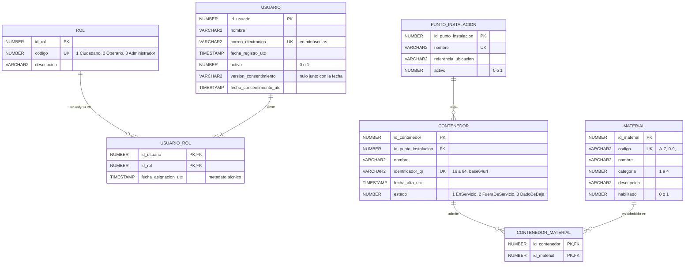
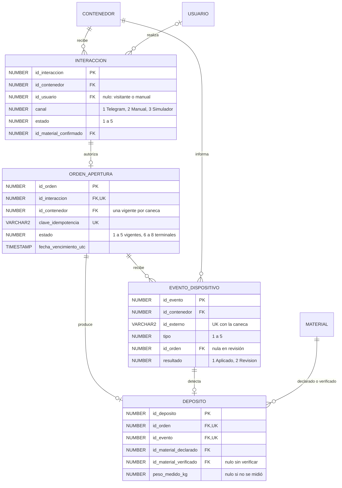
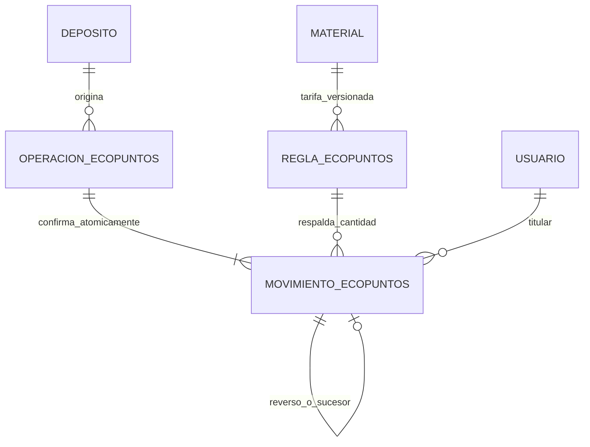

# Diagrama entidad-relación — EcoAccess P3 (versión 001 y migración V003)

Corresponde a `database/02_tablas/01_crear_tablas_iniciales.sql`. Detalle de columnas y reglas en `DICCIONARIO_DATOS.md`. GitHub y VS Code muestran el diagrama Mermaid.

## Migración V003 — interacciones y depósitos

## Lectura del diagrama
- `USUARIO ||--|{ USUARIO_ROL`: un usuario tiene **uno o más** roles; Oracle solo garantiza la relación, el «al menos uno» lo garantiza la lógica.
- `CONTENEDOR ||--o{ CONTENEDOR_MATERIAL`: una caneca recién creada puede no admitir nada (nace fuera de servicio); para ponerla en servicio necesita al menos un material.
- Ninguna relación borra en cascada: para retirar algo se usan `activo`, `habilitado` o el estado `DadoDeBaja`.
- Los nombres y descripciones obligatorios no admiten espacios al inicio ni al final, ni texto formado solo por espacios; el detalle de cada `CHECK` está en `DICCIONARIO_DATOS.md`.
- V003: las claves foráneas compuestas (orden → interacción con su caneca, evento → orden con su caneca, depósito → evento con su orden) impiden ligar un depósito o un evento a la orden de otra caneca.

## Extensión V005 — Ecopuntos

Un crédito inicial por depósito; un reverso y un sucesor como máximo por crédito. La corrección confirma reverso y sucesor juntos. El saldo se calcula del libro. Ver `docs/modulos/16_ECOPUNTOS.md`.
