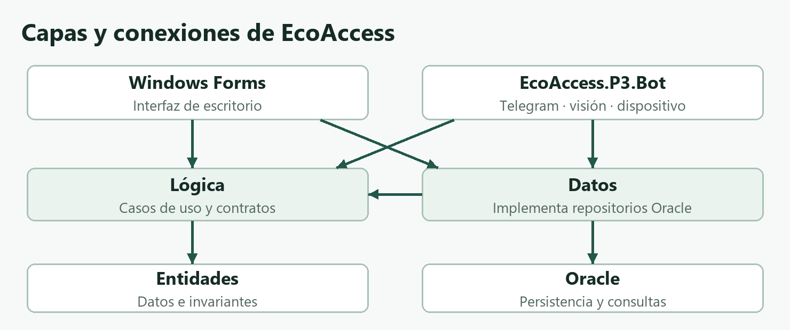
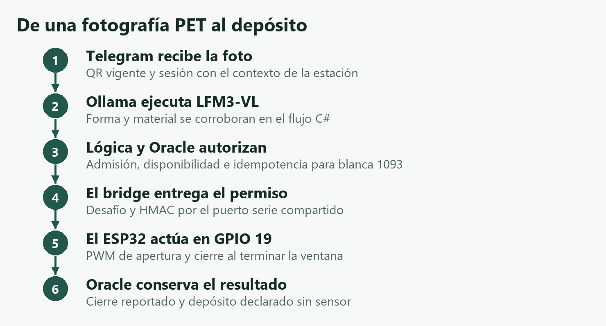
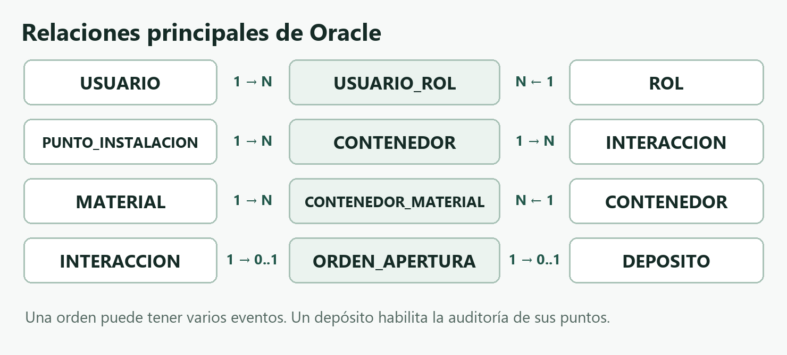
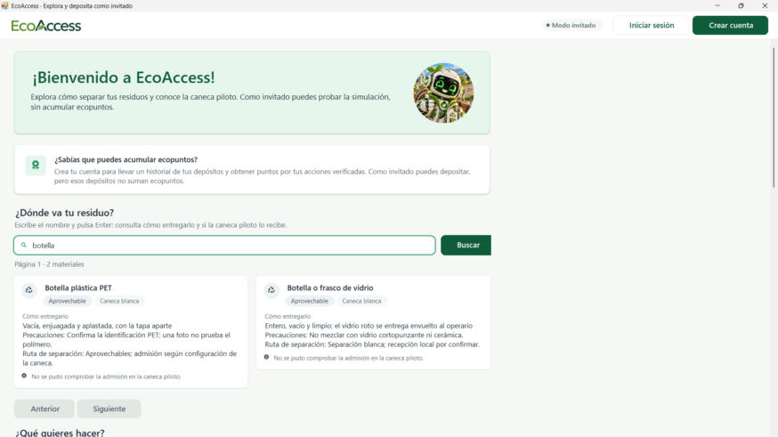
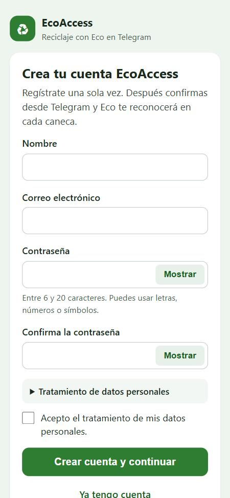
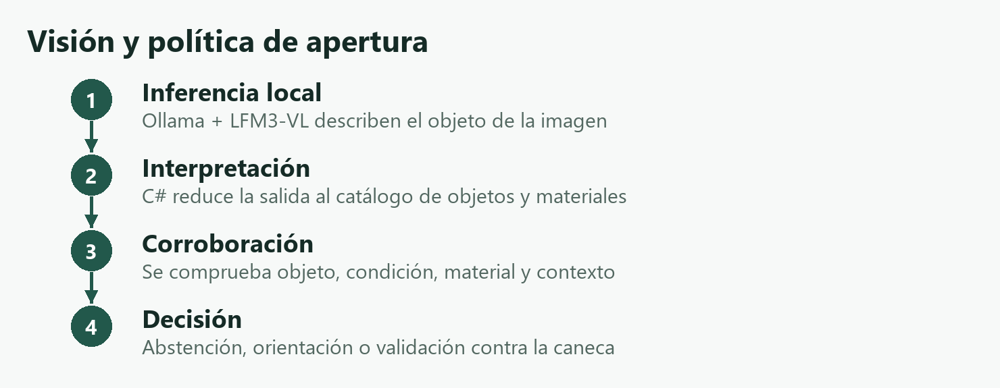
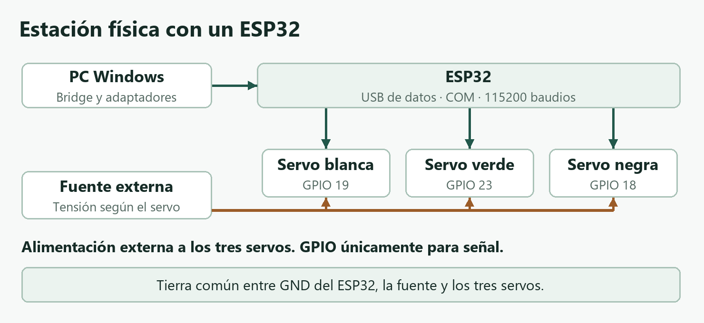
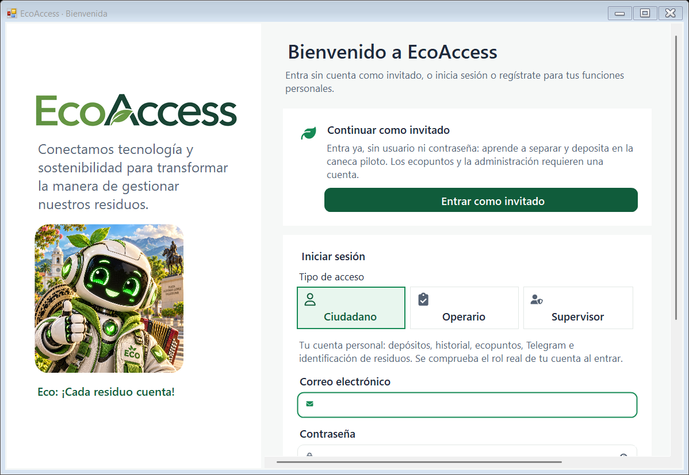
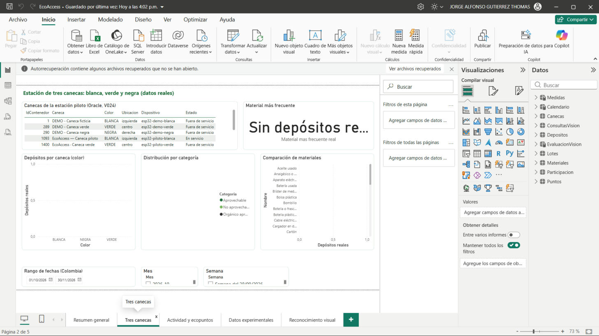

# 01 Guía rápida para el equipo

EcoAccess P3 V1 permite orientar la separación de residuos, registrar operaciones y consultar sus resultados. El recorrido completo une Telegram, el reconocimiento visual local, las reglas C#, Oracle y una estación piloto con tres tapas. Windows Forms permite operar y auditar el sistema según el rol. Power BI consulta el historial. Esta guía corresponde al código de `main` en `a6875cce9f9c5b1c08fba2b4862111fa9121da5f`, merge del PR #11 del 16 de noviembre de 2026.

## Si vas a usar Windows Forms en otro PC

1. Solicita acceso al repositorio privado, una cuenta EcoAccess con el rol que necesitas y un mecanismo autorizado de conexión a Oracle. La cuenta de GitHub, el usuario del esquema y el usuario EcoAccess tienen funciones distintas.
2. Instala Git, PowerShell 7, Visual Studio con **Desarrollo de escritorio de .NET**, el SDK de .NET y el Developer Pack de .NET Framework 4.8. Clona, compila y prepara la wallet según los capítulos 03 y 04.
3. Ejecuta `Validar-Entorno.ps1 -ProbarOracle`. Cuando confirme la consulta, ejecuta el EXE de Presentación o selecciona el proyecto en Visual Studio y presiona F5.
4. Desde **Ciudadano**, **Operario** o **Supervisor**, accede con tu usuario de la aplicación. Abre una consulta permitida y verifica que devuelve datos. Consulta el capítulo 08 si el rol o la base impiden continuar.
5. Comprueba Telegram mediante el bot que ya opera el equipo principal. Para practicar un depósito sin tapas, usa la demostración local del capítulo 10. El simulador y la fase nube sin dispositivo tienen resultados distintos.

## Si vas a operar la estación del equipo

1. Enciende el PC principal y comprueba red, Oracle y Ollama. Comprueba Tailscale si se usará el formulario de registro.
2. Confirma el firmware operativo, la alimentación, el COM y las tapas calibradas. Colócate junto a la estación con acceso al corte de alimentación. El capítulo 07 contiene el encendido y la parada completos.
3. Coordina el cierre de cualquier otro consumidor del token. Inicia `scripts\desarrollo\Iniciar-Estacion-Fisica.ps1`. Verifica que el prechequeo reconoce el firmware y que los tres pares de servicios locales escuchan.
4. Si las tres canecas están habilitadas y el recorrido está libre, prueba una a la vez. El registro de cierre en Oracle acredita el reporte de PWM. La confirmación de la tapa y del residuo es presencial.
5. Termina el ciclo activo, detén la sesión y corta la alimentación de los servos. Ante movimiento inesperado, usa el corte físico inmediatamente.

## Qué se verificó para esta guía

Se verificaron compilación Release, pruebas sin hardware, conexión Oracle de solo lectura, identidad del bot y disponibilidad del modelo local. Los registros históricos del repositorio incluyen pruebas físicas firmadas. En esta revisión quedó pendiente repetir el recorrido integral desde un teléfono, comprobar la estación energizada y actualizar el PBIX en Power BI Desktop con la cuenta de informes. Los estados y fechas están en [verificaciones](../evidencias/verificaciones.md).

# 02 Arquitectura y viaje de una fotografía



*Figura 1. Dependencias de compilación y conexiones de ejecución. El bot es un ejecutable adicional que compone las mismas capas que Windows Forms.*

## Las cuatro capas y la compatibilidad

| Capa | Proyecto y responsabilidad | Código que conviene abrir |
| --- | --- | --- |
| Entidades | `EcoAccess.P3.Entidades`. Representa los datos y estados que conservan sentido independientemente de la pantalla y Oracle. | `Usuario`, `Material`, `Contenedor`, `Interaccion`, `OrdenApertura`, `Deposito`, `ReglaEcopuntos`, `MovimientoEcopuntos`. |
| Lógica | `EcoAccess.P3.Logica`. Define casos de uso y contratos. | `ServicioAutenticacion`, `ControlAcceso`, `MatrizPermisos`, `ServicioClasificacionImagen`, `ResolutorDestino`, `ServicioInteracciones`, `ServicioEcopuntos`. |
| Datos | `EcoAccess.P3.Datos`. Implementa los repositorios y las consultas Oracle. | `FabricaConexionesOracle`, `ComandosOracle`, `RepositorioRegistroCiudadanosOracle`, `RepositorioInteraccionesOracle`, `TraductorErroresOracle`. |
| Presentación | `EcoAccess.P3.Presentacion` muestra formularios y `EcoAccess.P3.Bot` atiende Telegram y transporta órdenes. Los respectivos `Program.cs` componen las dependencias. | `FormInicioSesion`, `FormPrincipal`, `FormRegistroCiudadano`, `BuclePolling`, `ProcesadorUpdates`. |

`EcoAccess.P3.Compatibilidad` aporta adaptaciones para ejecutar código C# 9 sobre .NET Framework 4.8. `Directory.Build.props` fija la configuración común. El SDK moderno participa en compilación y restauración. Los EXE de operación salen de `bin\Release\net48`.

### Entidades y estados del dominio

Un `Usuario` agrupa identificador, nombre, correo, estado activo, roles y consentimiento. La credencial tiene su ciclo propio en `CredencialAcceso`. `Material` describe el código, la categoría y si está habilitado. `Contenedor` asocia la caneca con el punto de instalación, el QR y el estado de servicio. La relación de admisión une el material con cada caneca.

`Interaccion` identifica una solicitud por canal, mantiene su estado y puede relacionarse con un ciudadano o visitante. `OrdenApertura` identifica una autorización temporal para una caneca y guarda una clave de idempotencia. `Deposito` conserva el material declarado, la verificación posterior y la procedencia de los datos. `ReglaEcopuntos` define la tarifa vigente. `MovimientoEcopuntos` deja constancia de créditos o reversos. Un registro sin sensor conserva la declaración y es revisable por el personal autorizado.

### Interfaces y repositorios

Lógica consume contratos como `IRepositorioUsuarios`, `IClasificadorMaterial` e `ICanalDispositivo`. Datos implementa los contratos Oracle y el bot implementa los adaptadores que necesita para Telegram, visión y dispositivo. `ControlAcceso` comprueba el actor en los servicios aunque la pantalla ya haya ocultado opciones. El resultado de negocio llega a la interfaz como un valor o un rechazo legible.

`FabricaConexionesOracle` abre por ODP.NET. `ComandosOracle` enlaza parámetros por nombre. `RepositorioRegistroCiudadanosOracle.RegistrarAsync` escribe usuario, rol y credencial dentro de la misma transacción. Si el correo se duplica, Oracle rechaza la restricción única y el repositorio permite presentar el conflicto como mensaje al usuario. El pool reutiliza conexiones. Cada consumidor las libera con `using`.

```csharp
// Principio aplicado por ComandosOracle con Oracle.ManagedDataAccess.
using var comando = conexion.CreateCommand();
comando.BindByName = true;
comando.CommandText = "SELECT id_usuario FROM usuario WHERE correo_electronico = :correo";
comando.Parameters.Add("correo", OracleDbType.Varchar2).Value = correo;
```

El ejemplo muestra la parametrización. Para leer varias filas se usa un lector, se avanza por cada resultado y se convierten los tipos al dominio. Las entradas viajan como valores y el texto SQL queda fijo.

## Caso completo de una botella PET



*Figura 2. Caso con QR vigente, modelo disponible, botella limpia y vacía, y estación física operativa.*

1. **Entrada.** El ciudadano escanea el QR compartido en la estación. `EnlaceTelegram` y `CodigoQrCaneca` representan el enlace y su identificador. `BuclePolling.EjecutarAsync` y `ProcesadorUpdates.ProcesarAsync` reciben y traducen el update. El contexto de presencia en fase física vence a los cinco minutos.
2. **Visión.** `ServicioConversacionTelegram` tramita la foto con `ServicioClasificacionImagen.ClasificarAsync`. `ClasificadorOllamaLocal` pide una inferencia a LFM3-VL y aplica comprobaciones complementarias. `InterpretadorNombreObjeto` lleva el resultado al vocabulario de `CatalogoObjetos`. Una forma parecida a botella, por sí sola, deja condiciones por resolver.
3. **Ruta.** `CanecaDeEstacionAsync` y `ResolutorDestino` dirigen a blanca. `ParaCanecaDeEstacionAsync` vuelve a comprobar el catálogo para el destino concreto. `PoliticaAperturaAutomatica` exige un caso admitido y corroborado. Oracle aporta disponibilidad y admisión. La caneca blanca del piloto es 1093. Sin puente o dispositivo disponible, Eco orienta o informa del fallo.
4. **Orden.** `ServicioInteracciones.AutorizarAperturaAsync` crea una orden con vigencia de dos minutos, vinculada a la solicitud. Oracle mantiene `INTERACCION` y `ORDEN_APERTURA`. La autorización, la confirmación de ejecución y el registro del depósito son momentos distintos.
5. **Actuación.** `AplicacionBridge` y `ActuacionSerial.EjecutarAsync` llevan el permiso firmado al ESP32 por el COM compartido. El firmware valida desafío, HMAC, identidad, caneca y reserva de orden, aplica PWM en GPIO 19 y ordena el cierre tras la ventana.
6. **Resultado.** Los eventos reportan acuse, apertura y cierre. El cierre sin sensor permite registrar depósito declarado y pendiente de verificar en `DEPOSITO`. La consulta visual, el resultado de clasificación y la ejecución quedan en registros diferentes. Operario o Supervisor verifican físicamente y, si aplican las reglas, quedan movimientos en `MOVIMIENTO_ECOPUNTOS`.

Si llega una foto sin QR vigente, la experiencia puede empezar como consulta general. Si la imagen resulta ambigua, Eco orienta, pide otra foto o permite una interacción manual según el contexto. Ninguna de esas respuestas acredita un movimiento ni asigna puntos.

# 03 Instalación en Windows

## Qué instala cada equipo

| Componente | PC principal | Compañero |
| --- | --- | --- |
| Git, .NET, PowerShell y Visual Studio | Sí | Sí para compilar |
| Wallet y cuenta Oracle autorizadas | Sí, para el rol del servicio | Sí, si usará Oracle Cloud |
| Ollama y LFM3-VL | Sí, en el host de inferencia | Solo para laboratorio local |
| Telegram y Tailscale | Token y Funnel bajo control del anfitrión | Cliente Telegram para usar Eco |
| Arduino IDE y USB serie | Para preparar o recuperar firmware | Solo si participa en hardware |
| Power BI Desktop x64 | Si consulta informes | Si consulta informes |
| Docker Desktop | Solo para Oracle Free local y simulación | Solo para laboratorio aislado |

1. **Git.** Descarga Git for Windows para la arquitectura de tu equipo. En el instalador conserva el uso de Git desde la línea de comandos y aplicaciones de terceros. Abre una terminal nueva y ejecuta `git --version`. Para el repositorio privado, completa el inicio de sesión de Git Credential Manager con el usuario al que dieron acceso. Si GitHub devuelve «Repository not found», verifica el nombre y la invitación.
2. **Visual Studio.** Descarga Community. En Visual Studio Installer selecciona **Desarrollo de escritorio de .NET**. En **Componentes individuales**, busca **SDK de .NET Framework 4.8** y **Paquete de destino de .NET Framework 4.8**. Instala, abre Visual Studio y elige **Abrir un proyecto o una solución**. Se comprobó Community 18.11.12328.437. La guía del repositorio admite Visual Studio 2022 o posterior con esa carga.
3. **.NET.** Descarga el SDK x64 de .NET 10 para reproducir el entorno verificado, versión 10.0.403. Si faltan referencias de Framework, instala **Developer Pack 4.8**. El runtime 4.8 o superior compatible ejecuta los EXE y el paquete de desarrollo aporta las referencias. Comprueba `dotnet --list-sdks`. Ante MSB3644, revisa el paquete de destino.
4. **PowerShell.** Instala el MSI x64 de PowerShell 7 y conserva la opción de agregarlo a PATH. Desde Inicio abre **PowerShell 7** o ejecuta `pwsh`. Se usó 7.6.9. Si recibes un error de política, revisa `Get-ExecutionPolicy -List` y la política del equipo. Puedes usar `-ExecutionPolicy Bypass` para un proceso puntual y un script revisado si la política de la organización lo admite.
5. **Oracle.** La aplicación restaura `Oracle.ManagedDataAccess` 23.26.400 con NuGet. Para este cliente administrado se prepara el wallet, según el capítulo 04. Power BI tiene sus propios requisitos de controlador, descritos en el capítulo 09.
6. **Servicios complementarios.** Completa Ollama en el capítulo 06, Telegram y Tailscale en el 05, Arduino y driver en el 07, y Power BI en el 09. El modo demostración con Docker se prepara en el capítulo 10.

## Clonar abrir y compilar

Abre PowerShell 7, crea o selecciona una carpeta escribible y clona. Mantén el directorio corto para que Windows y MSBuild puedan resolver las rutas largas.

```powershell
Set-Location $env:USERPROFILE\Documents
git clone https://github.com/JorgeGutho21/EcoAccess-2026-2.git
Set-Location .\EcoAccess-2026-2
git switch main
git status -sb
git log -1 --oneline
dotnet build EcoAccess.P3.sln -c Release
pwsh -NoProfile -File scripts/instalacion/Validar-Entorno.ps1
```

Espera el resultado de compilación con cero errores. Los paquetes vienen de las referencias de la solución. Si falla la restauración, comprueba acceso a NuGet, fecha del equipo y proxy. En Visual Studio usa **Compilar > Compilar solución**. Para el escritorio, clic derecho en **EcoAccess.P3.Presentacion > Establecer como proyecto de inicio**. Usa **Iniciar sin depurar** con Ctrl+F5 o F5 si necesitas el depurador.

## Qué hace cada script de instalación

| Script en `scripts/instalacion` | Acción y resultado |
| --- | --- |
| `Validar-Entorno.ps1` | Comprueba Framework, Developer Pack, IDE, SDK, wallet o Docker, Ollama, token y COM. Con `-ProbarOracle` llama al EXE compilado y lee el catálogo público. Debe indicar los componentes obligatorios disponibles. |
| `Configurar-Credenciales.ps1` | `-Oracle` valida la cadena de forma discreta. `-Telegram` comprueba `getMe`. `-Groq` comprueba el modelo de la cuenta. `-Modo Local` selecciona visión local. Ejecuta solo el parámetro que corresponda a tu rol. |
| `Configurar-Telegram.ps1` | Pide el token del bot, valida el nombre esperado y guarda la configuración privada. `-NombreEsperado` permite indicar un bot de prueba. El anfitrión también puede usar `Configurar-Credenciales.ps1 -Telegram`. |
| `Preparar-BaseDatos.ps1` | Trabaja dentro del contenedor local `oracle-free-p3`. Crea el esquema y aplica SQL por orden. Registra versiones y prepara la conexión del perfil. El escenario Cloud usa la wallet y una conexión autorizada. |
| `Preparar-Demostracion.ps1` | Prepara Oracle local, el piloto simulado, datos ficticios y `bridge.local.json`. |
| `Preparar-Estacion-Fisica.ps1` | Genera archivos privados y cabecera de firmware para tres identidades. Consulta el capítulo 07 antes de ejecutarlo. |
| `Publicar-Registro-HTTPS.ps1` | Configura públicamente la ruta de registro en Funnel y guarda los parámetros de escucha. Es una operación de configuración del anfitrión. |

Las credenciales de servicio viven bajo `%APPDATA%\Microsoft\UserSecrets\ecoaccess-p3-framework` en el perfil de Windows. User Secrets mantiene los valores fuera del proyecto y es un almacén de desarrollo en texto local. Usa permisos del sistema de archivos. Entrega por separado las cuentas EcoAccess y la autorización Oracle. Si una cuenta de menor privilegio carece de algún permiso de operación, solicita al dueño que provea la conexión prevista. No se recomienda suplirlo con ADMIN ni con la cuenta de Power BI, que tiene otro alcance.

Descargas oficiales de [Git for Windows](https://git-scm.com/download/win), [Visual Studio](https://visualstudio.microsoft.com/downloads/), [.NET 10](https://dotnet.microsoft.com/download/dotnet/10.0), [Developer Pack](https://dotnet.microsoft.com/en-us/download/dotnet-framework/net48) y [PowerShell](https://learn.microsoft.com/powershell/scripting/install/installing-powershell-on-windows).

# 04 Oracle Cloud y SQL

## Conceptos para empezar

Oracle Autonomous Database es un servicio administrado de Oracle Cloud Infrastructure. Una instancia es la base aprovisionada y tiene región, compartimento, estado y endpoints. Un esquema agrupa los objetos propiedad de un usuario de la base. El código emplea tablas de filas y columnas, restricciones y transacciones. La clave primaria, PK, identifica cada fila. La clave foránea, FK, conecta filas con la tabla referenciada. La relación entre usuarios y roles es de muchos a muchos mediante `USUARIO_ROL`. Las vistas exponen consultas guardadas. Una función devuelve un valor, un procedimiento ejecuta una operación y puede devolver parámetros, y un trigger se dispara ante un evento de la base.

Una transacción agrupa una unidad de trabajo. `COMMIT` confirma y `ROLLBACK` deshace cambios DML pendientes. El DDL de Oracle puede confirmar implícitamente. Un ensayo con creación de objetos o cuentas requiere un esquema o instancia de pruebas. El flujo C# de registro de ciudadanos trabaja en una sola transacción.



*Figura 3. Relaciones operativas principales. El inventario de columnas está en el capítulo 13. El DER de database/01_modelo cubre las tablas iniciales y V003.*

## Entrar en la consola y consultar la base

1. Abre [OCI](https://cloud.oracle.com/) y entra con el nombre de cuenta Cloud, tu identidad autorizada y el segundo factor si se solicita. Abre el selector de región y elige la región del proyecto. El historial de EcoAccess registra Bogotá. Si el listado queda vacío, verifica región, compartimento e IAM con el propietario.
2. Abre el menú de navegación y busca **Autonomous Database** o **Autonomous AI Database**, según la consola. Selecciona el compartimento autorizado y abre la instancia existente de EcoAccess. En **Detalles** comprueba que esté disponible. Si está detenida, coordina el arranque con quien administra OCI.
3. En la ficha abre **Database Actions > SQL**. Si la consola ofrece **Database Actions > View all database actions**, abre después **SQL Worksheet**. Inicia sesión con el usuario SQL autorizado. Una cuenta OCI autorizada a ver la instancia y una cuenta SQL autorizada a consultar sus datos son accesos distintos.
4. En el árbol de objetos selecciona **Tables** y el esquema visible. En la hoja pega una consulta, deja el cursor dentro de ella y presiona **Run Statement**. El resultado aparece en la cuadrícula. **Run Script** ejecuta un bloque o varias sentencias y muestra salida textual.
5. Comienza con la identidad de sesión y con el inventario. Para otra cuenta de lectura, usa el prefijo de esquema solo donde existan permisos y consulta `ALL_TABLES` con `OWNER`.

```sql
SELECT USER AS cuenta, SYS_CONTEXT('USERENV','CURRENT_SCHEMA') AS esquema FROM dual;
SELECT table_name FROM user_tables ORDER BY table_name;
SELECT object_type, object_name FROM user_objects WHERE status <> 'VALID';
```

6. Abre `database/04_consultas/11_consultas_cierre.sql`. Ejecuta por separado los SELECT numerados. La consulta 1 lista las canecas y sus estados. La 2 separa estados de depósitos operativos. La 3 consulta el lote experimental y la 7 muestra el historial de migraciones. Una salida vacía puede ser válida para el filtro elegido.

Las pantallas de OCI y el recorrido SQL Worksheet quedan pendientes de comprobación visual con el propietario. El cliente compilado sí comprobó la consulta de catálogo en Oracle Cloud. Los recorridos de consola se basan en la documentación oficial de [Database Actions](https://docs.oracle.com/en/cloud/paas/autonomous-database/serverless/adbsb/connect-database-actions.html).

## Wallet y comprobación desde C#

1. En la ficha Autonomous abre **Database connection**. Con mTLS, selecciona **Instance wallet** para esa base y **Download wallet**. Utiliza una contraseña de descarga conforme a OCI. Si careces de permiso, solicita al dueño una copia autorizada por un canal privado.
2. Descomprime en una carpeta privada como `%USERPROFILE%\.oracle\wallets\EcoAccess`. Deben existir `tnsnames.ora`, `sqlnet.ora` y `cwallet.sso`. En `sqlnet.ora`, sustituye la ruta portátil `?/network/admin` por la ruta real de esa carpeta si viene así. Restringe acceso a tu usuario.
3. Abre **Editar las variables de entorno de tu cuenta > Nueva**, escribe `TNS_ADMIN` y como valor pega la ruta absoluta de la carpeta. Abre una terminal nueva. Lee `tnsnames.ora` localmente y comprueba que contiene el alias autorizado, históricamente `ecoaccess_tp`. El alias resuelve host, puerto, servicio y los parámetros de conexión.
4. Desde la raíz, compila Release y ejecuta el script de credenciales. En el campo oculto escribe la cadena con tu usuario, contraseña y alias. Ejemplo de formato `User Id=USUARIO_AUTORIZADO;Password=<contraseña>;Data Source=ecoaccess_tp`. Sustituye los tres valores que el dueño te indique. Si el diálogo de Windows Forms pide conexión, revisa `EcoAccess.P3.Presentacion.exe.config` y la parte pública de la cadena del equipo.

```powershell
Test-Path (Join-Path $env:TNS_ADMIN 'tnsnames.ora')
pwsh -File scripts/instalacion/Configurar-Credenciales.ps1 -Oracle
pwsh -File scripts/instalacion/Validar-Entorno.ps1 -ProbarOracle
```

Espera que salga «Oracle respondió a la consulta del catálogo público». En la auditoría devolvió 41 materiales habilitados. Si la lectura falla, verifica los archivos de wallet, la vigencia, la coincidencia del alias, la cuenta Oracle y la conectividad. `ORA-12154` apunta a resolución de alias, `ORA-01017` a autenticación y `ORA-00942` puede indicar esquema o permiso. El administrador de OCI debe revisar restricciones de red y estado de la instancia. Mantén fuera de Git el ZIP, `cwallet.sso`, `ewallet.p12`, cadenas, contraseñas, archivos `secrets.json` y exportaciones con datos privados. [Instrucciones oficiales de descarga de wallet](https://docs.oracle.com/en/cloud/paas/autonomous-database/serverless/adbsb/connect-download-wallet.html).

## Consultas de lectura para la sustentación

Ejecuta con cuenta autorizada. Los ejemplos con identificadores personales se acotan al registro de ensayo autorizado. Escoge los campos mínimos al mostrar resultados.

```sql
SELECT id_usuario, activo FROM usuario
WHERE correo_electronico = 'ensayo@example.invalid';

SELECT codigo, nombre, categoria, habilitado
FROM material ORDER BY categoria, nombre;

SELECT id_contenedor, nombre, estado
FROM contenedor WHERE id_contenedor IN (1093, 1400, 1401);

SELECT estado_registro, color_caneca, COUNT(*) AS cantidad
FROM vista_depositos_estado
WHERE es_simulacion = 0 AND es_ensayo = 0
GROUP BY estado_registro, color_caneca;

SELECT tipo, SUM(puntos) AS puntos
FROM movimiento_ecopuntos GROUP BY tipo;

SELECT id_orden, id_contenedor, estado, fecha_vencimiento_utc
FROM orden_apertura ORDER BY id_orden DESC FETCH FIRST 10 ROWS ONLY;

SELECT tipo, resultado, COUNT(*) AS cantidad
FROM evento_dispositivo GROUP BY tipo, resultado;

SELECT COUNT(*) AS dialogos FROM conversacion_telegram;
SELECT COUNT(*) AS vinculos FROM vinculo_telegram;
SELECT COUNT(*) AS consultas FROM consulta_vision;
```

Los diez SELECT del bloque se ejecutaron en Oracle Cloud en solo lectura durante esta auditoría. Se verificó que Oracle aceptara cada consulta. Consulta disponibilidad mediante `vista_canecas_estacion`, actividad visual agregada según V023 y trazabilidad de errores mediante `EVENTO_DISPOSITIVO`, `ORDEN_APERTURA` y el log de la sesión. En Oracle, `USER_ERRORS` ayuda con objetos PL/SQL inválidos. Para una orden concreta filtra los eventos por su `id_orden` y revisa la fecha y el resultado. Para evitar confundir depósitos y conversaciones, conserva esa distinción al comparar informes.

## Laboratorio con cambios en un entorno aislado

1. Configura Oracle local según el capítulo 10. `database/00_administracion/01_crear_usuario_p3.sql` y su cuerpo sirven para aprovisionar un **usuario de esquema** y sus permisos con SQL*Plus. `Preparar-BaseDatos.ps1` automatiza el aprovisionamiento local. El alta de un **ciudadano de la aplicación** se realiza desde el formulario con `ServicioRegistroCiudadanos.RegistrarAsync`. Comprueba las filas con un correo ficticio. El repositorio revisado implementa esa alta desde C#.
2. Para el ensayo de depósitos, arranca el simulador de ese entorno, accede con un Operario de prueba, busca una caneca y un material admitido, solicita apertura y completa la verificación autorizada. Contrasta `INTERACCION`, `ORDEN_APERTURA`, `EVENTO_DISPOSITIVO` y el depósito por la orden. `Ejecutar-Integracion-Esquema.ps1` automatiza escenarios sobre un esquema aislado.
3. V022 crea `FN_RESOLVER_CANECA_DISPONIBLE`, que recibe punto y material y devuelve la caneca disponible cuando se puede resolver. Selecciona IDs de ensayo de `PUNTO_INSTALACION` y `MATERIAL` y reemplaza las variables enlazadas. V022 contiene la firma de `PR_CONSULTAR_ESTADISTICAS`, que devuelve un `SYS_REFCURSOR` delegando en `PKG_ECOACCESS_STATS`.

```sql
SELECT FN_RESOLVER_CANECA_DISPONIBLE(:id_punto, :id_material) AS caneca
FROM dual;
```

```sql
-- Usar Run Script en SQL*Plus o SQLcl en el esquema de ensayo.
VARIABLE resumen REFCURSOR
BEGIN
  PR_CONSULTAR_ESTADISTICAS(
    TIMESTAMP '2026-11-01 00:00:00',
    TIMESTAMP '2026-12-01 00:00:00',
    NULL, NULL, :resumen);
END;
/
PRINT resumen
```

4. `tr_ecop_unidades` (V011) valida antes de insertar un crédito por unidad. Para una tarifa unitaria exige cantidad verificada y coincidencia exacta entre puntos y tarifa por cantidad. `T001_ensayo_primera_insercion_aislado.sql` documenta un ensayo con rollback. Las migraciones versionadas se aplican con respaldo y autorización. La carpeta contiene V002 a V026. El registro de la base que consultes determina cuáles se aplicaron.




*Figura 4. Captura histórica del catálogo Oracle desde la aplicación. La consola OCI y SQL Worksheet tienen el recorrido del apartado anterior.*

# 05 Telegram y registro público

## Cuenta del bot y arranque

BotFather crea y administra bots. Desde la cuenta de Telegram del dueño, abre el BotFather oficial, ejecuta `/newbot`, elige nombre y un identificador disponible que termine en `bot`. El token recibido autentica llamadas a Telegram Bot API. Guárdalo con el script interactivo. El bot oficial se verificó como `@EcoAccessP3_JG_bot` mediante `--comprobar-telegram`, que llama para consultar identidad y estado sin consumir mensajes. Un integrante que ensaye usa un token separado y el nombre correspondiente.

```powershell
# Anfitrión, una vez y en su perfil privado.
pwsh -File scripts/instalacion/Configurar-Credenciales.ps1 -Telegram
$bot = '.\src\EcoAccess.P3.Bot\bin\Release\net48\EcoAccess.P3.Bot.exe'
& $bot --comprobar-telegram
```

Telegram Bot API es una interfaz HTTP. En long polling, `BuclePolling` pide `getUpdates` con espera y offset, y procesa los mensajes por conversación. Varias instancias del mismo token compiten por la cola y pueden recibir HTTP 409. Un webhook activo también impide `getUpdates`. Usa un solo consumidor por token entre todas las máquinas. Los diagnósticos y los procesos bridge pueden coexistir con ese consumidor.

```powershell
# Inventario de consumidores locales por modo y PID, sin imprimir su comando.
Get-CimInstance Win32_Process -Filter "Name='EcoAccess.P3.Bot.exe'" |
  Where-Object { $_.CommandLine -match '--(polling|webhook)\b' } |
  Select-Object ProcessId, ExecutablePath
# Oracle Cloud, fase de orientación por software.
pwsh -File scripts/desarrollo/Iniciar-EcoAccess-Nube.ps1
# Parada de la sesión registrada.
pwsh -File scripts/desarrollo/Detener-Demostracion.ps1
```

`Iniciar-EcoAccess-Nube.ps1` verifica Oracle, bot y motor visual, arranca `--polling` sin bridge y comprueba el registro HTTP. `Iniciar-Bot-Eco.ps1` tiene opciones de supervisor y reinicio. Para simulación local usa el capítulo 10. Para la estación física usa el capítulo 07. Si el proceso se inició manualmente en primer plano, usa Ctrl+C en su propia terminal y comprueba su PID. Un proceso remoto se coordina con su operador.

## Conversación QR y vínculo

El QR oficial representa la estación. La ruta que se elige depende del residuo y del estado de la caneca, aun cuando el QR de referencia pertenezca a la caneca blanca. Un QR fijo se puede copiar. Autoriza pruebas físicas con alguien presente. La presencia dura cinco minutos y el reinicio del bot obliga a escanear de nuevo. Eco ofrece orientación a visitantes y vinculación con una cuenta. Para fotos elegibles, guarda la interacción y, si aplica, el análisis asociado y la consulta de visión. `CONVERSACION_TELEGRAM` conserva el diálogo, `VINCULO_TELEGRAM` la asociación y `TOKEN_VINCULACION` la solicitud temporal. La respuesta sale por el cliente de Telegram como texto y botones.

1. En Telegram abre el bot escrito por su identificador. Pulsa **Iniciar** o envía `/start`. Eco muestra el saludo y el menú.
2. Para asociar tu cuenta, envía `/vincular` o usa la opción de cuenta. Abre el enlace privado que genera para ese diálogo. En el formulario elige crear cuenta o iniciar sesión con la cuenta que ya existe.
3. Vuelve a Telegram y completa la confirmación que solicite Eco. Verifica el vínculo consultando tu cuenta o actividad. Si el enlace vence, solicita uno nuevo.
4. Para disposición, escanea el QR en presencia del operador, envía una foto de un objeto y espera respuesta. Con material admitido y equipo disponible, Eco informa la apertura y después el cierre. Si la visión falla, espera otra foto o selección manual. Si Oracle falla, el bot no puede validar la sesión o registrar la orden. Si la estación falla, se conserva la orientación y se revisa el estado antes de reintentar.
5. **Validación manual pendiente.** Repite registro, vínculo y consulta desde datos móviles con el operador presente. Usa una cuenta de ensayo y registra hora, paso, HTTP y resultado con el enlace oculto.



*Figura 5. Captura histórica del HTML real de registro en navegador emulado a 375 px. Los datos del ejemplo son ficticios.*

## HTTPS con Tailscale Funnel

Tailscale Funnel sirve HTTPS público de la ruta `/registro` y reenvía al registro del bot en loopback por el puerto 8081. `ServidorRegistro` atiende la página. Telegram sigue recibiendo mensajes mediante polling. Los servicios de Oracle, Ollama y bridge quedan fuera de esta publicación.

1. Instala Tailscale para Windows x64 desde la página oficial, abre la aplicación desde Inicio, inicia sesión en la cuenta autorizada y comprueba que el servicio esté conectado. La auditoría encontró 1.104.5. Si el estado es `NoState`, abre el cliente de escritorio y comprueba sesión y red.
2. Comprueba `tailscale status` y `tailscale funnel status`. Si es una publicación inicial autorizada, ejecuta `pwsh -File scripts/instalacion/Publicar-Registro-HTTPS.ps1` desde el perfil que guarda la configuración del bot. Si Tailscale devuelve un enlace para permitir Funnel, lo gestiona el dueño de la cuenta. El script guarda `Telegram:PaginaRegistro` y `Telegram:PrefijoRegistro`.
3. Reinicia el bot en el modo elegido para que adopte la configuración. Comprueba la ruta HTTPS pública desde un navegador con el dominio aprobado. Un 400 sin token puede indicar que el listener alcanzó la validación del enlace. Un 502 orienta a un listener ausente, puerto distinto o problema entre Funnel y el servicio. Revisa la sesión del bot, el puerto local y el estado de Funnel.
4. Comprueba desde datos móviles con `/vincular`. Con el PC dormido o apagado quedan fuera de servicio el polling local, la inferencia y el formulario. Si el dueño decide retirar la exposición, revisa las rutas activas y el alcance de `tailscale funnel reset` sobre el nodo antes de ejecutarlo.

Referencias de [Telegram Bot API](https://core.telegram.org/bots/api), [BotFather](https://core.telegram.org/bots/features#botfather), [Tailscale para Windows](https://tailscale.com/download/windows) y [Tailscale Funnel](https://tailscale.com/kb/1223/funnel).

# 06 Reconocimiento visual de Eco

Ollama aloja la inferencia en el PC y expone una API local. LFM3-VL es el modelo visual que utiliza, con etiqueta `lfm3-vl:latest`. Groq es un proveedor externo opcional y el código selecciona `qwen/qwen3.8-27b` allí. `ConfiguracionVision` gestiona las opciones, `ClasificadorOllamaLocal` pide inferencias y `InterpretadorNombreObjeto` traduce la salida a claves de `CatalogoObjetos`. `ResolutorDestino` decide el color ambiental. `PoliticaAperturaAutomatica` exige evidencia suficiente y el servicio contrasta catálogo, condición, presencia y disponibilidad. La confianza declarada por el modelo requiere corroboración.



*Figura 6. La autorización se completa con catálogo, Oracle y disponibilidad del dispositivo.*

El modo Local procesa la inferencia en el PC. El proveedor externo exige clave válida y consentimiento para compartir la foto. La opción de segunda opinión se solicita de manera explícita y `/revocarfotos` revoca ese permiso. Si falla la visión, Eco puede pedir otra foto o brindar selección manual según el recorrido.

## Instalar y probar Ollama

1. Descarga Ollama para Windows e instala la aplicación. Abre PowerShell 7 en una consola nueva. La versión verificada fue 0.40.16. `ollama list` muestra etiquetas e identificadores. Descarga el modelo si falta.
2. Comprueba que la API escucha localmente. Configura el modo Local en el host autorizado. Ejecuta el diagnóstico con el EXE compilado en Release y confirma `Local.Disponible` y el modelo cargable.

```powershell
ollama --version
ollama list
ollama pull lfm3-vl:latest
Invoke-RestMethod http://127.0.0.1:11434/api/tags |
  Select-Object -ExpandProperty models | Select-Object name
pwsh -File scripts/instalacion/Configurar-Credenciales.ps1 -Modo Local
$bot = '.\src\EcoAccess.P3.Bot\bin\Release\net48\EcoAccess.P3.Bot.exe'
& $bot --estado-vision
```

3. Si el puerto no responde, abre Ollama desde Inicio. `ollama serve` sirve en primer plano si nadie escucha en 11434. Si aparece «address already in use», comprueba el servidor existente. Si falta el modelo, revisa internet y disco. Consulta los archivos bajo `%LOCALAPPDATA%\Ollama` y los logs del bot.
4. En un bot de ensayo o en modo nube de orientación coordinado, envía una foto de un objeto limpio sin QR vigente de estación. Espera la respuesta. Comprueba otro caso con buena luz y fondo despejado si el primero resulta ambiguo. La primera inferencia puede incluir carga del modelo.

[Ollama para Windows](https://docs.ollama.com/windows) · [LFM3-VL](https://ollama.com/library/lfm3-vl)

## Corpus y evaluación

1. Abre `docs/vision/resultados/banco_ampliado_v1/banco.csv` y `rutas_v2.csv`. Usa los nombres, etiquetas, autores, enlaces, licencias y huellas registrados. Descarga desde las páginas de Wikimedia Commons y comprueba la licencia de cada imagen antes de redistribuir. Los scripts `Buscar-FotosCommons.ps1` y `Descargar-CategoriasCommons.ps1` ayudan a reconstruir candidatos.
2. Guarda las fotos en un área local fuera de Git. Elimina duplicados exactos por SHA-256 y usa `Crear-HojasContacto.ps1` para revisar imágenes y etiquetas. Contrasta las correcciones en `revision.txt`. `Aplicar-RevisionBanco.ps1` y `Preparar-ManifiestosBanco.ps1` apoyan la preparación.
3. Conserva la división de 915 imágenes en ajuste A (303), ajuste B (302), validación (171) y prueba (139). Los manifiestos llaman «entrenamiento» a las particiones de ajuste. Usa datos de ajuste para corregir instrucciones y datos independientes para estimar generalización. Para un ensayo que permanezca ciego, reserva fotos nuevas tras incorporar correcciones obtenidas de rondas anteriores.
4. En una copia del manifiesto v2 ajusta las rutas de las imágenes al laboratorio. Comprueba la existencia y huellas de las fotos. Corre el evaluador sin hardware, registra versión de Ollama, ID del modelo y versión del código. El tag `latest` puede cambiar de contenido.
5. Compara rutas, aperturas, abstenciones, errores y latencias con los JSON `v2b-*` bajo `evaluaciones`. Los errores de comida dentro de envases llevaron a dos preguntas de corroboración y a la clave `food_in_container`. La corrección se aplica en el recorrido compartido por Telegram.

```powershell
$env:ECOACCESS_SIN_HARDWARE = '1'
$bot = '.\src\EcoAccess.P3.Bot\bin\Release\net48\EcoAccess.P3.Bot.exe'
& $bot --evaluar-objetos 'C:\Laboratorio\manifiesto_prueba_915_v2.json' local
Remove-Item Env:ECOACCESS_SIN_HARDWARE
```

El entrenamiento modifica los pesos de un modelo. El fine-tuning modifica pesos de un modelo preentrenado con datos adicionales. La inferencia usa los pesos existentes para responder. En las rondas de EcoAccess se mantuvieron los pesos de LFM3-VL y se ajustaron instrucciones, catálogo y reglas C#.

## Casos de decisión

| Objeto | Evidencia necesaria | Resultado esperado |
| --- | --- | --- |
| Botella PET | Botella limpia y vacía y corroboración de plástico | Blanca 1093 si se admite |
| Caja de jugo | Multicapa, estado y contenido | Blanca solo si el catálogo y la corroboración lo permiten |
| Bolsa de agua con líquido | Flexible con contenido | Orienta a vaciar. Sin apertura |
| Cáscara de banano | Cáscara orgánica separada | Verde 1400 si está disponible |
| Restos de comida | Orgánico separado sin envase | Verde tras corroboración |
| Comida en recipiente plástico | Alimento dentro de desechable | Orienta a separar. Sin apertura |
| Servilleta usada | Fibra con evidencia de uso | Negra 1401 si el caso se admite |
| Papel higiénico | Diferenciar usado, rollo nuevo y tubo limpio | Usado a negra, rollo nuevo se trata como objeto, tubo limpio se evalúa como aprovechable |
| Pila | Batería | Posconsumo. Sin apertura |
| Cargador | Aparato eléctrico | Ruta especial. Sin apertura |
| Medicamento | Fármaco o blíster con contexto | Posconsumo. Sin apertura |
| Envase con contenido | Visible o no descartable | Otra foto u orientación. Sin apertura automática |

| Partición v2b | Fotos | Ruta correcta | Aperturas evaluadas | Aperturas equivocadas |
| --- | --- | --- | --- | --- |
| Ajuste A | 303 | 79,2 % | 45 | 0 |
| Ajuste B | 302 | 71,9 % | 51 | 1 |
| Validación | 171 | 73,1 % | 22 | 0 |
| Prueba | 139 | 71,2 % | 21 | 0 |

El banco completo pasó de 15 aperturas equivocadas a 1. El error restante en ajuste fue una servilleta limpia interpretada como usada. Sobre 139 fotos de prueba, las 21 aperturas evaluadas coincidieron con el destino, con latencia mediana de 4,8 s y p95 de 9,2 s. El 71,2 % mide la ruta global. El acierto de las aperturas usa solo las 21 decisiones de apertura. La meta de 90 % de ruta quedó pendiente. Sombras, manos, líquidos transparentes y objetos mezclados siguen exigiendo abstención cuando no se puede corroborar. Fuente interna `docs/vision/CIERRE_SOFTWARE_COMIDA_EN_RECIPIENTE.md`.


# 07 ESP32 Arduino y las tres canecas

## Identificación y conexión

La estación documentada en `EstacionCanecas.h`, los scripts físicos y las evidencias de cierre utiliza un ESP32 clásico, un COM y un servo por tapa. El repositorio conserva una referencia de seis canales y una variante `servosecoacces` para un actuador. Sigue `estacion_tres_canecas` para la operación de este montaje.

| Tapa | Destino | ID Oracle | GPIO | Puertos de eventos y comandos |
| --- | --- | --- | --- | --- |
| Blanca | Aprovechables | 1093 | 19 | 8182 y 8183 |
| Verde | Orgánicos | 1400 | 23 | 8184 y 8185 |
| Negra | No aprovechables | 1401 | 18 | 8186 y 8187 |

El ESP32 es el microcontrolador. Un GPIO lleva la señal. PWM codifica el ángulo con pulsos de periodo constante, aquí a 50 Hz. El servomotor desplaza la tapa mediante un acople. Un cable USB de datos proporciona la comunicación entre el PC y el adaptador que Windows presenta como puerto COM. El bridge conecta Oracle con el adaptador de cada caneca. Una orden firmada HMAC lleva un código de autenticación calculado con una clave compartida por el emisor y el firmware.



*Figura 7. Señal, alimentación externa y tierra común. Confirma el pinout en la placa y las fichas de los componentes.*

1. Con la fuente apagada, identifica la placa, tensión nominal del servo, polaridad, corriente de bloqueo y capacidad de la fuente. El dueño verifica estos datos, la tensión bajo carga y la efectividad del corte físico. El inventario público deja pendientes modelo exacto de los servos y dimensionamiento de la fuente del montaje actual.
2. Une la señal de blanca a GPIO 19, verde a 23 y negra a 18 según el cableado comprobado. Une GND del ESP32, fuente y servos. Alimenta los servos mediante la fuente externa apropiada. Los GPIO llevan solo señales. Dimensiona la fuente para arranque, bloqueo y consumo de todos los motores conectados con margen.
3. Conecta el USB de datos. Abre **Administrador de dispositivos > Puertos (COM y LPT)**. Anota qué COM aparece al enchufar y desaparece al retirar el USB. Una inspección por consola que no abre el puerto es `[System.IO.Ports.SerialPort]::GetPortNames()`.
4. Si aparece un dispositivo desconocido, abre **Propiedades > Detalles > Id. de hardware**. Identifica el chip por VID/PID o placa. Instala el driver oficial que corresponda, por ejemplo CP210x de Silicon Labs o CH34x de WCH si coincide. Si persiste la ausencia, prueba otro cable de datos y otro puerto.
5. Mantén libre el recorrido y la fuente al alcance del supervisor. Si hay un atasco, zumbido sostenido, calentamiento o reinicio, corta alimentación antes de inspeccionar.

## Instalar Arduino IDE y determinar versión

1. Descarga **Arduino IDE 2 para Windows x64**, instálalo y abre **Archivo > Preferencias**. En **URLs adicionales del gestor de placas** agrega el índice estable de Espressif.

```text
https://espressif.github.io/arduino-esp32/package_esp32_index.json
```

2. En **Herramientas > Placa > Gestor de placas** busca **esp32 by Espressif Systems**. Selecciona **3.0.7** para reproducir el CI. Se compilaron los dos sketches con **3.3.12** en la auditoría, usando la instalación local. Las llamadas `ledcAttach(pin, 50, 16)` y `ledcWrite(pin, ...)` corresponden a la API 3.x. La compilación determina compatibilidad de código. La observación física verifica el comportamiento del montaje y la placa que se usan.
3. Para el ESP32 clásico, en **Herramientas > Placa > esp32** elige **ESP32 Dev Module** y en **Herramientas > Puerto** el COM detectado. `sketch.yaml` señala el FQBN `esp32:esp32:esp32` y COM3 histórico. Si cambia la placa, confirma su variante y los pines antes de elegir otro FQBN.
4. En **Archivo > Abrir**, selecciona `hardware\estacion_tres_canecas\estacion_tres_canecas.ino`. El directorio del sketch debe conservar la cabecera y archivos vecinos. `hardware\calibracion_seis_servos\calibracion_seis_servos.ino` se usa solo durante la calibración.
5. **Verificar**, el botón con marca de verificación, compila y muestra errores o tamaño. **Subir**, el botón con flecha, compila y escribe en flash. Para subir, mantén apagada la fuente de servos y cierra el Monitor Serie y los procesos que usan el COM. Espera el mensaje de carga terminada. Si el IDE queda en «Connecting», revisa cable, driver, placa y COM. Si el fabricante de la placa exige el botón BOOT, sigue su secuencia de carga.
6. Abre el **Monitor Serie** a 115200 baudios con terminador **Nueva línea**. Envía `?` y espera un objeto `ecoaccessDesafio` de 32 hexadecimales. Si aparece `ARMAR`, la placa está en modo calibración. Cierra el monitor antes del arranque físico. El firmware cargado queda en la flash. Abre Arduino IDE cuando necesites verificar, cargar o diagnosticar. Arduino IDE 2.3.10 estaba instalado en el PC auditado.

Descargas de [Arduino IDE](https://www.arduino.cc/en/software/), [Arduino ESP32](https://docs.espressif.com/projects/arduino-esp32/en/latest/installing.html), [CP210x](https://www.silabs.com/developer-tools/usb-to-uart-bridge-vcp-drivers) y [CH340](https://www.wch-ic.com/downloads/CH341SER_EXE.html).

## Calibrar una tapa y restaurar funcionamiento

La muestra del firmware propone 0° cerrado y 90° abierto. La evidencia presencial del 11 de noviembre registra 0° y 60° para las tres tapas de aquel montaje. La geometría, el acople y los servos actuales se comprueban tapa por tapa.

1. Detén procesos que usan el COM, separa la tapa del mecanismo para identificar el recorrido inicial y confirma alimentación y tierra común. Con fuente apagada sube el banco de calibración. Abre el Monitor Serie a 115200 y comprueba la bienvenida.
2. Despeja el recorrido y enciende la fuente bajo supervisión. Escribe `ARMAR` para habilitar 60 s. El banco mueve un pin por orden. `S 19 30` es un ejemplo de comprobación inicial del canal blanco con el mecanismo libre. Usa el ángulo que permita ese montaje. `MOVIDO` reporta que aplicó PWM. Confirma el movimiento visualmente.
3. Aproxima apertura y cierre de forma gradual. Comprueba si choca, zumba, abre lo suficiente y cierra por completo. Cambia un ajuste a la vez. `PARAR` retira PWM y desarma. El servo puede quedar libre sin PWM. Si hay un atasco usa el corte físico.
4. Apaga la fuente, cierra el Monitor Serie y restaura `estacion_tres_canecas` con la cabecera privada válida. Comprueba la respuesta al desafío. Si todavía aparece el mensaje del banco, restaura el sketch operativo antes de continuar.
5. Registra fecha, supervisor, placa, COM, núcleo, pines, ángulos, tensión bajo carga y observación de cada tapa. Mantén fuera de servicio las tapas pendientes o con fallos. Repite la prueba tras cambiar un componente.

## Claves privadas y cabecera operativa

`Preparar-Estacion-Fisica.ps1` crea claves separadas y los JSON `bridge-COLOR.json` con su estado en `%ProgramData%\EcoAccessP3Framework\Bridge`. Genera `hardware/estacion_tres_canecas/configuracion_privada.h` con los valores de bridge, pines y ángulos. El archivo de ejemplo deja las tapas sin calibrar y sin claves. Conserva claves y diarios. Si el COM cambia, el script avisa del JSON previo y conserva su valor. Corrige `PuertoSerial` de cada JSON privado con el dueño. Comprueba que coincida el mismo puerto para los tres.

```powershell
# Preparación inicial del equipo anfitrión.
.\scripts\instalacion\Preparar-Estacion-Fisica.ps1 -Puerto COM3
# Ejemplo de regeneración después de confirmar el montaje.
$parametrosEstacion = @{
  Puerto = 'COM3'
  RehacerCabecera = $true
  Pines = @{ blanca = '19'; verde = '23'; negra = '18' }
  Angulos = @{ blanca = '0;60'; verde = '0;60'; negra = '0;60' }
  Calibradas = @('blanca','verde','negra')
}
.\scripts\instalacion\Preparar-Estacion-Fisica.ps1 @parametrosEstacion
git check-ignore -- hardware/estacion_tres_canecas/configuracion_privada.h
```

Usa el COM real, los ángulos observados y solo las tapas calibradas. Protege la cabecera, los binarios de claves y los JSON. Tras actualizar la cabecera, valida el sketch y carga bajo supervisión.

En cada apertura, `ActuacionSerial` toma el COM en exclusiva y vuelve a validar la autorización. Pide un desafío fresco al ESP32. El firmware verifica HMAC, identidad, destino y vigencia, y reserva la orden en NVS antes de aplicar PWM. Si se repite la orden, la reserva impide otro movimiento. La ventana configurada dura 10.000 ms desde la aplicación de PWM hasta ordenar el cierre. El recibo firmado «sin sensor» acredita la ejecución electrónica del comando. Para confirmar posición, cierre real y objeto depositado se necesita una observación física.

## Encender la estación con el firmware ya cargado

1. Enciende el PC principal y comprueba red, Oracle con `Validar-Entorno.ps1 -ProbarOracle` y disponibilidad de Ollama. Para registro comprueba Tailscale y el sitio autorizado. Consulta el estado de las tres canecas en `vista_canecas_estacion` o en Supervisor. Solo queda habilitada para abrir la caneca en servicio con material admitido.
2. Coordina el cierre de otro polling y de su vigilante si lo hay. Revisa USB, COM y firmware. Cierra herramientas serie. Despeja las tapas y con un supervisor presente energiza la fuente externa. Ante posición inesperada, corta y revisa.
3. Ejecuta el arranque desde el host autorizado. El script lee los JSON, comprueba COM libre, abre a 115200 y pide un desafío. Si detecta calibración, diagnóstico o silencio, se detiene. Revisa procesos previos y compila Release salvo `-SinCompilar`. Arranca tres `--dispositivo-serial`, tres `--bridge` y un `--polling` con configuración por ID. `-SinBot` arranca sin el consumidor Telegram.

```powershell
pwsh -NoProfile -File scripts/instalacion/Validar-Entorno.ps1 -ProbarOracle
pwsh -NoProfile -File scripts/desarrollo/Iniciar-Estacion-Fisica.ps1
```

4. Espera «Responde con desafíos» y seis puertos con «escucha». Revisa errores y PID en los registros de sesión bajo `%ProgramData%\EcoAccessP3Framework\Sesiones`. Un puerto en escucha acredita el listener. Revisa además la disponibilidad Oracle y el estado físico antes de probar.
5. Para una prueba autorizada, estando al lado de la estación, escanea el QR y envía un caso permitido. Observa apertura y cierre desde fuera del recorrido. Mide la ventana, registra ID de orden y consulta los eventos. Repite un color a la vez. La bolsa con líquido comprueba abstención.
6. Suspende nuevas solicitudes y espera un cierre sano. Ante movimiento inesperado corta fuente inmediatamente y trata la orden como incierta. Ejecuta `pwsh -File scripts/desarrollo/Detener-Demostracion.ps1`. Comprueba que se detuvieron los PID de `Desarrollo\sesion.json` o mediante el registro de la sesión. Apaga la fuente y retira USB cuando corresponda. Comprueba que ningún vigilante relance el bot durante la parada.

## Cuatro pruebas de recorrido

| Caso | Servicio y actuación | Registro esperado |
| --- | --- | --- |
| PET admitido | `ServicioClasificacionImagen`, `ResolutorDestino`, blanca 1093, GPIO 19 | `ServicioInteracciones` crea `ORDEN_APERTURA`. El bridge genera acuse, PWM y cierre en `EVENTO_DISPOSITIVO` |
| Cáscara de banano admitida | `CanecaDeEstacionAsync`, verde 1400, GPIO 23 | El mismo ciclo para el ID de verde y su clave |
| Servilleta usada admitida | `PoliticaAperturaAutomatica`, negra 1401, GPIO 18 | El mismo ciclo para el ID de negra y su clave |
| Bolsa de agua con líquido | Clasificador, catálogo y validación de contenido | Orientación. Sin `ORDEN_APERTURA` atribuible a esa foto |

Estados de orden en código y Oracle. Emitida 1, Enviada 2, Acusada 3, Abierta 4 y Detectada 5 constituyen el ciclo vigente. Cerrada 6, Vencida 7 y Fallida 8 son terminales. El cierre sin detección física deja `DEPOSITO` en `DECLARADA_SIN_SENSOR` hasta que se verifique. La verificación de unidades y tarifa vigente gobierna los ecopuntos. Un fallo también puede quedar en el diario de una orden de ejecución incierta. Consulta la evidencia antes de rehabilitar la tapa.

## Diagnóstico de fallas

| Síntoma | Evidencia | Acción |
| --- | --- | --- |
| COM ocupado | Monitor Serie, otra sesión o herramienta de pruebas | Cierra el proceso dueño del COM y comprueba el puerto |
| ESP32 ausente | Administrador de dispositivos, VID/PID y conexión | Usa USB de datos, otro puerto y el driver correcto |
| Firmware de calibración o silencio | Monitor Serie a 115200 y respuesta a `?` | Restaura el operativo con fuente de servos apagada |
| Núcleo incompatible | Error en `ledcAttach`, FQBN o placa | Instala esp32 3.x verificado y selecciona la placa correcta |
| Servo quieto con acuse | Comprueba alimentación, tierra común, señal, acople y calibración | Inspección física desenergizada |
| Zumbido, atasco o cierre incompleto | Tope, recorrido o servo forzado | Corte inmediato y calibración con recorrido libre |
| Reinicio o pérdida del COM | Caída de tensión, fuente, USB o contacto | Revisa cableado y tensión bajo carga antes de repetir |
| Tapa equivocada | Contrasta ID, JSON, cabecera y señal física | Deja fuera de servicio y verifica cada ruta |
| Rechazo o repetición | Revisa vencimiento, HMAC, destino, reserva y diario | Investiga la orden. Preserva el estado y evita reenviarla |
| Bridge caído | Listener 8182–8187, logs, Oracle, COM | Corrige causa y vuelve a iniciar una sesión controlada |
| Bot sin respuesta | Diagnóstico, logs, HTTP 409, QR, modelo | Coordina único consumidor, revisa Ollama y reescanea |
| Oracle desconectado | Validador, wallet, red e instancia | Recupera conexión y consulta estado antes de otra orden |

La evidencia histórica de `docs/evidencias/esp32_fisico/LEEME.md` registra aperturas firmadas de los tres colores con ventanas de alrededor de 10,5 s. También registra la orden 1683 con ejecución incierta al quedar el banco de calibración. El desafío de arranque aborda ese incidente. En esta auditoría se compiló el firmware público y el ESP32 no figuraba conectado. El recorrido integral en el montaje presente y las mediciones eléctricas quedan para prueba supervisada.


# 08 Windows Forms y permisos

## Compilar acceder y navegar

1. Abre `EcoAccess.P3.sln`. Establece **EcoAccess.P3.Presentacion** como proyecto de inicio y compila. Usa F5 para depurar o Ctrl+F5 para iniciar sin depurar. También puedes abrir el EXE Release desde la raíz.

```powershell
& '.\src\EcoAccess.P3.Presentacion\bin\Release\net48\EcoAccess.P3.Presentacion.exe'
```

2. Si el primer arranque solicita conexión, prepara Oracle según el capítulo 04. En una instalación vacía, **Configuración inicial** permite crear el primer administrador. Usa un esquema de prueba para practicar.
3. En la bienvenida selecciona **Ciudadano**, **Operario** o **Supervisor**. Escribe correo y contraseña de EcoAccess. Si hay bloqueo por intentos, corrige credenciales o solicita recuperación según el flujo del equipo. Cierra sesión antes de pasar a otra área.



*Figura 8. Evidencia histórica del acceso de Ciudadano, Operario y Supervisor.*

Un formulario es una vista o ventana de controles. Un evento se produce al pulsar un botón, cambiar una selección o cargar datos. El método del evento lee entradas, llama al servicio y muestra la respuesta. `FormRegistroCiudadano` llama a `ServicioRegistroCiudadanos.RegistrarAsync`, que valida y calcula un hash PBKDF2 antes de usar el repositorio. `FormInicioSesion` llama a `ServicioAutenticacion`. `FormPrincipal` construye menús por área. Los servicios revalidan con `ControlAcceso`. Usa `FormDiagnosticoOracle` y el validador para incidencias de conexión.

## Ciudadano

- Selecciona **Ciudadano** y explora la bienvenida o crea una cuenta con `FormRegistroCiudadano`. Indica nombre, correo, clave y consentimiento. Para una cuenta existente, inicia sesión.
- Consulta la actividad y saldo con `FormEstadisticasPersonales` y `FormMisEcopuntos`. Comprueba que correspondan a tu usuario. Un depósito como visitante puede quedar sin ID de usuario. Una apertura saludable todavía requiere verificación para el crédito.
- Para Telegram, completa la vinculación del capítulo 05. Solo el anfitrión administra token, bot y el formulario HTTPS.

## Operario

1. Abre **Consultar**. `FormConsultaOperario` expone las consultas permitidas. **Registro manual** abre `FormRegistroManual` para buscar ciudadano, caneca y material e iniciar el flujo según el modo operativo.
2. Abre **Depósitos**, aplica filtros y selecciona una operación. `FormInteraccionesDepositos` permite consulta y verificación. Registra las unidades comprobadas. `ServicioInteracciones` valida la transición y `ServicioEcopuntos` aplica la tarifa.
3. En **Estadísticas** o **Dashboard institucional** filtra fechas y modo. `FormDashboardInstitucional` llama a `ServicioInformeInstitucional.ConsultarAsync` y el repositorio agrega datos Oracle. **Análisis en Power BI** abre el informe externo.

## Supervisor

1. Usa **Usuarios y roles** para cuentas y permisos. Supervisor es el rótulo del área y Administrador el rol de dominio. Conserva un administrador habilitado.
2. **Materiales** usa `FormMateriales`. **Canecas y QR** usa `FormContenedores` y `FormQrCaneca`. **Puntos de instalación** usa `FormPuntos`. Comprueba estado, punto y admisión antes de autorizar pruebas.
3. **Tarifas y ecopuntos** abre `FormEcopuntos`. **Auditar depósitos** permite revisar operaciones. **Sistema y Telegram** ofrece diagnóstico. Consulta **Valoraciones**, **Dashboard institucional** y **Análisis en Power BI** según la pregunta.
4. Si un menú falta, comprueba el área y el rol. Si un clic devuelve un rechazo, confirma estado del usuario, rol efectivo y restricciones de negocio. `MatrizPermisos` define permisos y `ControlAcceso` los exige al ejecutar.

# 09 Power BI Desktop y datos Oracle

## Instalar configurar y actualizar

1. Descarga Power BI Desktop x64 desde Microsoft Store o Microsoft. Para el instalador independiente usa `PBIDesktopSetup_x64.exe`. Acepta licencia y finaliza. Se detectó 2.159.1231.0 en este PC. Comprueba la versión en la pantalla Acerca de.
2. Configura wallet y `TNS_ADMIN`. El conector Oracle admite Oracle Client for Microsoft Tools (OCMT) de la misma arquitectura. Microsoft también documenta un controlador administrado integrado para las versiones que ofrecen esa opción. Confirma la variante disponible y reinicia Desktop tras instalar el controlador o cambiar variables.
3. En **Archivo > Abrir informe > Examinar** abre `reportes/powerbi/EcoAccess.pbix`. Puedes usar **Análisis en Power BI** en Windows Forms, que llama a `AccesoPowerBi`. El PBIX incluye el informe y los datos importados. `reportes/powerbi/EcoAccessP3.pbip` es el proyecto editable de varios archivos. Usa PBIR para visuales y TMDL para el modelo.
4. En **Inicio > Transformar datos > Administrar parámetros** revisa `ServidorOracle` (alias autorizado, históricamente `ecoaccess_tp`) y `EsquemaOracle` (históricamente `ECOACCESS_P3_APP`). Cierra y aplica. En **Archivo > Opciones y configuración > Configuración de origen de datos**, elige el origen y **Editar permisos > Editar**. Usa autenticación de base de datos con tu cuenta de informes.
5. Presiona **Inicio > Actualizar** y espera el resultado. Si falta el alias, revisa TNS y wallet. Si falla el controlador, comprueba arquitectura y OCMT. Si falta una vista, comparte el error con el administrador. Guarda mediante **Archivo > Guardar como**. En el PC de otro integrante, vuelve a preparar el conector, wallet y credenciales. El PBIX puede abrir mostrando datos importados de un corte anterior.
6. `database/00_administracion/cuenta_informes_powerbi.sql` define la cuenta y varios GRANT. **El script por sí solo deja vistas del PBIP actual sin conceder**. El dueño comprueba acceso de lectura a `VISTA_DEPOSITOS_ESTADO`, `VISTA_CANECAS_ESTACION`, `VISTA_LOTES_SIMULACION`, `EA_R_CONSULTAS_VISION`, `EA_R_BASE_PUNTOS`, `EA_R_MATERIALES` y `EA_R_PARTICIPACION_MENSUAL`. El script histórico describe un PDB local y Oracle Cloud requiere el acceso de administración que corresponda. Mantén credenciales en el diálogo. La actualización con esa cuenta requiere validación manual.

[Power BI Desktop](https://powerbi.microsoft.com/desktop/) · [Conector Oracle](https://learn.microsoft.com/power-query/connectors/oracle-database)

## Navegar y validar las cinco páginas

| Pestaña | Interpretación |
| --- | --- |
| Resumen general | Tarjetas operativas de depósitos, verificados, peso estimado o medido y puntos |
| Tres canecas | Estado, actividad por color y materiales. Contrasta IDs del piloto |
| Actividad y ecopuntos | Tendencia diaria, semanal o mensual y créditos, reversos y netos. Los únicos mensuales no son aditivos entre meses |
| Datos experimentales | Lote sintético, estados y cantidades. Comprueba origen y rótulo |
| Reconocimiento visual | Volumen, destino y latencia de consultas, y evaluaciones de banco. Cada medición tiene una población |

Elige la pestaña en el pie del lienzo. Usa segmentadores de rango, semana o mes. Haz clic en una barra para probar interacción con otros visuales. Borra un filtro con su icono correspondiente. En Vista Modelo localiza `Medidas` y selecciona la medida para ver su fórmula. La fuente versionada es `reportes/powerbi/EcoAccessP3.SemanticModel/definition/tables/Medidas.tmdl`. `Consultas.pq` y `Medidas.dax` aportan consultas y fórmulas de referencia.



*Figura 9. Página real del informe conservada en el repositorio. Sus datos corresponden a la fecha de la captura.*

```dax
Depósitos reales =
    CALCULATE(COUNTROWS(Depositos), Depositos[Origen] = "Real") + 0
```

`COUNTROWS` cuenta depósitos. `CALCULATE` aplica el origen al contexto ya filtrado por fecha y caneca. El cero permite visualizar el contexto vacío. Para comparar, usa los SELECT de `reportes/powerbi/Validacion.sql` con la misma ventana, zona horaria y población.

```sql
SELECT es_ensayo, SUM(depositos) AS depositos,
       SUM(verificados) AS verificados
FROM ea_r_base_depositos
GROUP BY es_ensayo
ORDER BY es_ensayo;
```

La evidencia SQL de cierre registró 5 depósitos operativos con 0 verificados y 100 experimentales con 58 verificados. Los pesos estimados siguen siendo estimaciones y el lote sintético no acredita pesaje físico. Una tarjeta vacía requiere revisar filtros, conexión y consulta SQL. En esta auditoría se comprobaron PBIX, PBIP, definiciones e instalación de Desktop. Una actualización nueva y la apertura en otro equipo quedan pendientes con la cuenta de lectura.


# 10 Arranque modos y apagado

| Modalidad | Procesos y base | Resultado |
| --- | --- | --- |
| Orientación Cloud | Oracle Cloud, Ollama y `Iniciar-EcoAccess-Nube.ps1` | Eco orienta sin dispositivo |
| Demostración local | Oracle Free local, bridge y `--dispositivo-simulado` | Ciclos de software con datos ficticios |
| Física supervisada | Oracle Cloud y `Iniciar-Estacion-Fisica.ps1` | Adaptadores, bridges y bot para el ESP32 |
| Solo escritorio | Oracle autorizado y EXE de Presentación | Consultas u operación por rol |

## Preparar y usar la demostración sin hardware

1. En un equipo o perfil de Windows separado, instala [Docker Desktop](https://docs.docker.com/desktop/setup/install/windows-install/). Usa WSL 2 según los requisitos de tu instalación. Abre Docker Desktop y ejecuta `docker version` y `docker info`. Si falta la parte Server, revisa Docker y virtualización.
2. Comprueba que tu perfil EcoAccess corresponde exclusivamente al laboratorio. La preparación escribe la conexión de User Secrets. Reserva nombre, volumen y puerto. Lee una contraseña local para el contenedor y elimina la variable de la terminal al terminar. Docker conserva variables en su configuración local.

```powershell
$env:ORACLE_PWD = Read-Host 'Contraseña de laboratorio' -MaskInput
$imagen = 'container-registry.oracle.com/database/free:latest'
$dockerArgs = @('run','-d','--name','oracle-free-p3',
  '-p','127.0.0.1:1522:1521','-e','ORACLE_PWD',
  '-v','ecoaccess-p3-oradata:/opt/oracle/oradata', $imagen)
docker @dockerArgs
Remove-Item Env:ORACLE_PWD
docker ps --filter name=oracle-free-p3
```

3. Espera `healthy`. Una vez, en Oracle Free local, crea el PDB `PRUEBAP3`. Ejecuta `docker exec -it oracle-free-p3 sqlplus / as sysdba` y pega el bloque de esta guía que coincide con la distribución de archivos documentada en `docs/instalacion/11_instalacion.md`. Sustituye `CLAVE_LOCAL_PDB` dentro de SQL*Plus por una clave propia. Comprueba el layout si la imagen es distinta.

```sql
CREATE PLUGGABLE DATABASE PRUEBAP3
  ADMIN USER pdbadmin IDENTIFIED BY "CLAVE_LOCAL_PDB"
  FILE_NAME_CONVERT=('/opt/oracle/oradata/FREE/pdbseed/',
                    '/opt/oracle/oradata/FREE/PRUEBAP3/');
ALTER PLUGGABLE DATABASE PRUEBAP3 OPEN;
ALTER PLUGGABLE DATABASE PRUEBAP3 SAVE STATE;
ALTER SESSION SET CONTAINER=PRUEBAP3;
CREATE TABLESPACE users
  DATAFILE '/opt/oracle/oradata/FREE/PRUEBAP3/users01.dbf'
  SIZE 100M AUTOEXTEND ON;
EXIT
```

4. Ejecuta la preparación, la compilación y el arranque. El lanzador intenta iniciar el contenedor y espera su estado sano. La preparación instala datos ficticios y el piloto simulado. Desconecta el USB de la estación para el laboratorio.

```powershell
pwsh -File scripts/instalacion/Preparar-BaseDatos.ps1
pwsh -File scripts/instalacion/Preparar-Demostracion.ps1
dotnet build EcoAccess.P3.sln -c Release
pwsh -File scripts/instalacion/Validar-Entorno.ps1 -ProbarOracle
pwsh -File scripts/desarrollo/Iniciar-Demostracion.ps1
```

5. Espera «Servicios activos: Bridge, Simulador» y el escritorio. Usa las cuentas de demostración con autorización en ese contenedor. Para el primer administrador usa **Configuración inicial** si está disponible. Abre **Registro manual**, busca la caneca simulada y un caso admitido, y consulta el estado tras el ciclo. Comprueba los logs `Simulador` y el resultado Oracle.
6. Para sumar Telegram, agrega `-ConBot` con un token de prueba ya configurado y un único consumidor. Un mensaje simulado avisa que no hubo movimiento físico. El modo nube por software se limita a orientar, mientras el simulador prueba el ciclo de órdenes.
7. Ejecuta `Detener-Demostracion.ps1` para parar lo registrado. Cierra el escritorio. Si es tu laboratorio y nadie necesita la instancia, `docker stop oracle-free-p3` detiene Oracle local conservando el volumen.

## Orden de encendido y cambio de modo

1. Primero red, Oracle y entorno. Segundo Ollama si se harán fotos y Tailscale si se requiere registro. Tercero el lanzador de la modalidad elegida. El lanzador físico crea adaptadores y bridges antes de iniciar el polling. Inicia después Windows Forms. Abre Power BI solo al consultar informes.
2. Para cambiar de modo, detén la sesión precedente, comprueba el consumidor del token y verifica el destino Oracle del perfil. El simulador usa `bridge.local.json`, el físico usa `bridge-COLOR.json` y el COM, y el modo nube opera sin dispositivo.
3. Ollama y Tailscale pueden funcionar en segundo plano. Los bridges se inician desde los scripts. La tarea opcional **EcoAccess P3 - vigilante del bot** existe si alguien ejecutó `Instalar-Arranque-Automatico.ps1`; corre al entrar al perfil y periódicamente. Comprueba su estado antes de parar. El script documenta `pausa-vigilante` y `-Quitar`.
4. En apagado, suspende nuevas solicitudes, espera un cierre sano y detén los procesos del modo correspondiente. En físico, corta fuente y verifica la tapa si hubo fallo. Revisa que no vuelva el polling por el vigilante. Los componentes alojados en este PC dejan de estar disponibles si se apaga o suspende.

# 11 Preguntas para la sustentación

### Por qué cuatro capas

**Respuesta.** La interfaz recibe acciones, Lógica valida y coordina, Entidades representa datos e invariantes, y Datos usa Oracle. Los adaptadores del bot comparten Lógica y Datos con la interfaz de escritorio.

### Dónde se ve programación orientada a objetos

**Respuesta.** `OrdenApertura` encapsula su ciclo de estado y `Deposito` representa la operación y la verificación. Los repositorios implementan interfaces que permiten usar una implementación Oracle o un doble de prueba.

### Dónde se aplica SOLID

**Respuesta.** La responsabilidad de autenticar vive en `ServicioAutenticacion`. La dependencia se invierte al consumir `IRepositorioUsuarios` desde Lógica. La implementación Oracle cambia sin que el formulario tenga que construir SQL. Probar sustitución requiere preservar el contrato del repositorio.

### Cómo se aplica GRASP

**Respuesta.** La entidad tiene datos suficientes para comprobar invariantes de estado, ejemplo de Experto en Información. `ServicioInteracciones` actúa como controlador de casos de uso y el repositorio ofrece indirección respecto a Oracle.

### Por qué parametrizar SQL

**Respuesta.** Oracle recibe el SQL por separado de los valores. `ComandosOracle` enlaza por nombre. Esto conserva el significado de la consulta aunque el correo contenga caracteres especiales.

### Qué cardinalidad tienen usuarios y roles

**Respuesta.** Un usuario tiene varios roles y un rol puede estar asignado a varios usuarios. La tabla `USUARIO_ROL` registra los pares. La lógica exige al menos un rol para el usuario.

### Qué diferencia hay entre vista función procedimiento y trigger

**Respuesta.** `EA_R_BASE_PUNTOS` se consulta como vista. `FN_RESOLVER_CANECA_DISPONIBLE` retorna un valor. `PR_CONSULTAR_ESTADISTICAS` entrega un cursor de resultados. `tr_ecop_unidades` valida de forma automática la inserción de créditos.

### Qué sucede si falla un paso del alta

**Respuesta.** `RepositorioRegistroCiudadanosOracle` guarda usuario, rol y credencial en una transacción. Un fallo impide una cuenta parcial. Una restricción única protege el correo frente a duplicados.

### Cómo llegan los mensajes de Telegram

**Respuesta.** `BuclePolling` ejecuta `getUpdates` con espera y offset. `ProcesadorUpdates` adapta el mensaje a la aplicación. Dos procesos con el mismo token compiten por la misma cola.

### Cómo se vincula un ciudadano

**Respuesta.** Eco genera un enlace temporal en el diálogo. El navegador llega por HTTPS al servidor de registro y el ciudadano confirma la asociación. Oracle guarda el vínculo. El token del bot es un secreto independiente.

### Ollama y LFM3 VL son lo mismo

**Respuesta.** Ollama ejecuta la inferencia y ofrece su API. LFM3-VL es el modelo visual. Groq ofrece inferencia externa opcional con el modelo Qwen configurado y consentimiento.

### Qué se entrenó

**Respuesta.** Los pesos se mantuvieron. A partir del banco de 915 fotos se ajustaron instrucciones, catálogo y reglas C#. Las particiones permiten medir errores y abstenciones sin confundir ajuste de reglas con fine-tuning.

### Qué significa la precisión de aperturas del banco

**Respuesta.** En las 139 fotos de prueba de v2b hubo 21 aperturas evaluadas, sin error en ese subconjunto. La ruta global acertó 71,2 %. Un subconjunto de 21 aperturas no predice por sí solo la exactitud con fotos de campo.

### Qué evita una apertura falsa

**Respuesta.** C# corrobora objeto, material y condición. Oracle aporta estado y admisión. El QR, la sesión y la disponibilidad limitan la orden. HMAC, desafío y reserva impiden aceptar un comando manipulado o repetido.

### Qué hace el GPIO 19

**Respuesta.** Lleva PWM al servo de la blanca 1093. GPIO 23 corresponde a verde 1400 y GPIO 18 a negra 1401. La potencia de los servos viene de la fuente externa con tierra común.

### Qué confirma el cierre sin sensor

**Respuesta.** El firmware reporta el comando PWM de cierre. La tapa y el residuo se confirman físicamente. Por eso Oracle conserva el depósito declarado y la verificación posterior.

### Por qué los resultados experimentales van aparte

**Respuesta.** Simulación prueba flujos y medidas con un lote ficticio. El informe usa el origen para filtrar. Un peso estimado o sintético no sustituye una medición real.

### Qué prueba DAX y qué prueba SQL

**Respuesta.** DAX calcula dentro del modelo bajo el contexto de filtros. SQL comprueba las filas o agregados de origen. La comparación usa los mismos filtros, fechas y criterios.

### Para qué sirven las pruebas de integración

**Respuesta.** Comprueban la interacción de repositorios y servicios con un Oracle aislado. Las unitarias pueden usar dobles. Los bancos nativos verifican reglas de firmware sin una placa. La operación presencial confirma aspectos mecánicos y eléctricos.

### Qué documenta el merge de GitHub

**Respuesta.** El PR #11 integró el cierre de software en main en `a6875cc`. La rama documental contiene este manual y sus fuentes. La trazabilidad se obtiene del SHA y las evidencias.

# 12 Glosario limitaciones y referencias

| Término | Significado en EcoAccess |
| --- | --- |
| SDK y runtime | Herramientas para compilar y entorno para ejecutar. El proyecto ejecuta en Framework 4.8 |
| mTLS y TNS_ADMIN | Autenticación mutua y variable que apunta a la configuración de la wallet |
| ODP.NET | Proveedor Oracle utilizado por C# |
| HMAC y NVS | Autenticación de mensajes con clave y almacenamiento persistente del ESP32 |
| Idempotencia | Resistencia a que la misma solicitud u orden se aplique dos veces |
| FQBN | Identificador completo de placa, aquí `esp32:esp32:esp32` |
| QR | Identificador público de estación. Su vigencia lógica no impide copiarlo |
| PBIR y TMDL | Formatos de definición del informe y del modelo semántico de Power BI |
| DAX y Power Query | Lenguaje de medidas y herramientas de adquisición y preparación de datos |
| Latencia p95 | Tiempo por debajo del cual cae aproximadamente el 95 % de las observaciones |
| Simulación | Ejecución de eventos y órdenes sin movimiento físico |

La V1 valida decisiones de software y registra sus efectos, con límites de visión, disponibilidad y evidencia mecánica. El QR fijo puede reutilizarse. El prototipo no recibe mediciones de posición, peso o depósito desde la estación de tres tapas. Un cierre «sin sensor» y un peso estimado requieren interpretación. El anfitrión concentra el bot, la inferencia y el registro local. El apagado o suspensión afecta su disponibilidad. Los pasos que dependen de otra cuenta o montaje quedan identificados en las verificaciones.

## Materiales del repositorio

- [Código base del PR #11](https://github.com/JorgeGutho21/EcoAccess-2026-2/tree/a6875cce9f9c5b1c08fba2b4862111fa9121da5f). Solución, DDL, pruebas y reportes.
- [Índice documental académico](../../entrega/INDICE_DOCUMENTAL_CIERRE.md). Entregas anteriores, diagramas UML, diccionarios y guiones.
- [Verificaciones de la revisión](../evidencias/verificaciones.md) y [rutas operativas](../evidencias/rutas_y_dependencias.md).
- [Hardware físico](../../evidencias/esp32_fisico/LEEME.md), [registro móvil](../../evidencias/registro_movil/LEEME.md) y [Power BI](../../evidencias/powerbi_p3/validacion_sql_20261115.txt).


# 13 Diccionario de datos

Inventario del esquema documentado en docs/academico/inventario, contrastado con las migraciones de la revisión. Cada tabla se presenta con sus columnas del inventario histórico. V026 añade PUNTO_DISPOSICION y se presenta al final como objeto del DDL. La comprobación de USER_TABLES en la conexión Cloud de la auditoría no encontró esa tabla. Consulta USER_TAB_COLUMNS y USER_CONSTRAINTS para validar la instancia actual. PK identifica la fila, FK referencia otra tabla y U indica unicidad individual o participación en una restricción única compuesta. La nulabilidad viene de USER_TAB_COLUMNS.

## ANALISIS_IMAGEN

Resultado y versiones de análisis asociadas a la interacción, con material sugerido y confirmado.

| Columna | Tipo Oracle | Admite nulo | Clave o relación |
| --- | --- | --- | --- |
| CLAVE | VARCHAR2(100) | No | PK |
| ID_INTERACCION | NUMBER(10) | No | FK → INTERACCION |
| PROVEEDOR | VARCHAR2(80) | No |  |
| MODELO | VARCHAR2(120) | No |  |
| VERSION_MODELO | VARCHAR2(40) | No |  |
| ESTADO | NUMBER(2) | No |  |
| ID_MATERIAL_SUGERIDO | NUMBER(10) | Sí | FK → MATERIAL |
| FECHA_UTC | TIMESTAMP(6) | No |  |
| ID_MATERIAL_CONFIRMADO | NUMBER(10) | Sí | FK → MATERIAL |
| FECHA_CONFIRMACION_UTC | TIMESTAMP(6) | Sí |  |

## COMENTARIO_CIUDADANO

Comentario clasificado y asociado a participante, opcionalmente a una identidad EcoAccess.

| Columna | Tipo Oracle | Admite nulo | Clave o relación |
| --- | --- | --- | --- |
| ID_COMENTARIO | NUMBER(10) | No | PK |
| CLAVE | VARCHAR2(64) | No | U |
| ID_USUARIO | NUMBER(10) | Sí | FK → USUARIO |
| PARTICIPANTE | VARCHAR2(64) | No |  |
| TIPO | NUMBER(2) | No |  |
| CATEGORIA | NUMBER(2) | No |  |
| ESTADO | NUMBER(2) | No |  |
| COMENTARIO | VARCHAR2(500) | Sí |  |
| ID_INTERACCION | NUMBER(10) | Sí | FK → INTERACCION |
| FECHA_UTC | TIMESTAMP(6) | No |  |

## CONFIGURACION_CANECA

Color (por categoría), dispositivo y ubicación de cada caneca de una estación de tres canecas.

| Columna | Tipo Oracle | Admite nulo | Clave o relación |
| --- | --- | --- | --- |
| ID_CONTENEDOR | NUMBER(10) | No | PK, FK → CONTENEDOR |
| CATEGORIA | NUMBER(1) | No |  |
| IDENTIFICADOR_DISPOSITIVO | VARCHAR2(40) | Sí | U |
| UBICACION_EN_ESTACION | VARCHAR2(60) | Sí |  |
| FECHA_ACTUALIZACION_UTC | TIMESTAMP(6) | No |  |

## CONSENTIMIENTO_VISION_EXTERNA

Autorización vigente o revocada para analizar fotos con un servicio externo

| Columna | Tipo Oracle | Admite nulo | Clave o relación |
| --- | --- | --- | --- |
| TELEGRAM_USER_ID | NUMBER(20) | No | PK |
| VERSION_AVISO | VARCHAR2(30) | No |  |
| FECHA_OTORGADO_UTC | TIMESTAMP(6) | No |  |
| FECHA_REVOCADO_UTC | TIMESTAMP(6) | Sí |  |

## CONSULTA_VISION

Trazabilidad de consultas de visión y tiempos. La vista de informes utiliza agregados.

| Columna | Tipo Oracle | Admite nulo | Clave o relación |
| --- | --- | --- | --- |
| ID_CONSULTA | NUMBER(10) | No | PK |
| CLAVE | VARCHAR2(80) | No | U |
| ID_USUARIO | NUMBER(10) | Sí | FK → USUARIO |
| CANAL | NUMBER(2) | No |  |
| MODO | NUMBER(2) | No |  |
| PROVEEDOR | VARCHAR2(80) | No |  |
| CLAVE_OBJETO | VARCHAR2(40) | Sí |  |
| CONTEXTO | NUMBER(2) | Sí |  |
| RESULTADO | NUMBER(2) | No |  |
| ID_MATERIAL | NUMBER(10) | Sí | FK → MATERIAL |
| ADMISION | NUMBER(2) | Sí |  |
| ID_CONTENEDOR | NUMBER(10) | Sí | FK → CONTENEDOR |
| LATENCIA_MS | NUMBER(7) | No |  |
| FECHA_UTC | TIMESTAMP(6) | No |  |

## CONTENEDOR_MATERIAL

Materiales que admite cada caneca

| Columna | Tipo Oracle | Admite nulo | Clave o relación |
| --- | --- | --- | --- |
| ID_CONTENEDOR | NUMBER(10) | No | PK, FK → CONTENEDOR |
| ID_MATERIAL | NUMBER(10) | No | PK, FK → MATERIAL |

## CONTENEDOR

Caneca física de un compartimiento y su QR público

| Columna | Tipo Oracle | Admite nulo | Clave o relación |
| --- | --- | --- | --- |
| ID_CONTENEDOR | NUMBER(10) | No | PK |
| ID_PUNTO_INSTALACION | NUMBER(10) | No | FK → PUNTO_INSTALACION |
| NOMBRE | VARCHAR2(100) | No |  |
| IDENTIFICADOR_QR | VARCHAR2(64) | No | U |
| FECHA_ALTA_UTC | TIMESTAMP(6) | No |  |
| ESTADO | NUMBER(1) | No |  |

## CONVERSACION_TELEGRAM

Estado del diálogo del bot con cada cuenta de Telegram, con versión optimista.

| Columna | Tipo Oracle | Admite nulo | Clave o relación |
| --- | --- | --- | --- |
| TELEGRAM_USER_ID | NUMBER(19) | No | PK |
| CHAT_ID | NUMBER(19) | No |  |
| ESTADO | NUMBER(1) | No |  |
| ID_CONTENEDOR | NUMBER(10) | Sí | FK → CONTENEDOR |
| ID_INTERACCION | NUMBER(10) | Sí | FK → INTERACCION |
| ID_MATERIAL_PROPUESTO | NUMBER(10) | Sí | FK → MATERIAL |
| FECHA_ACTUALIZACION_UTC | TIMESTAMP(6) | No |  |
| VERSION | NUMBER(10) | No |  |

## CREDENCIAL_ACCESO

Contraseña de inicio de sesión de la GUI: hash PBKDF2-SHA256 con sal (ADR-034). Nunca la contraseña.

| Columna | Tipo Oracle | Admite nulo | Clave o relación |
| --- | --- | --- | --- |
| ID_USUARIO | NUMBER(10) | No | PK, FK → USUARIO |
| HASH_CONTRASENA | RAW | No |  |
| SAL | RAW | No |  |
| ITERACIONES | NUMBER(7) | No |  |
| INTENTOS_FALLIDOS | NUMBER(3) | No |  |
| BLOQUEADA_HASTA_UTC | TIMESTAMP(6) | Sí |  |
| FECHA_CAMBIO_UTC | TIMESTAMP(6) | No |  |

## DEPOSITO

Registro de entrega declarado sin sensor, detectado o verificado. Contiene cantidades y pesos según su origen.

| Columna | Tipo Oracle | Admite nulo | Clave o relación |
| --- | --- | --- | --- |
| ID_DEPOSITO | NUMBER(10) | No | PK |
| ID_ORDEN | NUMBER(10) | No | FK → EVENTO_DISPOSITIVO, U |
| ID_EVENTO | NUMBER(10) | No | FK → EVENTO_DISPOSITIVO, U |
| ID_MATERIAL_DECLARADO | NUMBER(10) | No | FK → MATERIAL |
| ID_MATERIAL_VERIFICADO | NUMBER(10) | Sí | FK → MATERIAL |
| ID_VERIFICADOR | NUMBER(10) | Sí | FK → USUARIO |
| FECHA_VERIFICACION_UTC | TIMESTAMP(6) | Sí |  |
| PESO_MEDIDO_KG | NUMBER(6,3) | Sí |  |
| PESO_ESTIMADO_KG | NUMBER(6,3) | Sí |  |
| FECHA_DETECCION_UTC | TIMESTAMP(6) | No |  |
| CANTIDAD_VERIFICADA | NUMBER(4) | Sí |  |
| SIN_SENSOR | NUMBER(1) | No |  |

## ECO_MIGRACION_APLICADA

Bitácora de versiones y huellas de migraciones gestionadas en Cloud.

| Columna | Tipo Oracle | Admite nulo | Clave o relación |
| --- | --- | --- | --- |
| VERSION | VARCHAR2(10) | No | PK |
| DESCRIPCION | VARCHAR2(200) | No |  |
| ARCHIVO | VARCHAR2(200) | No |  |
| HUELLA_SHA256 | VARCHAR2(64) | No |  |
| MODO | VARCHAR2(12) | No |  |
| DURACION_MS | NUMBER(10) | No |  |
| APLICADA_UTC | TIMESTAMP(6) | No |  |
| APLICADA_POR | VARCHAR2(128) | No |  |

## EVENTO_DISPOSITIVO

Evento recibido de una caneca ya autenticada por el adaptador (RN-20, ADR-010).

| Columna | Tipo Oracle | Admite nulo | Clave o relación |
| --- | --- | --- | --- |
| ID_EVENTO | NUMBER(10) | No | PK, U |
| ID_CONTENEDOR | NUMBER(10) | No | FK → CONTENEDOR, U |
| ID_EXTERNO | VARCHAR2(64) | No | U |
| TIPO | NUMBER(1) | No |  |
| ID_ORDEN | NUMBER(10) | Sí | FK → ORDEN_APERTURA, U |
| RESULTADO | NUMBER(1) | No |  |
| FECHA_DISPOSITIVO_UTC | TIMESTAMP(6) | Sí |  |
| FECHA_RECEPCION_UTC | TIMESTAMP(6) | No |  |

## INTERACCION

Visita a una caneca por un canal; la sugerencia de la IA no es material verificado (ADR-035).

| Columna | Tipo Oracle | Admite nulo | Clave o relación |
| --- | --- | --- | --- |
| ID_INTERACCION | NUMBER(10) | No | PK, U |
| ID_CONTENEDOR | NUMBER(10) | No | FK → CONTENEDOR, U |
| ID_USUARIO | NUMBER(10) | Sí | FK → USUARIO |
| CANAL | NUMBER(1) | No |  |
| ESTADO | NUMBER(1) | No |  |
| ID_MATERIAL_SUGERIDO | NUMBER(10) | Sí | FK → MATERIAL |
| CONFIANZA_SUGERIDA | NUMBER(4,3) | Sí |  |
| ID_MATERIAL_CONFIRMADO | NUMBER(10) | Sí | FK → MATERIAL |
| ID_OPERARIO | NUMBER(10) | Sí | FK → USUARIO |
| MOTIVO | VARCHAR2(300) | Sí |  |
| FECHA_INICIO_UTC | TIMESTAMP(6) | No |  |
| FECHA_CIERRE_UTC | TIMESTAMP(6) | Sí |  |
| CANTIDAD_DECLARADA | NUMBER(4) | Sí |  |

## LOTE_SIMULACION

Lotes de datos experimentales (SIMULACION). No son depósitos físicos ni pesajes reales.

| Columna | Tipo Oracle | Admite nulo | Clave o relación |
| --- | --- | --- | --- |
| ID_LOTE | VARCHAR2(40) | No | PK |
| DESCRIPCION | VARCHAR2(200) | No |  |
| SEMILLA | NUMBER(10) | No |  |
| FECHA_CREACION_UTC | TIMESTAMP(6) | No |  |
| CIUDADANOS | NUMBER(5) | No |  |
| REGISTROS | NUMBER(5) | No |  |
| ESTADO | VARCHAR2(12) | No |  |

## MATERIAL

Catálogo validado de materiales; incluye no admitidos para orientar

| Columna | Tipo Oracle | Admite nulo | Clave o relación |
| --- | --- | --- | --- |
| ID_MATERIAL | NUMBER(10) | No | PK |
| CODIGO | VARCHAR2(30) | No | U |
| NOMBRE | VARCHAR2(100) | No |  |
| CATEGORIA | NUMBER(1) | No |  |
| DESCRIPCION | VARCHAR2(500) | Sí |  |
| HABILITADO | NUMBER(1) | No |  |
| SINONIMOS | VARCHAR2(300) | Sí |  |
| PRECAUCIONES | VARCHAR2(500) | Sí |  |
| RUTA_SEPARACION | VARCHAR2(150) | Sí |  |

## MOVIMIENTO_ECOPUNTOS

Libro auditable; la API solo agrega créditos y reversos, saldo = suma de puntos

| Columna | Tipo Oracle | Admite nulo | Clave o relación |
| --- | --- | --- | --- |
| ID_MOVIMIENTO | NUMBER(10) | No | PK, U |
| ID_OPERACION | NUMBER(10) | No | FK → OPERACION_ECOPUNTOS |
| ID_DEPOSITO | NUMBER(10) | No | FK → DEPOSITO, U |
| ID_USUARIO | NUMBER(10) | No | FK → MOVIMIENTO_ECOPUNTOS, U |
| ID_REGLA | NUMBER(10) | No | FK → REGLA_ECOPUNTOS |
| TIPO | NUMBER(1) | No |  |
| PUNTOS | NUMBER(7) | No |  |
| ID_CREDITO_REVERTIDO | NUMBER(10) | Sí | FK → MOVIMIENTO_ECOPUNTOS, U |
| ID_PREDECESOR | NUMBER(10) | Sí | FK → MOVIMIENTO_ECOPUNTOS, U |

## OPERACION_ECOPUNTOS

Agrupa la operación auditada que origina los movimientos de puntos.

| Columna | Tipo Oracle | Admite nulo | Clave o relación |
| --- | --- | --- | --- |
| ID_OPERACION | NUMBER(10) | No | PK, U |
| CLAVE | VARCHAR2(80) | No | U |
| TIPO | NUMBER(1) | No |  |
| ID_DEPOSITO | NUMBER(10) | No | FK → DEPOSITO, U |
| ID_ACTOR | NUMBER(10) | No | FK → USUARIO |
| ID_CREDITO | NUMBER(10) | Sí | FK → MOVIMIENTO_ECOPUNTOS |
| ID_REGLA | NUMBER(10) | Sí | FK → REGLA_ECOPUNTOS |
| MOTIVO | VARCHAR2(300) | No |  |
| FECHA_UTC | TIMESTAMP(6) | No |  |

## OPINION

Valoración por participante y fecha.

| Columna | Tipo Oracle | Admite nulo | Clave o relación |
| --- | --- | --- | --- |
| ID_OPINION | NUMBER(10) | No | PK |
| ID_USUARIO | NUMBER(10) | Sí | FK → USUARIO |
| PARTICIPANTE | VARCHAR2(64) | No | U |
| ESTRELLAS | NUMBER(1) | No |  |
| COMENTARIO | VARCHAR2(500) | Sí |  |
| FECHA_UTC | TIMESTAMP(6) | No |  |
| DIA_UTC | DATE | Sí | U |

## ORDEN_APERTURA

Autorización para abrir una caneca; abrirla no es reciclar (RN-07, RN-14, RN-16).

| Columna | Tipo Oracle | Admite nulo | Clave o relación |
| --- | --- | --- | --- |
| ID_ORDEN | NUMBER(10) | No | PK, U |
| ID_INTERACCION | NUMBER(10) | No | FK → INTERACCION, U |
| ID_CONTENEDOR | NUMBER(10) | No | FK → INTERACCION, U |
| CLAVE_IDEMPOTENCIA | VARCHAR2(64) | No | U |
| ESTADO | NUMBER(1) | No |  |
| FECHA_EMISION_UTC | TIMESTAMP(6) | No |  |
| FECHA_VENCIMIENTO_UTC | TIMESTAMP(6) | No |  |
| FECHA_CIERRE_UTC | TIMESTAMP(6) | Sí |  |

## PUNTO_INSTALACION

Lugar físico donde se instalan las canecas

| Columna | Tipo Oracle | Admite nulo | Clave o relación |
| --- | --- | --- | --- |
| ID_PUNTO_INSTALACION | NUMBER(10) | No | PK |
| NOMBRE | VARCHAR2(100) | No | U |
| REFERENCIA_UBICACION | VARCHAR2(200) | Sí |  |
| ACTIVO | NUMBER(1) | No |  |

## REGISTRO_SIMULACION

Filas creadas por cada lote de SIMULACION, con clave estable para idempotencia y exclusión exacta.

| Columna | Tipo Oracle | Admite nulo | Clave o relación |
| --- | --- | --- | --- |
| ID_LOTE | VARCHAR2(40) | No | PK, FK → LOTE_SIMULACION, U |
| TABLA | VARCHAR2(30) | No | PK |
| ID_REGISTRO | NUMBER(10) | No | PK |
| CLAVE | VARCHAR2(80) | No | U |

## REGLA_ECOPUNTOS

Versiones de tarifa; crear una versión nueva, nunca modificar la que respalda movimientos

| Columna | Tipo Oracle | Admite nulo | Clave o relación |
| --- | --- | --- | --- |
| ID_REGLA | NUMBER(10) | No | PK |
| ID_MATERIAL | NUMBER(10) | No | FK → MATERIAL |
| PUNTOS | NUMBER(7) | No |  |
| DESCRIPCION | VARCHAR2(200) | No |  |
| DESDE_UTC | TIMESTAMP(6) | No |  |
| HASTA_UTC | TIMESTAMP(6) | Sí |  |
| ID_CREADOR | NUMBER(10) | No | FK → USUARIO |
| CREADA_UTC | TIMESTAMP(6) | No |  |
| POR_UNIDAD | NUMBER(1) | No |  |

## ROL

Catálogo de roles aprobados: 1 Ciudadano, 2 Operario, 3 Administrador

| Columna | Tipo Oracle | Admite nulo | Clave o relación |
| --- | --- | --- | --- |
| ID_ROL | NUMBER(10) | No | PK |
| CODIGO | NUMBER(2) | No | U |
| DESCRIPCION | VARCHAR2(200) | No |  |

## TOKEN_VINCULACION

Token de un solo uso del enlace de registro; solo se guarda su hash (ADR-037).

| Columna | Tipo Oracle | Admite nulo | Clave o relación |
| --- | --- | --- | --- |
| HASH_TOKEN | VARCHAR2(64) | No | PK |
| TELEGRAM_USER_ID | NUMBER(19) | No |  |
| CHAT_ID | NUMBER(19) | No |  |
| FECHA_CREACION_UTC | TIMESTAMP(6) | No |  |
| FECHA_VENCIMIENTO_UTC | TIMESTAMP(6) | No |  |
| FECHA_USO_UTC | TIMESTAMP(6) | Sí |  |
| ID_USUARIO_REGISTRADO | NUMBER(10) | Sí | FK → USUARIO |

## UPDATE_TELEGRAM

Updates de Telegram ya procesados; evita atender dos veces un reintento.

| Columna | Tipo Oracle | Admite nulo | Clave o relación |
| --- | --- | --- | --- |
| UPDATE_ID | NUMBER(19) | No | PK |
| RECIBIDO_UTC | TIMESTAMP(6) | No |  |

## USUARIO_ROL

Roles de cada usuario; una cuenta puede tener varios

| Columna | Tipo Oracle | Admite nulo | Clave o relación |
| --- | --- | --- | --- |
| ID_USUARIO | NUMBER(10) | No | PK, FK → USUARIO |
| ID_ROL | NUMBER(10) | No | PK, FK → ROL |
| FECHA_ASIGNACION_UTC | TIMESTAMP(6) | No |  |

## USUARIO

Cuenta de una persona; sin contraseñas (van en otra tabla, ADR-024)

| Columna | Tipo Oracle | Admite nulo | Clave o relación |
| --- | --- | --- | --- |
| ID_USUARIO | NUMBER(10) | No | PK |
| NOMBRE | VARCHAR2(100) | No |  |
| CORREO_ELECTRONICO | VARCHAR2(254) | No | U |
| FECHA_REGISTRO_UTC | TIMESTAMP(6) | No |  |
| ACTIVO | NUMBER(1) | No |  |
| VERSION_CONSENTIMIENTO | VARCHAR2(20) | Sí |  |
| FECHA_CONSENTIMIENTO_UTC | TIMESTAMP(6) | Sí |  |

## VINCULACION_PENDIENTE

Vinculación de cuenta existente en espera del código escrito en Telegram (P-15)

| Columna | Tipo Oracle | Admite nulo | Clave o relación |
| --- | --- | --- | --- |
| HASH_TOKEN | VARCHAR2(64) | No | PK, FK → TOKEN_VINCULACION |
| TELEGRAM_USER_ID | NUMBER(19) | No |  |
| ID_USUARIO | NUMBER(10) | No | FK → USUARIO |
| HASH_CODIGO | VARCHAR2(64) | No |  |
| FECHA_CREACION_UTC | TIMESTAMP(6) | No |  |
| FECHA_VENCIMIENTO_UTC | TIMESTAMP(6) | No |  |
| INTENTOS | NUMBER(2) | No |  |

## VINCULO_TELEGRAM

Cuenta de EcoAccess unida a una cuenta de Telegram; las bajas se conservan (RN-24, ADR-037).

| Columna | Tipo Oracle | Admite nulo | Clave o relación |
| --- | --- | --- | --- |
| ID_VINCULO | NUMBER(10) | No | PK |
| ID_USUARIO | NUMBER(10) | No | FK → USUARIO |
| TELEGRAM_USER_ID | NUMBER(19) | No |  |
| FECHA_VINCULO_UTC | TIMESTAMP(6) | No |  |
| FECHA_BAJA_UTC | TIMESTAMP(6) | Sí |  |


## PUNTO_DISPOSICION

V026 incorpora ubicaciones y programas de posconsumo para orientar residuos especiales. Su PK es el código, sin FK declarada en esta tabla. La dirección puede estar vacía para un programa nacional sin sitio local confirmado.

| Columna | Tipo Oracle | Admite nulo | Uso |
| --- | --- | --- | --- |
| CODIGO | VARCHAR2(40) | No | PK |
| NOMBRE | VARCHAR2(160) | No | Nombre del punto o programa |
| DIRECCION | VARCHAR2(200) | Sí | Ubicación si hay punto local |
| MUNICIPIO | VARCHAR2(60) | No | Filtro territorial |
| RUTAS | VARCHAR2(200) | No | Categorías admitidas |
| RECIBE | VARCHAR2(400) | No | Descripción |
| ESTADO | VARCHAR2(30) | No | Confirmado, listado sin confirmar o solo programa |
| FUENTE | VARCHAR2(400) | No | Referencia HTTPS |
| FECHA_VERIFICACION | DATE | No | Fecha del dato |
| HORARIO | VARCHAR2(200) | Sí | Horario conocido |
| ACTIVO | NUMBER(1) | No | 0 o 1 |

Un ejemplo es una orientación de pilas hacia un programa posconsumo. El registro muestra el estado de confirmación y la fuente para comprobación antes de visitar el lugar.
