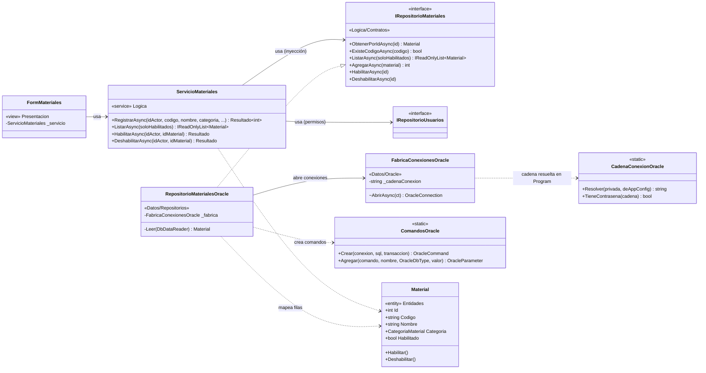
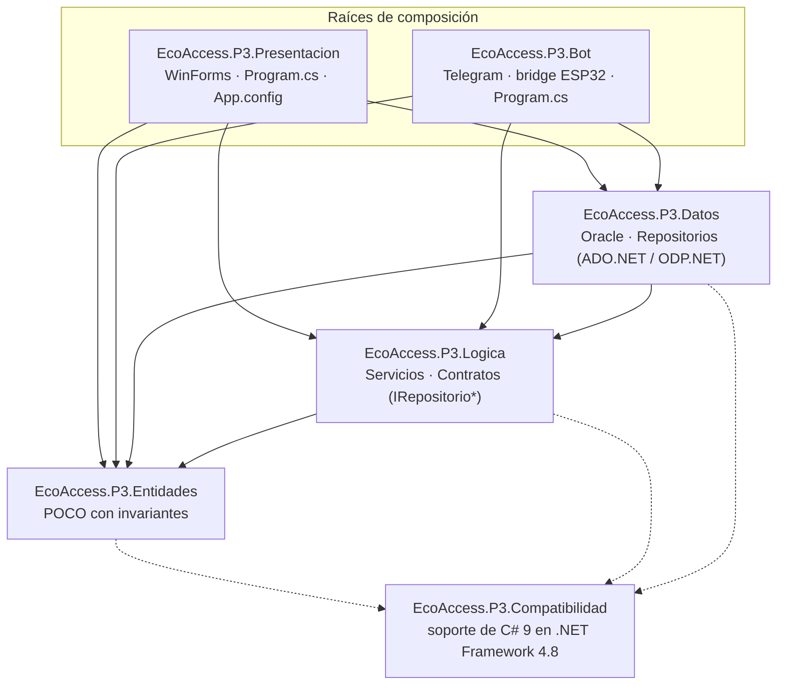
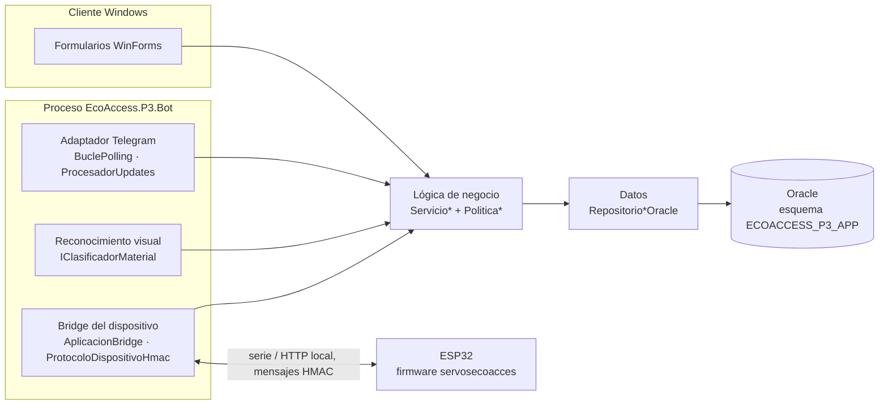
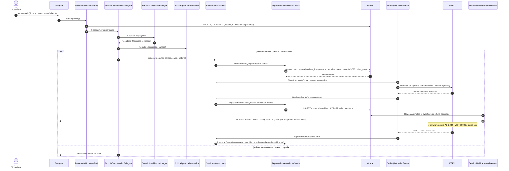
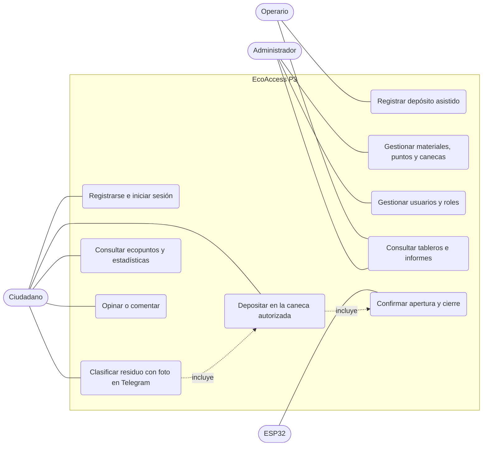
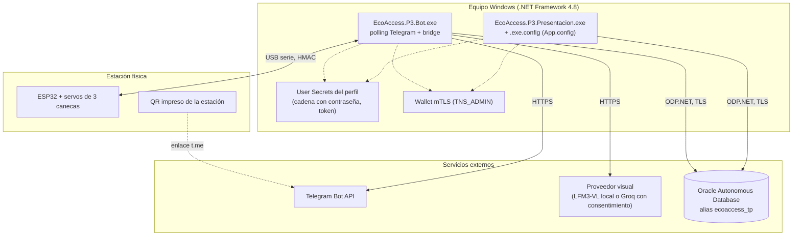
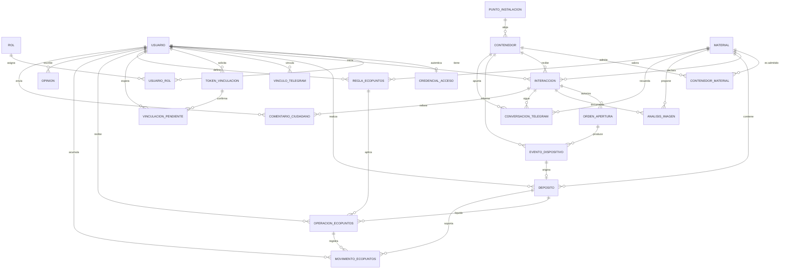
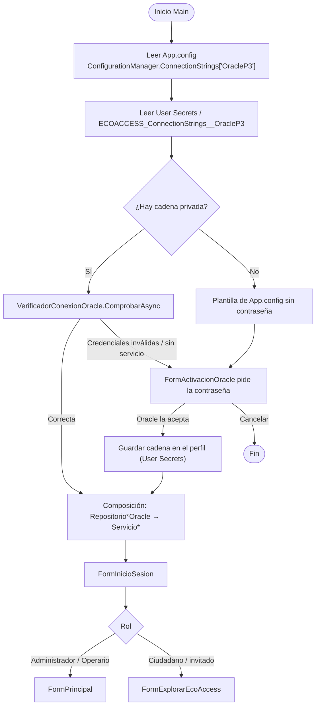
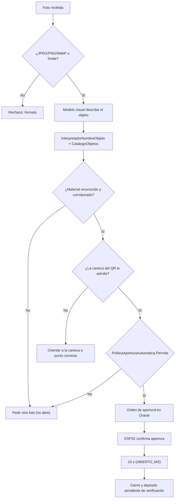
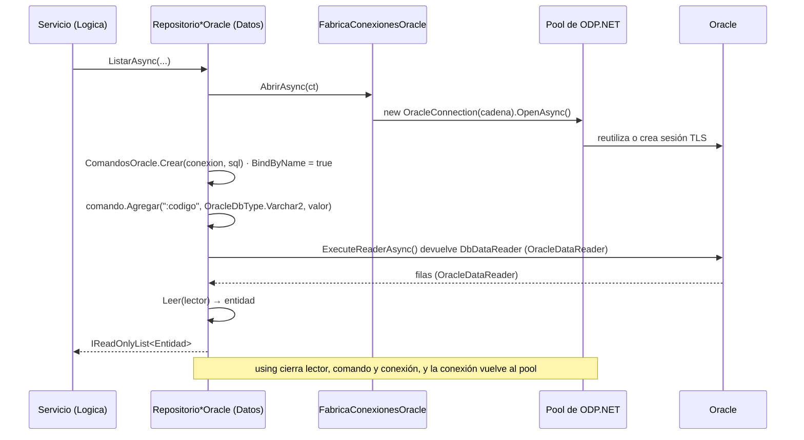

# Diagramas UML del tercer corte — EcoAccess P3

Fuente reproducible: Mermaid (GitHub y VS Code lo dibujan sin instalar nada). Cada diagrama nombra clases, interfaces y
métodos que existen en la rama `desarrollo/auditoria-tercer-corte`; se simplifican parámetros y se omiten miembros que
no aportan a la explicación. El modelo entidad-relación detallado (columnas) sigue en `database/01_modelo/DER.md`.

Versiones exportadas: `docs/academico/diagramas/01_clases.svg` … `10_conexion_oracle.svg`, generadas con Mermaid 10.9.1
(las 10 fuentes de este archivo se dibujaron sin errores el 09/11/2026). Si se cambia un diagrama aquí, se regenera su SVG.

## 1. Diagrama de clases (equivalente EcoAccess del patrón DAO + Repository del curso)

En la guía del curso la cadena es `MainWindow → ProductoService → IProductoRepository → ProductoRepository → IProductoDAO
→ ProductoDAO → Conexion → SQL Server`. En EcoAccess el ejemplo equivalente es el catálogo de materiales:

Diferencia con el curso (justificada en la matriz, criterio C-05): EcoAccess no tiene una clase DAO separada del
Repository. `RepositorioMaterialesOracle` cumple las dos responsabilidades de la guía: ejecuta el SQL con ADO.NET
(papel del DAO) y expone una colección orientada al dominio con interfaz propia (papel del Repository). La interfaz vive en
Lógica y la implementación en Datos (inversión de dependencias), de modo que la Lógica no conoce Oracle.

## 2. Diagrama de paquetes (proyectos y referencias reales de los .csproj)

`PruebasArquitectura.ReferenciasDeProyecto_CoincidenConElDiagramaDeDependencias` falla si un `.csproj` se aparta de este
diagrama.

## 3. Diagrama de componentes

## 4. Diagrama de secuencia: registro y autorización de un depósito

El aviso de los 10 s solo sale después del evento de apertura registrado en Oracle; el cierre lo ejecuta el ESP32 sin
depender de Telegram.

## 5. Diagrama de casos de uso

## 6. Diagrama de despliegue

## 7. Diagrama entidad-relación (todas las tablas con clave foránea)

Tablas sin clave foránea: `UPDATE_TELEGRAM` (deduplicación por `update_id`) y `CONSENTIMIENTO_VISION_EXTERNA`. Las
relaciones se extrajeron de los `REFERENCES` de `database/02_tablas/01_crear_tablas_iniciales.sql` y
`database/06_migraciones/V002…V020`.

## 8. Diagrama de actividad: inicio de la aplicación de escritorio

## 9. Flujo de clasificación y depósito

## 10. Flujo de conexión C# – Oracle (ADO.NET con ODP.NET)

