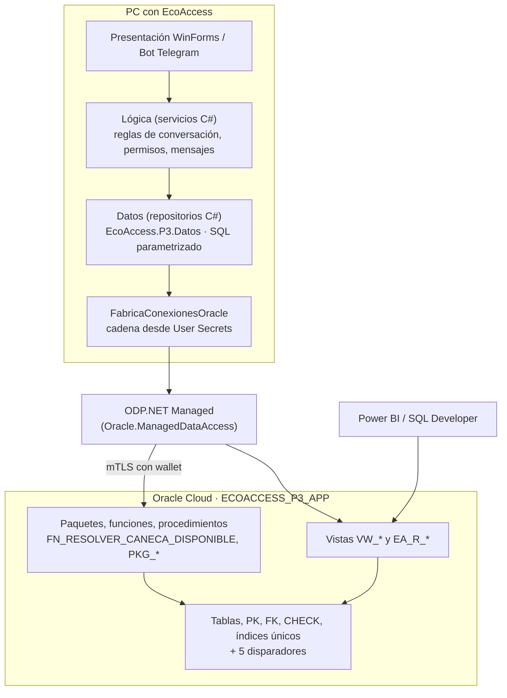

# 01 · Arquitectura y diagnóstico de conexiones

## Qué bases existen realmente (verificado el 18/11/2026)

Hay **dos instancias Oracle distintas**. No se sincronizan solas.

| | **Oracle Cloud** (la oficial) | **Oracle local** del PC de Jorge |
|---|---|---|
| Producto | Autonomous Database 19c, Transaction Processing, *Always Free* (versión 19.33) | Oracle AI Database 26ai Free (versión 23.26.3) |
| Dónde | Oracle Cloud, región Bogotá | `localhost:1521`, servicio `FREEPDB1` (instalación nativa en `C:\app\Usuario\product\26ai\dbhomeFree`, sin Docker) |
| Conexión | Alias `ecoaccess_tp` del wallet (mTLS); servicio `G5AB3C4722E812D_ECOACCESS_tp` | `//localhost:1521/FREEPDB1` |
| Esquemas EcoAccess | **`ECOACCESS_P3_APP`**: dueño de los 191 objetos; lo usan la aplicación, el bot y Power BI | `ECOACCESS_BD` (académico, del curso de Base de Datos), `ECOACCESS_BD_LECTOR` (lectura BI), `ECOACCESS_PRACTICAS` (prácticas de clase), **`ECOACCESS_P3_PRUEBAS`** (copia aislada de la estructura oficial para pruebas) |
| Datos | Reales y de ensayo marcados | De práctica y de prueba |

**Cómo se comprobó**, con consultas de solo lectura sin mostrar contraseñas:
```sql
SELECT SYS_CONTEXT('USERENV','SESSION_USER')   AS usuario,
       SYS_CONTEXT('USERENV','CURRENT_SCHEMA') AS esquema,
       SYS_CONTEXT('USERENV','SERVICE_NAME')   AS servicio,
       SYS_CONTEXT('USERENV','SERVER_HOST')    AS servidor
FROM dual;
```

| Conexión | Usuario | Esquema | Servicio | Servidor |
|---|---|---|---|---|
| Aplicación (User Secrets `ecoaccess-p3-framework`) | `ECOACCESS_P3_APP` | `ECOACCESS_P3_APP` | `G5AB3C4722E812D_ECOACCESS_tp.adb.oraclecloud.com` | nodo de Oracle Cloud |
| Lector local (`ECOACCESS_BD_LECTOR`) | `ECOACCESS_BD_LECTOR` | `ECOACCESS_BD_LECTOR` | `freepdb1` | este PC |
| Pruebas aisladas (User Secrets `ecoaccess-p3-pruebas`) | `ECOACCESS_P3_PRUEBAS` | `ECOACCESS_P3_PRUEBAS` | `FREEPDB1` | este PC |

## SQL Developer y la aplicación **no** miran la misma base

SQL Developer versión 26.2 tiene configuradas cuatro conexiones: `system`, `jorge`, `hr` y **`EcoAccess BD LOCAL`**. Las cuatro apuntan a `localhost:1521/FREEPDB1`.

`EcoAccess BD LOCAL` entra como **`ECOACCESS_BD`**, el esquema académico local. **No es la base de la aplicación.** Lo que se vea o se cambie ahí no aparece en EcoAccess, y al revés. No hay ninguna conexión de SQL Developer a Oracle Cloud configurada en este PC: para ver los datos reales hay que crearla (ver [03-oracle-cloud.md](03-oracle-cloud.md)).

**¿Por qué la captura muestra los mismos nombres?** Los objetos de la captura (las nueve `VW_*`, los cuatro paquetes, los dos procedimientos y las tres funciones) nacieron en `ECOACCESS_BD`. La migración V027 los **llevó a la base oficial**, adaptados a sus columnas reales. Hoy existen en las dos bases con el mismo nombre, pero:
- en Oracle Cloud son la versión **oficial y adaptada**, la que documenta esta carpeta;
- en `ECOACCESS_BD` son la versión **académica original**. No se pudo leer su código: la contraseña guardada de `ECOACCESS_BD` ya no es válida y no se pidió. La cuenta lectora solo ve 6 vistas.

## No hay sincronización automática

Tener archivos SQL parecidos **no** sincroniza dos bases. Hay tres cosas distintas:

| Qué se quiere | Mecanismo en EcoAccess |
|---|---|
| Que dos bases tengan la **misma estructura** | Migraciones numeradas en [`database/06_migraciones/`](../../database/06_migraciones/), aplicadas en orden y registradas en `ECO_MIGRACION_APLICADA` con su huella SHA-256 |
| **Copiar datos** de una a otra | Importación controlada y explícita, por ejemplo datos de demostración. No hay copia automática y no se implementó replicación |
| Que todos vean **los mismos datos en tiempo real** | Conectarse a **una sola base compartida**: Oracle Cloud, Escenario A de [14-guia-companeros.md](14-guia-companeros.md) |

**Comprobación de estructura:** el 18/11/2026 se exportaron con `DBMS_METADATA` la base oficial y el esquema aislado `ECOACCESS_P3_PRUEBAS`, y se compararon objeto por objeto, sin tener en cuenta espacios ni la cláusula `COLLATE`, que 19c muestra y 26ai no.
- **154 objetos son idénticos**: tablas, claves foráneas, índices, vistas, paquetes, procedimientos, funciones y disparadores.
- Solo difieren el texto de 8 comentarios de tabla y una tabla antigua, `REGISTRO_MIGRACION`, que existe solo en el esquema aislado.

## Capas



**Dónde vive cada regla:**
- **Oracle** garantiza lo que no puede romperse nunca: unicidad, integridad, un crédito por depósito, auditoría y la caneca correcta.
- **C#** orquesta la conversación, las transacciones y la comunicación con la caneca.

## Cómo se conecta la aplicación (auditado en el código)

| Aspecto | Implementación real |
|---|---|
| Componente | `src/EcoAccess.P3.Datos/Oracle/FabricaConexionesOracle.cs` abre una conexión nueva por operación; si falla al abrir, la libera. Los 91 usos en los repositorios la reciben con `using`, que la cierra al terminar |
| Driver | `Oracle.ManagedDataAccess` (ODP.NET administrado, sin cliente Oracle instalado) |
| Cadena de conexión | User Secrets de Windows `ecoaccess-p3-framework`, clave `ConnectionStrings:OracleP3`. **No** está en el código, en `App.config` ni en el repositorio |
| Wallet | `%USERPROFILE%\.oracle\wallets\EcoAccess`, fuera del repositorio; `CadenaConexionOracle.cs` fija `TNS_ADMIN` si falta |
| Errores | `TraductorErroresOracle.cs` convierte ORA-00001 (único) en un conflicto con el nombre de la restricción, y ORA-00054/30006/00060 (bloqueo) en un cambio concurrente; los demás errores se propagan. La cadena de conexión nunca va en un mensaje |
| Transacciones | `ExtensionesTransaccionOracle.cs`; 15 repositorios usan `BeginTransaction` explícito |
| SQL | Todas las consultas usan **parámetros vinculados** (`:nombre`). Los fragmentos interpolados con `$"…"` son **constantes del código** (listas de columnas, filtros fijos, agrupaciones de un `switch`), nunca datos de usuarios. Revisado en `RepositorioContenedoresOracle`, `RepositorioEstadisticasOracle`, `RepositorioAuditoriaRecorridoOracle` y `RepositorioCredencialesOracle` |
| PL/SQL | La aplicación invoca `FN_RESOLVER_CANECA_DISPONIBLE`. No invoca `PKG_DEPOSITO` ni `PKG_ECOPUNTOS`: implementa esas reglas en C# (ver [16-hallazgos.md](16-hallazgos.md) H-01) |
| Cuenta | La aplicación entra con `ECOACCESS_P3_APP`, la dueña del esquema. **No** usa ADMIN ni SYS. Tiene solo `CREATE SESSION/TABLE/VIEW/PROCEDURE/SEQUENCE/TRIGGER` y ningún privilegio `ANY` (Prueba A5) |
