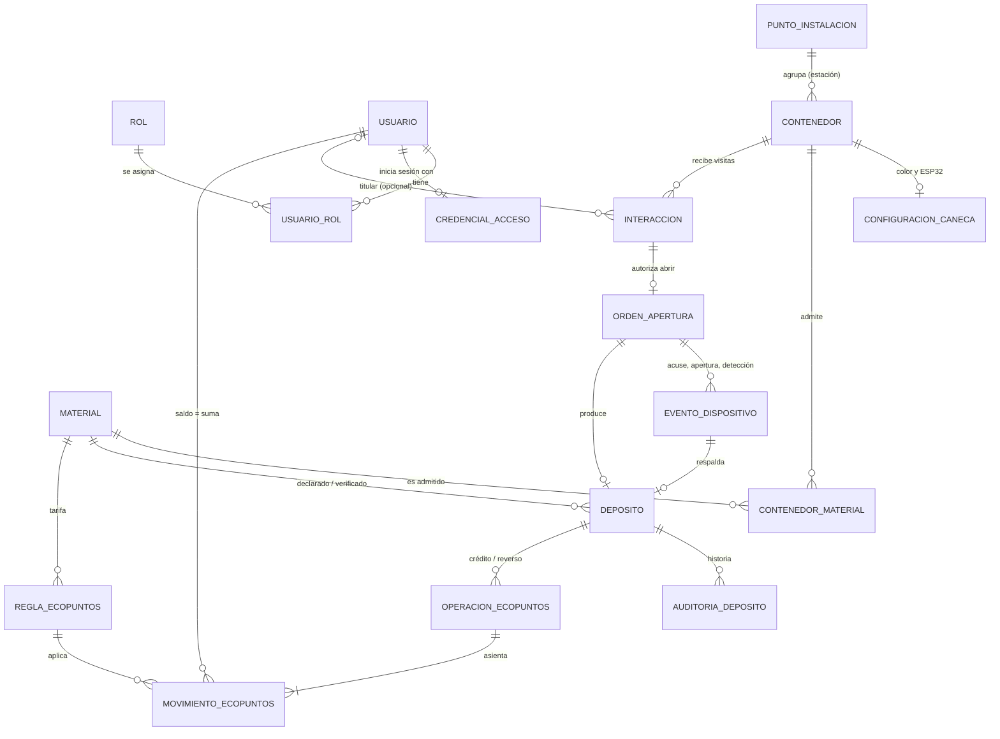

# 05 · Tablas, relaciones y diccionario de datos

Las 33 tablas del esquema oficial `ECOACCESS_P3_APP` (Oracle Cloud). Tipos, nulos y claves salen de `USER_TAB_COLUMNS` y `USER_CONSTRAINTS` (18/11/2026); el significado y el ejemplo están escritos a partir del DDL real, los `CHECK`, los comentarios de Oracle y los enumerados del código C#.

- **Clave:** `PK` = clave primaria, `FK` = clave foránea, `UQ` = forma parte de una restricción única.
- **Ejemplo válido:** un valor que cumple todas las restricciones. **No es un registro real** de la base.
- **Fechas `_UTC`:** se guardan en hora universal. Para verlas en hora de Colombia, se restan 5 horas; las vistas `VW_*` ya hacen esa conversión.
- **DDL de cada tabla:** [`database/schema/tables/`](../../database/schema/tables/); claves foráneas en [`database/schema/constraints/`](../../database/schema/constraints/).

## Mapa de relaciones (núcleo)

**Cómo leerlo en palabras:** una *estación* (`PUNTO_INSTALACION`) tiene tres *canecas* (`CONTENEDOR`), cada una con su color en `CONFIGURACION_CANECA`. Una persona *visita* una caneca (`INTERACCION`). Si el material es admitido, se emite una *orden de apertura*; la caneca envía *eventos*, y si detecta el residuo queda un *depósito*. Un operario lo *verifica*; con una *tarifa* vigente, el ciudadano recibe *ecopuntos* en el libro `MOVIMIENTO_ECOPUNTOS`.

**Claves foráneas compuestas** (más estrictas que una FK simple):
- `DEPOSITO(ID_EVENTO, ID_ORDEN)` → `EVENTO_DISPOSITIVO`: el evento debe ser **de la misma orden**.
- `EVENTO_DISPOSITIVO(ID_ORDEN, ID_CONTENEDOR)` → `ORDEN_APERTURA`: el evento debe venir **de la caneca de la orden**.
- `ORDEN_APERTURA(ID_INTERACCION, ID_CONTENEDOR)` → `INTERACCION`: la orden abre **la caneca de la visita**.
- `MOVIMIENTO_ECOPUNTOS(ID_CREDITO_REVERTIDO, ID_DEPOSITO, ID_USUARIO)` → el mismo libro: un reverso solo anula un crédito **del mismo depósito y del mismo ciudadano**.

## M1 · Catálogos

### ROL

Catálogo de roles aprobados: 1 Ciudadano, 2 Operario, 3 Administrador

| Columna | Tipo | Permite NULL | Clave | Significado sencillo | Ejemplo válido |
|---|---|---|---|---|---|
| `ID_ROL` | NUMBER(10) | No | PK | Número interno del rol. Se genera solo (IDENTITY). | 1 |
| `CODIGO` | NUMBER(2) | No | UQ | Código estable del rol que usa el código: 1 Ciudadano, 2 Operario, 3 Administrador (supervisor). | 2 |
| `DESCRIPCION` | VARCHAR2(200 CHAR) | No | — | Qué puede hacer una persona con ese rol. | Operario: atiende la caneca y verifica el material depositado |

DDL: [`database/schema/tables/rol.sql`](../../database/schema/tables/rol.sql)

### MATERIAL

Catálogo validado de materiales; incluye no admitidos para orientar

| Columna | Tipo | Permite NULL | Clave | Significado sencillo | Ejemplo válido |
|---|---|---|---|---|---|
| `ID_MATERIAL` | NUMBER(10) | No | PK | Número que identifica cada tipo de residuo del catálogo. Se genera solo (IDENTITY). | 12 |
| `CODIGO` | VARCHAR2(30 CHAR) | No | UQ | Código corto en mayúsculas que usan el bot, la app y las tarifas. | PET |
| `NOMBRE` | VARCHAR2(100 CHAR) | No | — | Nombre que ve el ciudadano. | Botella plástica PET |
| `CATEGORIA` | NUMBER(1) | No | — | A qué caneca va: 1 blanca (aprovechable), 2 verde (orgánico), 3 negra (no aprovechable), 4 ruta especial (peligroso, no va a las canecas). | 1 |
| `DESCRIPCION` | VARCHAR2(500 CHAR) | Sí | — | Explicación corta del material. | Envase de bebida transparente |
| `HABILITADO` | NUMBER(1) | No | — | 1 si se puede elegir; 0 si se retiró del catálogo sin borrarlo. | 1 |
| `SINONIMOS` | VARCHAR2(300 CHAR) | Sí | — | Otras palabras con las que se busca el material. | botella, gaseosa |
| `PRECAUCIONES` | VARCHAR2(500 CHAR) | Sí | — | Cómo manipularlo (vaciar, secar, no romper…). | Vaciar y aplastar |
| `RUTA_SEPARACION` | VARCHAR2(150 CHAR) | Sí | — | Dónde llevarlo si no va a las canecas (pilas, medicamentos…). | Punto posconsumo de pilas |

DDL: [`database/schema/tables/material.sql`](../../database/schema/tables/material.sql)

### PESO_REFERENCIAL

Pesos típicos de objetos comunes para ESTIMAR (nunca medir) el peso de un depósito a partir de una foto.

**Relaciones:** `ID_MATERIAL` → `MATERIAL` (FK_PESO_MATERIAL).

| Columna | Tipo | Permite NULL | Clave | Significado sencillo | Ejemplo válido |
|---|---|---|---|---|---|
| `ID_PESO_REFERENCIAL` | NUMBER(10) | No | PK | Número de la referencia de peso. Se genera solo (IDENTITY). | 3 |
| `ID_MATERIAL` | NUMBER(10) | No | FK | Material al que pertenece el objeto de referencia. | 12 |
| `CLAVE_OBJETO` | VARCHAR2(40 CHAR) | No | UQ | Objeto típico que se reconoce en una foto. | BOTELLA_PET_600ML |
| `DESCRIPCION_OBJETO` | VARCHAR2(150 CHAR) | No | — | Descripción del objeto típico. | Botella PET de 600 ml |
| `ESTADO_VISUAL` | NUMBER(1) | No | UQ | Código 0 a 3 del estado en que se ve el objeto en la foto; con CLAVE_OBJETO forma una clave única (mismo objeto, distinto estado, distinto peso). | 1 |
| `GRAMOS_MINIMO` | NUMBER(8,1) | No | — | Peso menor esperado de una unidad, en gramos. | 18 |
| `GRAMOS_TIPICO` | NUMBER(8,1) | No | — | Peso habitual de una unidad; es el que usa FN_PESO_ESTIMADO_KG. | 22 |
| `GRAMOS_MAXIMO` | NUMBER(8,1) | No | — | Peso mayor esperado de una unidad. | 28 |
| `FUENTE` | VARCHAR2(200 CHAR) | No | — | De dónde sale el dato (referencia bibliográfica o medición). | Ficha técnica del fabricante |

DDL: [`database/schema/tables/peso_referencial.sql`](../../database/schema/tables/peso_referencial.sql)

### PUNTO_DISPOSICION

Lugares y programas oficiales de Valledupar para residuos que no van a las canecas (pilas, medicamentos…).

| Columna | Tipo | Permite NULL | Clave | Significado sencillo | Ejemplo válido |
|---|---|---|---|---|---|
| `CODIGO` | VARCHAR2(40) | No | PK | Identificador de un lugar o programa de Valledupar que recibe residuos especiales. | PILAS_VALLEDUPAR |
| `NOMBRE` | VARCHAR2(160) | No | — | Nombre del lugar o programa. | Programa Pilas con el Ambiente |
| `DIRECCION` | VARCHAR2(200) | Sí | — | Dirección física; vacía cuando solo existe el programa (estado SOLO_PROGRAMA). | Cra. 9 # 16-50 |
| `MUNICIPIO` | VARCHAR2(60) | No | — | Municipio. | Valledupar |
| `RUTAS` | VARCHAR2(200) | No | — | Rutas de separación que atiende (las de MATERIAL.RUTA_SEPARACION). | PILAS |
| `RECIBE` | VARCHAR2(400) | No | — | Qué residuos recibe, en palabras simples. | Pilas y baterías pequeñas |
| `ESTADO` | VARCHAR2(30) | No | — | Qué tan confirmado está: CONFIRMADO, LISTADO_SIN_CONFIRMAR o SOLO_PROGRAMA. | CONFIRMADO |
| `FUENTE` | VARCHAR2(400) | No | — | Página web oficial que respalda el dato (debe empezar por https://). | https://… |
| `FECHA_VERIFICACION` | DATE | No | — | Día en que se revisó la fuente. | 2026-11-17 |
| `HORARIO` | VARCHAR2(200) | Sí | — | Horario de atención, si se conoce. | Lunes a viernes 8:00–17:00 |
| `ACTIVO` | NUMBER(1) | No | — | 1 si se muestra a los ciudadanos. | 1 |

DDL: [`database/schema/tables/punto_disposicion.sql`](../../database/schema/tables/punto_disposicion.sql)

## M2 · Usuarios y acceso

### USUARIO

Cuenta de una persona; sin contraseñas (van en otra tabla, ADR-024)

| Columna | Tipo | Permite NULL | Clave | Significado sencillo | Ejemplo válido |
|---|---|---|---|---|---|
| `ID_USUARIO` | NUMBER(10) | No | PK | Número que identifica a cada persona registrada en EcoAccess. Se genera solo (IDENTITY). | 4470 |
| `NOMBRE` | VARCHAR2(100 CHAR) | No | — | Nombre con el que la persona se registró. | Ana Pérez |
| `CORREO_ELECTRONICO` | VARCHAR2(254 CHAR) | No | UQ | Correo de inicio de sesión; se guarda en minúsculas y no se repite entre cuentas. | ana@ejemplo.invalid |
| `FECHA_REGISTRO_UTC` | TIMESTAMP(6) | No | — | Momento en que se creó la cuenta, en hora UTC (Colombia = UTC − 5). | 2026-11-09 21:00:00 |
| `ACTIVO` | NUMBER(1) | No | — | 1 si la cuenta puede usarse; 0 si fue desactivada (no se borra). | 1 |
| `VERSION_CONSENTIMIENTO` | VARCHAR2(20 CHAR) | Sí | — | Versión del aviso de tratamiento de datos que la persona aceptó. | 2026-11 |
| `FECHA_CONSENTIMIENTO_UTC` | TIMESTAMP(6) | Sí | — | Cuándo aceptó ese aviso; va junto con la versión o ambas quedan vacías. | 2026-11-09 21:00:00 |

DDL: [`database/schema/tables/usuario.sql`](../../database/schema/tables/usuario.sql)

### USUARIO_ROL

Roles de cada usuario; una cuenta puede tener varios

**Relaciones:** `ID_ROL` → `ROL` (FK_USUARIO_ROL_ROL); `ID_USUARIO` → `USUARIO` (FK_USUARIO_ROL_USUARIO).

| Columna | Tipo | Permite NULL | Clave | Significado sencillo | Ejemplo válido |
|---|---|---|---|---|---|
| `ID_USUARIO` | NUMBER(10) | No | PK, FK | Persona a la que se le asigna el rol. | 4470 |
| `ID_ROL` | NUMBER(10) | No | PK, FK | Rol asignado (ver ROL). Una persona puede tener varios. | 1 |
| `FECHA_ASIGNACION_UTC` | TIMESTAMP(6) | No | — | Metadato técnico; la evidencia de quién asignó el rol va en auditoría (ADR-027) | 2026-11-09 21:00:00 |

DDL: [`database/schema/tables/usuario_rol.sql`](../../database/schema/tables/usuario_rol.sql)

### CREDENCIAL_ACCESO

Contraseña de inicio de sesión de la GUI: hash PBKDF2-SHA256 con sal (ADR-034). Nunca la contraseña.

**Relaciones:** `ID_USUARIO` → `USUARIO` (FK_CREDENCIAL_USUARIO).

| Columna | Tipo | Permite NULL | Clave | Significado sencillo | Ejemplo válido |
|---|---|---|---|---|---|
| `ID_USUARIO` | NUMBER(10) | No | PK, FK | Cuenta dueña de esta contraseña (una credencial por cuenta). | 4470 |
| `HASH_CONTRASENA` | RAW(32) | No | — | Resultado PBKDF2-SHA256 de la contraseña. La contraseña nunca se guarda. | (32 bytes binarios) |
| `SAL` | RAW(16) | No | — | Valor aleatorio que hace distinto el hash aunque dos personas usen la misma contraseña. | (16 bytes binarios) |
| `ITERACIONES` | NUMBER(7) | No | — | Veces que se repitió el cálculo del hash; el CHECK exige al menos 100 000. | 100000 |
| `INTENTOS_FALLIDOS` | NUMBER(3) | No | — | Contraseñas incorrectas seguidas; al llegar al límite se bloquea un tiempo. | 0 |
| `BLOQUEADA_HASTA_UTC` | TIMESTAMP(6) | Sí | — | Hasta cuándo no se admite iniciar sesión; vacío si no está bloqueada. | NULL |
| `FECHA_CAMBIO_UTC` | TIMESTAMP(6) | No | — | Último cambio de contraseña. | 2026-11-10 14:00:00 |

DDL: [`database/schema/tables/credencial_acceso.sql`](../../database/schema/tables/credencial_acceso.sql)

## M3 · Estaciones y canecas

### PUNTO_INSTALACION

Lugar físico donde se instalan las canecas

| Columna | Tipo | Permite NULL | Clave | Significado sencillo | Ejemplo válido |
|---|---|---|---|---|---|
| `ID_PUNTO_INSTALACION` | NUMBER(10) | No | PK | Número de la estación (el lugar donde están las tres canecas). Se genera solo (IDENTITY). | 1 |
| `NOMBRE` | VARCHAR2(100 CHAR) | No | UQ | Nombre de la estación; no se repite. | EcoAccess P3 — Estación piloto |
| `REFERENCIA_UBICACION` | VARCHAR2(200 CHAR) | Sí | — | Indicación para encontrarla. | Bloque de ingenierías, primer piso |
| `ACTIVO` | NUMBER(1) | No | — | 1 si la estación está operando; FN_RESOLVER_CANECA_DISPONIBLE rechaza estaciones inactivas. | 1 |

DDL: [`database/schema/tables/punto_instalacion.sql`](../../database/schema/tables/punto_instalacion.sql)

### CONTENEDOR

Caneca física de un compartimiento y su QR público

**Relaciones:** `ID_PUNTO_INSTALACION` → `PUNTO_INSTALACION` (FK_CONTENEDOR_PUNTO).

| Columna | Tipo | Permite NULL | Clave | Significado sencillo | Ejemplo válido |
|---|---|---|---|---|---|
| `ID_CONTENEDOR` | NUMBER(10) | No | PK | Número de cada caneca física. Se genera solo (IDENTITY). | 1093 |
| `ID_PUNTO_INSTALACION` | NUMBER(10) | No | FK | Estación en la que está la caneca. | 1 |
| `NOMBRE` | VARCHAR2(100 CHAR) | No | — | Nombre visible de la caneca. | EcoAccess · Caneca verde |
| `IDENTIFICADOR_QR` | VARCHAR2(64 CHAR) | No | UQ | Texto del QR público (parámetro start del enlace de Telegram). No da permisos por sí solo. | (16 a 64 letras, dígitos, _ o -) |
| `FECHA_ALTA_UTC` | TIMESTAMP(6) | No | — | Cuándo se registró la caneca. | 2026-11-09 21:00:00 |
| `ESTADO` | NUMBER(1) | No | — | 1 en servicio, 2 fuera de servicio, 3 dada de baja. | 1 |

DDL: [`database/schema/tables/contenedor.sql`](../../database/schema/tables/contenedor.sql)

### CONTENEDOR_MATERIAL

Materiales que admite cada caneca

**Relaciones:** `ID_CONTENEDOR` → `CONTENEDOR` (FK_CONT_MATERIAL_CONTENEDOR); `ID_MATERIAL` → `MATERIAL` (FK_CONT_MATERIAL_MATERIAL).

| Columna | Tipo | Permite NULL | Clave | Significado sencillo | Ejemplo válido |
|---|---|---|---|---|---|
| `ID_CONTENEDOR` | NUMBER(10) | No | PK, FK | Caneca. | 1400 |
| `ID_MATERIAL` | NUMBER(10) | No | PK, FK | Material que esa caneca acepta. Si el par no está aquí, la caneca no abre para ese material. | 7 |

DDL: [`database/schema/tables/contenedor_material.sql`](../../database/schema/tables/contenedor_material.sql)

### CONFIGURACION_CANECA

Color (por categoría), dispositivo y ubicación de cada caneca de una estación de tres canecas.

**Relaciones:** `ID_CONTENEDOR` → `CONTENEDOR` (FK_CONFIGURACION_CONTENEDOR).

| Columna | Tipo | Permite NULL | Clave | Significado sencillo | Ejemplo válido |
|---|---|---|---|---|---|
| `ID_CONTENEDOR` | NUMBER(10) | No | PK, FK | Caneca configurada (una fila por caneca). | 1401 |
| `CATEGORIA` | NUMBER(1) | No | — | Color de la caneca: 1 blanca, 2 verde, 3 negra. Es la misma escala que MATERIAL.CATEGORIA. | 3 |
| `IDENTIFICADOR_DISPOSITIVO` | VARCHAR2(40 CHAR) | Sí | UQ | Nombre del ESP32 que abre esta caneca; no se repite. | ECO-NEGRA-01 |
| `UBICACION_EN_ESTACION` | VARCHAR2(60 CHAR) | Sí | — | Posición dentro de la estación. | Derecha |
| `FECHA_ACTUALIZACION_UTC` | TIMESTAMP(6) | No | — | Último cambio de la configuración. | 2026-11-11 15:00:00 |

DDL: [`database/schema/tables/configuracion_caneca.sql`](../../database/schema/tables/configuracion_caneca.sql)

### HISTORIAL_ESTADO_CONTENEDOR

Historia de los cambios de estado de cada caneca (la llena TRG_CONTENEDOR_AUD_ESTADO).

**Relaciones:** `ID_ACTOR` → `USUARIO` (FK_HISTORIAL_ACTOR); `ID_CONTENEDOR` → `CONTENEDOR` (FK_HISTORIAL_CONTENEDOR).

| Columna | Tipo | Permite NULL | Clave | Significado sencillo | Ejemplo válido |
|---|---|---|---|---|---|
| `ID_HISTORIAL` | NUMBER(10) | No | PK | Número del cambio registrado. Se genera solo (IDENTITY). | 1 |
| `ID_CONTENEDOR` | NUMBER(10) | No | FK | Caneca que cambió de estado. | 1400 |
| `ESTADO_ANTERIOR` | NUMBER(1) | No | — | Estado antes del cambio (1, 2 o 3). | 1 |
| `ESTADO_NUEVO` | NUMBER(1) | No | — | Estado después del cambio. | 2 |
| `ID_ACTOR` | NUMBER(10) | Sí | FK | Persona de EcoAccess que hizo el cambio (la fija PKG_CONTEXTO_APP); vacío si se cambió fuera de la aplicación. | 1 |
| `USUARIO_BD` | VARCHAR2(128 CHAR) | No | — | Cuenta de Oracle con que se hizo el cambio. | ECOACCESS_P3_APP |
| `MOTIVO` | VARCHAR2(300 CHAR) | Sí | — | Por qué se cambió. | Mantenimiento del servo |
| `FECHA_UTC` | TIMESTAMP(6) | No | — | Cuándo se cambió. | 2026-11-18 15:00:00 |

DDL: [`database/schema/tables/historial_estado_contenedor.sql`](../../database/schema/tables/historial_estado_contenedor.sql)

## M4 · Operación: visita, apertura, depósito

### INTERACCION

Visita a una caneca por un canal; la sugerencia de la IA no es material verificado (ADR-035).

**Relaciones:** `ID_CONTENEDOR` → `CONTENEDOR` (FK_INTERACCION_CONTENEDOR); `ID_MATERIAL_CONFIRMADO` → `MATERIAL` (FK_INTERACCION_MAT_CONFIRMADO); `ID_MATERIAL_SUGERIDO` → `MATERIAL` (FK_INTERACCION_MAT_SUGERIDO); `ID_OPERARIO` → `USUARIO` (FK_INTERACCION_OPERARIO); `ID_USUARIO` → `USUARIO` (FK_INTERACCION_USUARIO).

| Columna | Tipo | Permite NULL | Clave | Significado sencillo | Ejemplo válido |
|---|---|---|---|---|---|
| `ID_INTERACCION` | NUMBER(10) | No | PK, UQ | Número de cada visita de una persona a una caneca. Se genera solo (IDENTITY). | 2410 |
| `ID_CONTENEDOR` | NUMBER(10) | No | FK, UQ | Caneca visitada. | 1093 |
| `ID_USUARIO` | NUMBER(10) | Sí | FK | Ciudadano identificado; NULL para un visitante o una apertura manual. | 4470 |
| `CANAL` | NUMBER(1) | No | — | CanalInteraccion: 1 Telegram, 2 Manual, 3 Simulador escritorio, 4 Telegram simulado con sesion privada. | 1 |
| `ESTADO` | NUMBER(1) | No | — | 1 iniciada, 2 autorizada, 3 con depósito, 4 sin depósito, 5 rechazada. | 3 |
| `ID_MATERIAL_SUGERIDO` | NUMBER(10) | Sí | FK | Material que sugirió la clasificación por imagen; solo orienta. | 12 |
| `CONFIANZA_SUGERIDA` | NUMBER(4,3) | Sí | — | Confianza de la sugerencia, de 0 a 1. | 0.910 |
| `ID_MATERIAL_CONFIRMADO` | NUMBER(10) | Sí | FK | Material que la persona confirmó y que se autorizó en la caneca (RN-06). | 12 |
| `ID_OPERARIO` | NUMBER(10) | Sí | FK | Operario que hizo la apertura manual (CU-17). | NULL |
| `MOTIVO` | VARCHAR2(300 CHAR) | Sí | — | Motivo de la apertura manual o del rechazo. | NULL |
| `FECHA_INICIO_UTC` | TIMESTAMP(6) | No | — | Cuándo empezó la visita. | 2026-11-18 22:41:00 |
| `FECHA_CIERRE_UTC` | TIMESTAMP(6) | Sí | — | Cuándo terminó; vacía mientras está en estado 1 o 2. | 2026-11-18 22:43:00 |
| `CANTIDAD_DECLARADA` | NUMBER(4) | Sí | — | Unidades declaradas, sin verificación física. NULL = no capturadas. No determina ecopuntos. | 2 |

DDL: [`database/schema/tables/interaccion.sql`](../../database/schema/tables/interaccion.sql)

### ORDEN_APERTURA

Autorización para abrir una caneca; abrirla no es reciclar (RN-07, RN-14, RN-16).

**Relaciones:** `ID_INTERACCION,ID_CONTENEDOR` → `INTERACCION` (FK_ORDEN_INTERACCION).

| Columna | Tipo | Permite NULL | Clave | Significado sencillo | Ejemplo válido |
|---|---|---|---|---|---|
| `ID_ORDEN` | NUMBER(10) | No | PK, UQ | Número de la autorización para abrir una caneca. Se genera solo (IDENTITY). | 116 |
| `ID_INTERACCION` | NUMBER(10) | No | FK, UQ | Visita a la que pertenece la orden. | 2410 |
| `ID_CONTENEDOR` | NUMBER(10) | No | FK, UQ | Caneca de la interacción; se repite para poder indexar la orden vigente. | 1093 |
| `CLAVE_IDEMPOTENCIA` | VARCHAR2(64 CHAR) | No | UQ | Clave del canal: repetir la solicitud con la misma clave devuelve la misma orden. | (8 a 64 caracteres) |
| `ESTADO` | NUMBER(1) | No | — | EstadoOrdenApertura: 1 Emitida, 2 Enviada, 3 Acusada, 4 Abierta, 5 Detectada, 6 Cerrada, 7 Vencida, 8 Fallida. | 6 |
| `FECHA_EMISION_UTC` | TIMESTAMP(6) | No | — | Cuándo se emitió la orden. | 2026-11-18 22:41:10 |
| `FECHA_VENCIMIENTO_UTC` | TIMESTAMP(6) | No | — | Después de esta hora la orden no se reenvía ni admite un depósito. | 2026-11-18 22:43:10 |
| `FECHA_CIERRE_UTC` | TIMESTAMP(6) | Sí | — | Cuándo terminó la orden (estados 6, 7 u 8). | 2026-11-18 22:42:30 |

DDL: [`database/schema/tables/orden_apertura.sql`](../../database/schema/tables/orden_apertura.sql)

### EVENTO_DISPOSITIVO

Evento recibido de una caneca ya autenticada por el adaptador (RN-20, ADR-010).

**Relaciones:** `ID_CONTENEDOR` → `CONTENEDOR` (FK_EVENTO_CONTENEDOR); `ID_ORDEN,ID_CONTENEDOR` → `ORDEN_APERTURA` (FK_EVENTO_ORDEN).

| Columna | Tipo | Permite NULL | Clave | Significado sencillo | Ejemplo válido |
|---|---|---|---|---|---|
| `ID_EVENTO` | NUMBER(10) | No | PK, UQ | Número de cada mensaje recibido de una caneca. Se genera solo (IDENTITY). | 376 |
| `ID_CONTENEDOR` | NUMBER(10) | No | FK, UQ | Caneca que envió el mensaje. | 1093 |
| `ID_EXTERNO` | VARCHAR2(64 CHAR) | No | UQ | Id que asigna el dispositivo; el mismo id en la misma caneca es una retransmisión. | ECO-BLANCA-01-000123 |
| `TIPO` | NUMBER(1) | No | — | TipoEventoDispositivo: 1 Acuse, 2 Apertura, 3 Deteccion, 4 Cierre, 5 Fallo. | 3 |
| `ID_ORDEN` | NUMBER(10) | Sí | FK, UQ | Orden a la que se aplicó el evento; vacía si no correspondía a ninguna. | 116 |
| `RESULTADO` | NUMBER(1) | No | — | ResultadoEvento: 1 Aplicado a la orden, 2 Revision. | 1 |
| `FECHA_DISPOSITIVO_UTC` | TIMESTAMP(6) | Sí | — | Hora según el reloj de la caneca; puede faltar o no ser fiable. | NULL |
| `FECHA_RECEPCION_UTC` | TIMESTAMP(6) | No | — | Hora UTC del servidor; es la que cuenta para la ventana de la orden. | 2026-11-18 22:42:00 |

DDL: [`database/schema/tables/evento_dispositivo.sql`](../../database/schema/tables/evento_dispositivo.sql)

### DEPOSITO

Depósito confirmado por el sensor dentro de la ventana de una orden vigente (RN-08, RN-17).

**Relaciones:** `ID_EVENTO,ID_ORDEN` → `EVENTO_DISPOSITIVO` (FK_DEPOSITO_EVENTO); `ID_MATERIAL_DECLARADO` → `MATERIAL` (FK_DEPOSITO_MAT_DECLARADO); `ID_MATERIAL_VERIFICADO` → `MATERIAL` (FK_DEPOSITO_MAT_VERIFICADO); `ID_VERIFICADOR` → `USUARIO` (FK_DEPOSITO_VERIFICADOR).

| Columna | Tipo | Permite NULL | Clave | Significado sencillo | Ejemplo válido |
|---|---|---|---|---|---|
| `ID_DEPOSITO` | NUMBER(10) | No | PK | Número de cada depósito registrado. Se genera solo (IDENTITY). | 113 |
| `ID_ORDEN` | NUMBER(10) | No | FK, UQ | Orden de apertura que permitió el depósito; una orden produce como máximo un depósito. | 116 |
| `ID_EVENTO` | NUMBER(10) | No | FK, UQ | Evento del sensor (o de «depósito sin sensor») que lo respalda; no se repite. | 376 |
| `ID_MATERIAL_DECLARADO` | NUMBER(10) | No | FK | Material confirmado por la persona al pedir la apertura; no está verificado. | 12 |
| `ID_MATERIAL_VERIFICADO` | NUMBER(10) | Sí | FK | Material comprobado por un operario; NULL mientras nadie lo verifique. | 12 |
| `ID_VERIFICADOR` | NUMBER(10) | Sí | FK | Operario o administrador que verificó el depósito; vacío mientras está pendiente. | 2 |
| `FECHA_VERIFICACION_UTC` | TIMESTAMP(6) | Sí | — | Cuándo se verificó; no puede ser anterior a la detección. | 2026-11-18 23:00:00 |
| `PESO_MEDIDO_KG` | NUMBER(6,3) | Sí | — | Peso medido por una báscula; NULL si no se midió (RN-12, ADR-012). | NULL |
| `PESO_ESTIMADO_KG` | NUMBER(6,3) | Sí | — | Estimación (por imagen u otra fuente); nunca se suma como kilogramos reales. | 0.044 |
| `FECHA_DETECCION_UTC` | TIMESTAMP(6) | No | — | Cuándo se detectó el depósito. | 2026-11-18 22:42:00 |
| `CANTIDAD_VERIFICADA` | NUMBER(4) | Sí | — | Conteo independiente con el responsable y fecha de verificacion; no se copia de la declaracion. | 2 |
| `SIN_SENSOR` | NUMBER(1) | No | — | 1 si el depósito se declaró sin que el sensor lo detectara (modo software); 0 si lo detectó el sensor. | 0 |

DDL: [`database/schema/tables/deposito.sql`](../../database/schema/tables/deposito.sql)

### AUDITORIA_DEPOSITO

Historia de cada verificación, rechazo, reapertura o corrección de un depósito (la llenan TRG_DEPOSITO_AUD_VERIFICACION y PKG_DEPOSITO).

**Relaciones:** `ID_ACTOR` → `USUARIO` (FK_AUDITORIA_ACTOR); `ID_DEPOSITO` → `DEPOSITO` (FK_AUDITORIA_DEPOSITO).

| Columna | Tipo | Permite NULL | Clave | Significado sencillo | Ejemplo válido |
|---|---|---|---|---|---|
| `ID_AUDITORIA` | NUMBER(10) | No | PK | Número del registro de auditoría. Se genera solo (IDENTITY). | 1 |
| `ID_DEPOSITO` | NUMBER(10) | No | FK | Depósito auditado. | 113 |
| `OPERACION` | VARCHAR2(12 CHAR) | No | — | Qué pasó: VERIFICACION, RECHAZO, REAPERTURA o CORRECCION. | VERIFICACION |
| `ESTADO_ANTERIOR` | NUMBER(1) | No | — | Estado antes: 0 pendiente, 1 verificado, 2 rechazado. | 0 |
| `ESTADO_NUEVO` | NUMBER(1) | No | — | Estado después. | 1 |
| `ID_MATERIAL_VERIFICADO_ANTERIOR` | NUMBER(10) | Sí | — | Material verificado antes del cambio. | NULL |
| `ID_MATERIAL_VERIFICADO_NUEVO` | NUMBER(10) | Sí | — | Material verificado después del cambio. | 12 |
| `CANTIDAD_ANTERIOR` | NUMBER(4) | Sí | — | Unidades verificadas antes. | NULL |
| `CANTIDAD_NUEVA` | NUMBER(4) | Sí | — | Unidades verificadas después. | 2 |
| `PESO_MEDIDO_ANTERIOR_KG` | NUMBER(9,4) | Sí | — | Peso medido antes, en kg. | NULL |
| `PESO_MEDIDO_NUEVO_KG` | NUMBER(9,4) | Sí | — | Peso medido después, en kg. | 0.044 |
| `ID_VERIFICADOR_ANTERIOR` | NUMBER(10) | Sí | — | Verificador antes del cambio. | NULL |
| `ID_VERIFICADOR_NUEVO` | NUMBER(10) | Sí | — | Verificador después del cambio. | 2 |
| `ID_ACTOR` | NUMBER(10) | Sí | FK | Persona de EcoAccess responsable del cambio. | 2 |
| `USUARIO_BD` | VARCHAR2(128 CHAR) | No | — | Cuenta de Oracle que ejecutó el cambio. | ECOACCESS_P3_APP |
| `MOTIVO` | VARCHAR2(300 CHAR) | Sí | — | Explicación; obligatoria para rechazos y correcciones. | No corresponde a la caneca |
| `FECHA_UTC` | TIMESTAMP(6) | No | — | Cuándo se registró. | 2026-11-18 23:00:00 |

DDL: [`database/schema/tables/auditoria_deposito.sql`](../../database/schema/tables/auditoria_deposito.sql)

## M5 · Ecopuntos

### REGLA_ECOPUNTOS

Versiones de tarifa; crear una versión nueva, nunca modificar la que respalda movimientos

**Relaciones:** `ID_MATERIAL` → `MATERIAL` (SYS_C0025305); `ID_CREADOR` → `USUARIO` (SYS_C0025306).

| Columna | Tipo | Permite NULL | Clave | Significado sencillo | Ejemplo válido |
|---|---|---|---|---|---|
| `ID_REGLA` | NUMBER(10) | No | PK | Número de la tarifa. Se genera solo (IDENTITY). | 3 |
| `ID_MATERIAL` | NUMBER(10) | No | FK | Material al que se aplica la tarifa. | 12 |
| `PUNTOS` | NUMBER(7) | No | — | Ecopuntos que da la tarifa (por depósito o por unidad); de 1 a 1 000 000. | 4 |
| `DESCRIPCION` | VARCHAR2(200 CHAR) | No | — | Explicación de la tarifa. | PET por unidad verificada |
| `DESDE_UTC` | TIMESTAMP(6) | No | — | Desde cuándo rige. | 2026-11-11 15:57:00 |
| `HASTA_UTC` | TIMESTAMP(6) | Sí | — | Hasta cuándo rige; vacío = vigente. Una tarifa usada no se cambia: se cierra y se crea otra. | NULL |
| `ID_CREADOR` | NUMBER(10) | No | FK | Administrador que creó la tarifa. | 1 |
| `CREADA_UTC` | TIMESTAMP(6) | No | — | Cuándo se creó. | 2026-11-11 15:57:00 |
| `POR_UNIDAD` | NUMBER(1) | No | — | 0 tarifa por deposito historica, 1 tarifa por unidad verificada. | 1 |

DDL: [`database/schema/tables/regla_ecopuntos.sql`](../../database/schema/tables/regla_ecopuntos.sql)

### OPERACION_ECOPUNTOS

Encabezado de cada operación de ecopuntos (crédito, reverso o corrección), con clave única para no repetirla.

**Relaciones:** `ID_CREDITO` → `MOVIMIENTO_ECOPUNTOS` (FK_ECOP_CREDITO_OBJETIVO); `ID_DEPOSITO` → `DEPOSITO` (SYS_C0025320); `ID_ACTOR` → `USUARIO` (SYS_C0025321); `ID_REGLA` → `REGLA_ECOPUNTOS` (SYS_C0025322).

| Columna | Tipo | Permite NULL | Clave | Significado sencillo | Ejemplo válido |
|---|---|---|---|---|---|
| `ID_OPERACION` | NUMBER(10) | No | PK, UQ | Número de la operación sobre ecopuntos (acreditar, revertir o corregir). Se genera solo (IDENTITY). | 1 |
| `CLAVE` | VARCHAR2(80 CHAR) | No | UQ | Clave única de la operación: repetirla no acredita dos veces (idempotencia). | BD-CRED-113 |
| `TIPO` | NUMBER(1) | No | — | 1 crédito, 2 reverso, 3 corrección. | 1 |
| `ID_DEPOSITO` | NUMBER(10) | No | FK, UQ | Depósito al que se refiere. | 113 |
| `ID_ACTOR` | NUMBER(10) | No | FK | Operario o administrador que la hizo. | 2 |
| `ID_CREDITO` | NUMBER(10) | Sí | FK | Crédito que se revierte o corrige (tipos 2 y 3). | NULL |
| `ID_REGLA` | NUMBER(10) | Sí | FK | Tarifa usada (tipos 1 y 3). | 3 |
| `MOTIVO` | VARCHAR2(300 CHAR) | No | — | Explicación obligatoria. | Crédito por depósito verificado |
| `FECHA_UTC` | TIMESTAMP(6) | No | — | Cuándo se hizo. | 2026-11-18 23:00:00 |

DDL: [`database/schema/tables/operacion_ecopuntos.sql`](../../database/schema/tables/operacion_ecopuntos.sql)

### MOVIMIENTO_ECOPUNTOS

Libro auditable; la API solo agrega créditos y reversos, saldo = suma de puntos

**Relaciones:** `ID_OPERACION,ID_DEPOSITO` → `OPERACION_ECOPUNTOS` (FK_ECOP_MOV_OPERACION); `ID_PREDECESOR,ID_DEPOSITO,ID_USUARIO` → `MOVIMIENTO_ECOPUNTOS` (FK_ECOP_MOV_PREDECESOR); `ID_CREDITO_REVERTIDO,ID_DEPOSITO,ID_USUARIO` → `MOVIMIENTO_ECOPUNTOS` (FK_ECOP_MOV_REVERTIDO); `ID_DEPOSITO` → `DEPOSITO` (SYS_C0025336); `ID_USUARIO` → `USUARIO` (SYS_C0025337); `ID_REGLA` → `REGLA_ECOPUNTOS` (SYS_C0025338).

| Columna | Tipo | Permite NULL | Clave | Significado sencillo | Ejemplo válido |
|---|---|---|---|---|---|
| `ID_MOVIMIENTO` | NUMBER(10) | No | PK, UQ | Número del movimiento en el libro de ecopuntos. Se genera solo (IDENTITY). | 1 |
| `ID_OPERACION` | NUMBER(10) | No | FK | Operación que produjo el movimiento. | 1 |
| `ID_DEPOSITO` | NUMBER(10) | No | FK, UQ | Depósito que origina los puntos. | 113 |
| `ID_USUARIO` | NUMBER(10) | No | FK, UQ | Ciudadano que gana o pierde los puntos (titular del depósito). | 4470 |
| `ID_REGLA` | NUMBER(10) | No | FK | Tarifa aplicada. | 3 |
| `TIPO` | NUMBER(1) | No | — | 1 crédito (puntos positivos) o 2 reverso (puntos negativos). | 1 |
| `PUNTOS` | NUMBER(7) | No | — | Cantidad: positiva en créditos, negativa en reversos. El saldo es la suma. | 8 |
| `ID_CREDITO_REVERTIDO` | NUMBER(10) | Sí | FK, UQ | En un reverso, el crédito que anula; cada crédito se revierte una sola vez. | NULL |
| `ID_PREDECESOR` | NUMBER(10) | Sí | FK, UQ | En una corrección, el crédito anterior al que reemplaza. | NULL |

DDL: [`database/schema/tables/movimiento_ecopuntos.sql`](../../database/schema/tables/movimiento_ecopuntos.sql)

## M6 · Visión artificial

### ANALISIS_IMAGEN

Cada foto analizada durante una visita: qué sugirió la IA y qué confirmó la persona.

**Relaciones:** `ID_MATERIAL_CONFIRMADO` → `MATERIAL` (FK_ANALISIS_CONFIRMADO); `ID_INTERACCION` → `INTERACCION` (FK_ANALISIS_INTERACCION); `ID_MATERIAL_SUGERIDO` → `MATERIAL` (FK_ANALISIS_SUGERIDO).

| Columna | Tipo | Permite NULL | Clave | Significado sencillo | Ejemplo válido |
|---|---|---|---|---|---|
| `CLAVE` | VARCHAR2(100 CHAR) | No | PK | Identificador único del análisis de una foto. | TG-… |
| `ID_INTERACCION` | NUMBER(10) | No | FK | Visita en la que se tomó la foto. | 2410 |
| `PROVEEDOR` | VARCHAR2(80 CHAR) | No | — | Servicio de visión que analizó la foto. | (nombre del proveedor) |
| `MODELO` | VARCHAR2(120 CHAR) | No | — | Modelo de visión usado. | (nombre del modelo) |
| `VERSION_MODELO` | VARCHAR2(40 CHAR) | No | — | Versión del modelo. | 2026-11 |
| `ESTADO` | NUMBER(2) | No | — | Estado del análisis de la foto, código 1 a 8 de la aplicación. | 1 |
| `ID_MATERIAL_SUGERIDO` | NUMBER(10) | Sí | FK | Material que sugirió la IA; solo orienta. | 12 |
| `FECHA_UTC` | TIMESTAMP(6) | No | — | Cuándo se analizó. | 2026-11-18 22:41:00 |
| `ID_MATERIAL_CONFIRMADO` | NUMBER(10) | Sí | FK | Material que la persona confirmó. | 12 |
| `FECHA_CONFIRMACION_UTC` | TIMESTAMP(6) | Sí | — | Cuándo lo confirmó; va junto con el material confirmado. | 2026-11-18 22:41:30 |

DDL: [`database/schema/tables/analisis_imagen.sql`](../../database/schema/tables/analisis_imagen.sql)

### CONSULTA_VISION

Cada consulta «¿en qué caneca va esto?» respondida con una foto, con su resultado y su latencia.

**Relaciones:** `ID_CONTENEDOR` → `CONTENEDOR` (FK_CONSULTA_VISION_CONTENEDOR); `ID_MATERIAL` → `MATERIAL` (FK_CONSULTA_VISION_MATERIAL); `ID_USUARIO` → `USUARIO` (FK_CONSULTA_VISION_USUARIO).

| Columna | Tipo | Permite NULL | Clave | Significado sencillo | Ejemplo válido |
|---|---|---|---|---|---|
| `ID_CONSULTA` | NUMBER(10) | No | PK | Número de cada consulta «¿dónde va esto?» atendida con una foto. Se genera solo (IDENTITY). | 34 |
| `CLAVE` | VARCHAR2(80 CHAR) | No | UQ | Identificador único de la consulta. | (texto único) |
| `ID_USUARIO` | NUMBER(10) | Sí | FK | Ciudadano que consultó; vacío si no tenía cuenta vinculada. | NULL |
| `CANAL` | NUMBER(2) | No | — | 1 Telegram, 2 escritorio, 3 evaluación (datos de ensayo). | 1 |
| `MODO` | NUMBER(2) | No | — | 1 solo software, 2 con dispositivo (caneca). | 1 |
| `PROVEEDOR` | VARCHAR2(80 CHAR) | No | — | Servicio de visión que respondió. | (nombre del proveedor) |
| `CLAVE_OBJETO` | VARCHAR2(40 CHAR) | Sí | — | Objeto típico reconocido (enlaza con PESO_REFERENCIAL.CLAVE_OBJETO). | BOTELLA_PET_600ML |
| `CONTEXTO` | NUMBER(2) | Sí | — | Qué aparece en la foto (ContextoObjeto): 0 desconocido, 1 residuo aprovechable, 2 no aprovechable, 3 orgánico, 4 sanitario, 5 electrónico, 6 especial, 7 objeto cotidiano, 8 animal vivo, 9 persona, 10 planta viva. | 1 |
| `RESULTADO` | NUMBER(2) | No | — | Resultado de la clasificación (ResultadoClasificacion 1–10): 1 identificado, 2 incierta, 3 imagen borrosa, 4 varios objetos, 5 sin residuo, 6 objeto desconocido… | 1 |
| `ID_MATERIAL` | NUMBER(10) | Sí | FK | Material identificado. | 12 |
| `ADMISION` | NUMBER(2) | Sí | — | Respuesta de la caneca del QR (AdmisionMaterial): 1 sin caneca, 2 la admite, 3 no lo recibe, 4 caneca no disponible. | 2 |
| `ID_CONTENEDOR` | NUMBER(10) | Sí | FK | Caneca del QR desde el que se consultó. | 1093 |
| `LATENCIA_MS` | NUMBER(7) | No | — | Milisegundos que tardó la respuesta. | 1850 |
| `FECHA_UTC` | TIMESTAMP(6) | No | — | Cuándo se consultó. | 2026-11-18 22:40:00 |

DDL: [`database/schema/tables/consulta_vision.sql`](../../database/schema/tables/consulta_vision.sql)

### CONSENTIMIENTO_VISION_EXTERNA

Autorización vigente o revocada para analizar fotos con un servicio externo

| Columna | Tipo | Permite NULL | Clave | Significado sencillo | Ejemplo válido |
|---|---|---|---|---|---|
| `TELEGRAM_USER_ID` | NUMBER(20) | No | PK | Cuenta de Telegram que dio el permiso. | (número de Telegram) |
| `VERSION_AVISO` | VARCHAR2(30 CHAR) | No | — | Versión del aviso aceptado. | 2026-11 |
| `FECHA_OTORGADO_UTC` | TIMESTAMP(6) | No | — | Cuándo aceptó que sus fotos se analicen con un servicio externo. | 2026-11-10 12:00:00 |
| `FECHA_REVOCADO_UTC` | TIMESTAMP(6) | Sí | — | Cuándo retiró el permiso; vacío si sigue vigente. | NULL |

DDL: [`database/schema/tables/consentimiento_vision_externa.sql`](../../database/schema/tables/consentimiento_vision_externa.sql)

## M7 · Telegram

### VINCULO_TELEGRAM

Cuenta de EcoAccess unida a una cuenta de Telegram; las bajas se conservan (RN-24, ADR-037).

**Relaciones:** `ID_USUARIO` → `USUARIO` (FK_VINCULO_USUARIO).

| Columna | Tipo | Permite NULL | Clave | Significado sencillo | Ejemplo válido |
|---|---|---|---|---|---|
| `ID_VINCULO` | NUMBER(10) | No | PK | Número del vínculo entre una cuenta EcoAccess y una de Telegram. Se genera solo (IDENTITY). | 1 |
| `ID_USUARIO` | NUMBER(10) | No | FK | Cuenta de EcoAccess vinculada. | 4470 |
| `TELEGRAM_USER_ID` | NUMBER(19) | No | — | Id de la cuenta de Telegram (from.id); no prueba por sí solo la identidad de nadie. | (número de Telegram) |
| `FECHA_VINCULO_UTC` | TIMESTAMP(6) | No | — | Cuándo se vinculó. | 2026-11-12 10:00:00 |
| `FECHA_BAJA_UTC` | TIMESTAMP(6) | Sí | — | Fin del vínculo; NULL mientras está activo. | NULL |

DDL: [`database/schema/tables/vinculo_telegram.sql`](../../database/schema/tables/vinculo_telegram.sql)

### CONVERSACION_TELEGRAM

Estado del diálogo del bot con cada cuenta de Telegram, con versión optimista.

**Relaciones:** `ID_CONTENEDOR` → `CONTENEDOR` (FK_CONVERSACION_CONTENEDOR); `ID_INTERACCION` → `INTERACCION` (FK_CONVERSACION_INTERACCION); `ID_MATERIAL_PROPUESTO` → `MATERIAL` (FK_CONVERSACION_MATERIAL).

| Columna | Tipo | Permite NULL | Clave | Significado sencillo | Ejemplo válido |
|---|---|---|---|---|---|
| `TELEGRAM_USER_ID` | NUMBER(19) | No | PK | Cuenta de Telegram con la que conversa el bot. | (número de Telegram) |
| `CHAT_ID` | NUMBER(19) | No | — | Chat donde responde el bot. | (número de chat) |
| `ESTADO` | NUMBER(1) | No | — | EstadoConversacion: 1 SinCaneca, 2 CanecaIdentificada, 3 EsperandoConfirmacion, 4 OrdenEmitida. | 2 |
| `ID_CONTENEDOR` | NUMBER(10) | Sí | FK | Caneca identificada por el QR en esta conversación. | 1093 |
| `ID_INTERACCION` | NUMBER(10) | Sí | FK | Visita en curso. | 2410 |
| `ID_MATERIAL_PROPUESTO` | NUMBER(10) | Sí | FK | Material propuesto a la persona, pendiente de confirmar. | 12 |
| `FECHA_ACTUALIZACION_UTC` | TIMESTAMP(6) | No | — | Último cambio de la conversación. | 2026-11-18 22:41:00 |
| `VERSION` | NUMBER(10) | No | — | Sube en cada escritura; una escritura con versión vieja se rechaza. | 7 |

DDL: [`database/schema/tables/conversacion_telegram.sql`](../../database/schema/tables/conversacion_telegram.sql)

### TOKEN_VINCULACION

Token de un solo uso del enlace de registro; solo se guarda su hash (ADR-037).

**Relaciones:** `ID_USUARIO_REGISTRADO` → `USUARIO` (FK_TOKEN_USUARIO).

| Columna | Tipo | Permite NULL | Clave | Significado sencillo | Ejemplo válido |
|---|---|---|---|---|---|
| `HASH_TOKEN` | VARCHAR2(64 CHAR) | No | PK | SHA-256 del token en hexadecimal minúsculo. | (64 caracteres hex) |
| `TELEGRAM_USER_ID` | NUMBER(19) | No | — | Cuenta de Telegram que pidió el enlace de registro. | (número de Telegram) |
| `CHAT_ID` | NUMBER(19) | No | — | Chat al que se envió el enlace. | (número de chat) |
| `FECHA_CREACION_UTC` | TIMESTAMP(6) | No | — | Cuándo se creó el enlace. | 2026-11-12 10:00:00 |
| `FECHA_VENCIMIENTO_UTC` | TIMESTAMP(6) | No | — | Hasta cuándo sirve. | 2026-11-12 10:30:00 |
| `FECHA_USO_UTC` | TIMESTAMP(6) | Sí | — | Momento en que se consumió; NULL si sigue sin usar. | NULL |
| `ID_USUARIO_REGISTRADO` | NUMBER(10) | Sí | FK | Cuenta creada con este token (trazabilidad). | 4470 |

DDL: [`database/schema/tables/token_vinculacion.sql`](../../database/schema/tables/token_vinculacion.sql)

### VINCULACION_PENDIENTE

Vinculación de cuenta existente en espera del código escrito en Telegram (P-15)

**Relaciones:** `HASH_TOKEN` → `TOKEN_VINCULACION` (FK_VINC_PEND_TOKEN); `ID_USUARIO` → `USUARIO` (FK_VINC_PEND_USUARIO).

| Columna | Tipo | Permite NULL | Clave | Significado sencillo | Ejemplo válido |
|---|---|---|---|---|---|
| `HASH_TOKEN` | VARCHAR2(64 CHAR) | No | PK, FK | Enlace de registro al que pertenece la espera. | (64 caracteres hex) |
| `TELEGRAM_USER_ID` | NUMBER(19) | No | — | Cuenta de Telegram que debe escribir el código. | (número de Telegram) |
| `ID_USUARIO` | NUMBER(10) | No | FK | Cuenta de EcoAccess que se quiere vincular. | 4470 |
| `HASH_CODIGO` | VARCHAR2(64 CHAR) | No | — | SHA-256 de hash_token:código; el código en claro no se guarda | (64 caracteres hex) |
| `FECHA_CREACION_UTC` | TIMESTAMP(6) | No | — | Cuándo empezó la espera. | 2026-11-12 10:00:00 |
| `FECHA_VENCIMIENTO_UTC` | TIMESTAMP(6) | No | — | Hasta cuándo se acepta el código. | 2026-11-12 10:10:00 |
| `INTENTOS` | NUMBER(2) | No | — | Códigos incorrectos escritos (máximo 5). | 0 |

DDL: [`database/schema/tables/vinculacion_pendiente.sql`](../../database/schema/tables/vinculacion_pendiente.sql)

### UPDATE_TELEGRAM

Updates de Telegram ya procesados; evita atender dos veces un reintento.

| Columna | Tipo | Permite NULL | Clave | Significado sencillo | Ejemplo válido |
|---|---|---|---|---|---|
| `UPDATE_ID` | NUMBER(19) | No | PK | Número de mensaje de Telegram ya atendido; evita responder dos veces el mismo. | (número de Telegram) |
| `RECIBIDO_UTC` | TIMESTAMP(6) | No | — | Hora UTC del servidor; permite purgar los antiguos. | 2026-11-18 22:41:00 |

DDL: [`database/schema/tables/update_telegram.sql`](../../database/schema/tables/update_telegram.sql)

## M8 · Participación

### OPINION

Calificación de 1 a 5 estrellas que deja un ciudadano o un invitado, una por día.

**Relaciones:** `ID_USUARIO` → `USUARIO` (FK_OPINION_USUARIO).

| Columna | Tipo | Permite NULL | Clave | Significado sencillo | Ejemplo válido |
|---|---|---|---|---|---|
| `ID_OPINION` | NUMBER(10) | No | PK | Número de la opinión. Se genera solo (IDENTITY). | 1 |
| `ID_USUARIO` | NUMBER(10) | Sí | FK | Ciudadano que opinó; vacío si fue un invitado (entonces no puede dejar comentario). | 4470 |
| `PARTICIPANTE` | VARCHAR2(64 CHAR) | No | UQ | Huella SHA-256 (64 caracteres hex) que identifica a quien opina sin guardar sus datos; con DIA_UTC evita votar dos veces el mismo día. | (64 caracteres hex) |
| `ESTRELLAS` | NUMBER(1) | No | — | Calificación de 1 a 5. | 5 |
| `COMENTARIO` | VARCHAR2(500 CHAR) | Sí | — | Comentario opcional. | Muy fácil de usar |
| `FECHA_UTC` | TIMESTAMP(6) | No | — | Cuándo opinó. | 2026-11-12 10:00:00 |
| `DIA_UTC` | DATE | Sí | UQ | Día de la opinión; con PARTICIPANTE forma una clave única. | 2026-11-12 |

DDL: [`database/schema/tables/opinion.sql`](../../database/schema/tables/opinion.sql)

### COMENTARIO_CIUDADANO

Quejas, sugerencias y comentarios de los ciudadanos.

**Relaciones:** `ID_INTERACCION` → `INTERACCION` (FK_COMENTARIO_INTERACCION); `ID_USUARIO` → `USUARIO` (FK_COMENTARIO_USUARIO).

| Columna | Tipo | Permite NULL | Clave | Significado sencillo | Ejemplo válido |
|---|---|---|---|---|---|
| `ID_COMENTARIO` | NUMBER(10) | No | PK | Número del comentario. Se genera solo (IDENTITY). | 1 |
| `CLAVE` | VARCHAR2(64 CHAR) | No | UQ | Clave única del comentario (evita duplicados por reintento). | (texto único) |
| `ID_USUARIO` | NUMBER(10) | Sí | FK | Ciudadano que lo escribió, si tiene cuenta. | 4470 |
| `PARTICIPANTE` | VARCHAR2(64 CHAR) | No | — | Huella SHA-256 de quien comenta. | (64 caracteres hex) |
| `TIPO` | NUMBER(2) | No | — | TipoComentario: 1 queja, 2 sugerencia, 3 problema técnico, 4 elogio, 5 comentario. | 2 |
| `CATEGORIA` | NUMBER(2) | No | — | CategoriaComentario: 1 general, 2 reconocimiento, 3 demora, 4 caneca, 5 valoración, 6 otro. | 4 |
| `ESTADO` | NUMBER(2) | No | — | EstadoComentario: 1 nuevo, 2 en revisión, 3 cerrado. | 1 |
| `COMENTARIO` | VARCHAR2(500 CHAR) | Sí | — | Texto del comentario. | La caneca verde estaba llena |
| `ID_INTERACCION` | NUMBER(10) | Sí | FK | Visita relacionada, si la hay. | 2410 |
| `FECHA_UTC` | TIMESTAMP(6) | No | — | Cuándo se escribió. | 2026-11-12 10:00:00 |

DDL: [`database/schema/tables/comentario_ciudadano.sql`](../../database/schema/tables/comentario_ciudadano.sql)

## M9 · Soporte: simulación y migraciones

### LOTE_SIMULACION

Lotes de datos experimentales (SIMULACION). No son depósitos físicos ni pesajes reales.

| Columna | Tipo | Permite NULL | Clave | Significado sencillo | Ejemplo válido |
|---|---|---|---|---|---|
| `ID_LOTE` | VARCHAR2(40 CHAR) | No | PK | Nombre del lote de datos simulados (empieza por SIM-). | SIM-2026-11-CIERRE |
| `DESCRIPCION` | VARCHAR2(200 CHAR) | No | — | Para qué se generó. | Datos simulados de cierre |
| `SEMILLA` | NUMBER(10) | No | — | Semilla aleatoria: con la misma semilla se generan los mismos datos. | 20261111 |
| `FECHA_CREACION_UTC` | TIMESTAMP(6) | No | — | Cuándo se generó. | 2026-11-11 15:00:00 |
| `CIUDADANOS` | NUMBER(5) | No | — | Ciudadanos ficticios creados. | 20 |
| `REGISTROS` | NUMBER(5) | No | — | Filas creadas en total. | 255 |
| `ESTADO` | VARCHAR2(12 CHAR) | No | — | EN_CURSO o COMPLETO. | COMPLETO |

DDL: [`database/schema/tables/lote_simulacion.sql`](../../database/schema/tables/lote_simulacion.sql)

### REGISTRO_SIMULACION

Filas creadas por cada lote de SIMULACION, con clave estable para idempotencia y exclusión exacta.

**Relaciones:** `ID_LOTE` → `LOTE_SIMULACION` (FK_REGISTRO_SIMULACION).

| Columna | Tipo | Permite NULL | Clave | Significado sencillo | Ejemplo válido |
|---|---|---|---|---|---|
| `ID_LOTE` | VARCHAR2(40 CHAR) | No | PK, FK, UQ | Lote que creó la fila. | SIM-2026-11-CIERRE |
| `TABLA` | VARCHAR2(30 CHAR) | No | PK | Tabla donde está la fila simulada (USUARIO, PUNTO_INSTALACION, CONTENEDOR, INTERACCION o DEPOSITO). | DEPOSITO |
| `ID_REGISTRO` | NUMBER(10) | No | PK | Id de la fila simulada en esa tabla; permite excluirla de los informes reales. | 101 |
| `CLAVE` | VARCHAR2(80 CHAR) | No | UQ | Clave estable para no duplicar al repetir el lote. | (texto único) |

DDL: [`database/schema/tables/registro_simulacion.sql`](../../database/schema/tables/registro_simulacion.sql)

### ECO_MIGRACION_APLICADA

Registro de las migraciones aplicadas a este esquema, con la huella SHA-256 de cada archivo.

| Columna | Tipo | Permite NULL | Clave | Significado sencillo | Ejemplo válido |
|---|---|---|---|---|---|
| `VERSION` | VARCHAR2(10 CHAR) | No | PK | Migración aplicada (V = estructura, C = catálogo, D = demostración). | V027 |
| `DESCRIPCION` | VARCHAR2(200 CHAR) | No | — | Qué hace la migración. | Capa académica de Base de Datos |
| `ARCHIVO` | VARCHAR2(200 CHAR) | No | — | Archivo del repositorio que se ejecutó. | database/06_migraciones/V027__capa_academica_bd.sql |
| `HUELLA_SHA256` | VARCHAR2(64 CHAR) | No | — | Huella del archivo: si alguien lo edita después, el instalador lo detecta. | (64 caracteres hex) |
| `MODO` | VARCHAR2(12 CHAR) | No | — | EJECUTADA (se corrió) o MARCADA (ya existía y solo se registró). | EJECUTADA |
| `DURACION_MS` | NUMBER(10) | No | — | Cuánto tardó. | 5400 |
| `APLICADA_UTC` | TIMESTAMP(6) | No | — | Cuándo se aplicó. | 2026-11-18 03:00:00 |
| `APLICADA_POR` | VARCHAR2(128 CHAR) | No | — | Cuenta de Oracle que la aplicó. | ECOACCESS_P3_APP |

DDL: [`database/schema/tables/eco_migracion_aplicada.sql`](../../database/schema/tables/eco_migracion_aplicada.sql)

