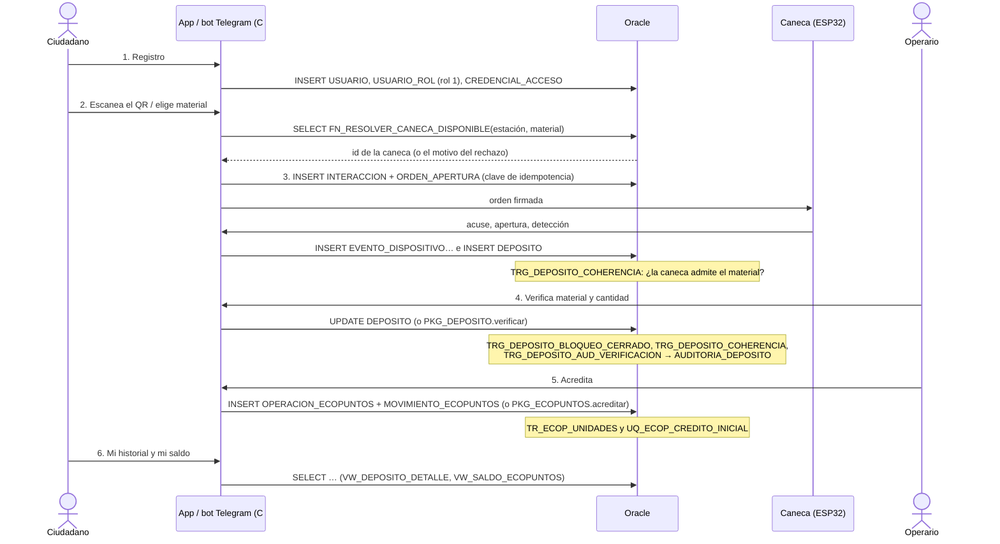

# 11 · Flujo completo: del registro al historial

**Caso de uso:** *un ciudadano se registra, consulta las canecas disponibles, hace un depósito válido, recibe sus ecopuntos y después consulta su historial.*

**¿Está implementado?** Sí, de punta a punta, en la base y en la aplicación, con las aclaraciones de cada paso. Se probó completo en el esquema aislado (Prueba F de [13-pruebas.md](13-pruebas.md) y pruebas de integración de C#). En la base compartida de Oracle Cloud **ningún depósito ha llegado todavía al paso 6**: hay 0 movimientos de ecopuntos. La explicación está en [12-ecopuntos.md](12-ecopuntos.md#por-qué-hoy-no-hay-ecopuntos).



## Paso a paso, con los objetos reales

| # | Qué pasa | Quién lo hace | Objetos Oracle | Reglas que lo protegen |
|---|---|---|---|---|
| 1 | **Registro** del ciudadano | `ServicioRegistroCiudadanos` → `RepositorioRegistroCiudadanosOracle` (C#) | `INSERT` en `USUARIO`, `USUARIO_ROL` (rol 1) y `CREDENCIAL_ACCESO` | Correo único y en minúsculas; hash PBKDF2 de 32 bytes; al menos 100 000 iteraciones; consentimiento con versión y fecha |
| 2 | **Consultar las canecas** de la estación | App: `RepositorioEstacionesOracle`. SQL Developer: `VW_CANECA_ESTACION` | `CONTENEDOR`, `PUNTO_INSTALACION`, `CONFIGURACION_CANECA`, `CONTENEDOR_MATERIAL` | Color según `CONFIGURACION_CANECA.CATEGORIA` (1 blanca, 2 verde, 3 negra) |
| 2b | **¿En qué caneca va mi residuo?** | App, con `SELECT FN_RESOLVER_CANECA_DISPONIBLE(:punto, :material) FROM DUAL` | [`FN_RESOLVER_CANECA_DISPONIBLE`](09-funciones.md#fn_resolver_caneca_disponible) | Estación activa, material habilitado, una sola caneca de esa categoría, en servicio y que admita el material; si no, un error −2081x con el motivo |
| 3 | **Visita y orden de apertura** | `ServicioInteracciones` → `RepositorioInteraccionesOracle` | `INSERT INTERACCION` (estado 1→2) y `INSERT ORDEN_APERTURA` (estado 1, emitida) | `CK_ORDEN_CLAVE` (idempotencia: repetir la solicitud devuelve la misma orden); FK compuesta: la orden abre la caneca de la visita; vencimiento posterior a la emisión |
| 3b | **La caneca responde** | Bridge del ESP32 → `RepositorioInteraccionesOracle` | `INSERT EVENTO_DISPOSITIVO` (1 acuse, 2 apertura, 3 detección, 4 cierre, 5 fallo, 6 sin sensor) | `ID_EXTERNO` único por caneca: una retransmisión no se cuenta dos veces; FK compuesta: el evento es de la caneca de la orden |
| 3c | **Depósito** | Mismo repositorio | `INSERT DEPOSITO` y cierre de la orden (6) y de la visita (3) | `UQ_DEPOSITO_ORDEN` (una orden, un depósito); `TRG_DEPOSITO_COHERENCIA` (la caneca admite el material declarado, −20102) |
| 4 | **Verificación** por un operario | App: `ServicioInteracciones.VerificarDepositoAsync` hace su propio `UPDATE deposito`. Base: `PKG_DEPOSITO.verificar` | `UPDATE DEPOSITO` → `AUDITORIA_DEPOSITO` | Rol 2 o 3; nadie verifica lo suyo; `CK_DEPOSITO_VERIFICACION`; `TRG_DEPOSITO_BLOQUEO_CERRADO` (no se cambia un verificado); `TRG_DEPOSITO_AUD_VERIFICACION` (deja la historia) |
| 5 | **Ecopuntos** | App: `FormEcopuntos` → `ServicioEcopuntos.AcreditarAsync`, un paso **aparte** y manual. Base: `PKG_ECOPUNTOS.acreditar`, al que `PKG_DEPOSITO.verificar` llama solo **en la misma transacción** | `INSERT OPERACION_ECOPUNTOS` + `MOVIMIENTO_ECOPUNTOS` | Solo depósitos verificados; tarifa vigente; `TR_ECOP_UNIDADES`; un solo crédito inicial (`UQ_ECOP_CREDITO_INICIAL`); clave única |
| 6 | **Historial y saldo** | App: `ServicioEstadisticas` y `ServicioEcopuntos.ConsultarMiosAsync`, con sus propias consultas. Base: `FN_DEPOSITOS_CIUDADANO`, `VW_DEPOSITO_DETALLE`, `VW_SALDO_ECOPUNTOS`, `PKG_ECOPUNTOS.saldo` | Solo lectura | Saldo = suma del libro; estado calculado por `PKG_DEPOSITO.estado` |

**Lo que corresponde a cada lado:**

| Lado | Qué hace | Ejemplos |
|---|---|---|
| **Oracle** | Garantiza las reglas que nunca deben romperse, aunque falle un programa | Claves, `CHECK`, FK compuestas, disparadores, índice único de crédito, `FN_RESOLVER_CANECA_DISPONIBLE` |
| **Aplicación** | Conversa con la persona, decide cuándo pedir cada paso y controla la transacción | Bot de Telegram, ventanas WinForms, puente del ESP32; mensajes, reintentos y firma de las órdenes |

## Diferencias que hay que conocer (comprobadas en el código)

1. **Dos caminos para verificar y acreditar.**
   - La aplicación verifica con un `UPDATE` propio y acredita en un paso separado y manual.
   - `PKG_DEPOSITO.verificar` hace las dos cosas juntas.
   - Ambos caminos pasan por los mismos disparadores y restricciones, así que **no pueden producir datos incoherentes**: un segundo crédito para el mismo depósito lo rechaza el índice único. Pero la regla de negocio está escrita dos veces. Ver [16-hallazgos.md](16-hallazgos.md) H-01.
2. **El historial de la aplicación no usa las vistas.** Calcula lo mismo con su propio SQL parametrizado. Las vistas sirven a SQL Developer, Power BI y la sustentación.

## Cómo reproducirlo en SQL Developer

La forma segura es en el **esquema aislado** (`ECOACCESS_P3_PRUEBAS`), nunca en Oracle Cloud. El guion completo que crea datos `IT_V027_*`, recorre los pasos 3 a 6 y termina con `ROLLBACK` es [`database/05_pruebas/V027_pruebas_capa_academica.sql`](../../database/05_pruebas/V027_pruebas_capa_academica.sql) (Prueba F, 27 comprobaciones). Para **ver** el flujo con datos reales, en modo solo lectura y en cualquier esquema:

```sql
-- Una visita de principio a fin:
SELECT * FROM vw_recorrido WHERE id_interaccion = :id;
-- Su depósito, con estado y color:
SELECT * FROM vw_deposito_detalle WHERE id_interaccion = :id;
-- Su auditoría y sus ecopuntos:
SELECT * FROM vw_bi_auditoria   WHERE id_deposito = :dep;
SELECT * FROM movimiento_ecopuntos WHERE id_deposito = :dep;
```
