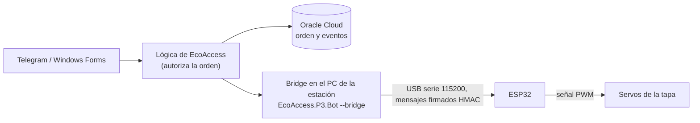
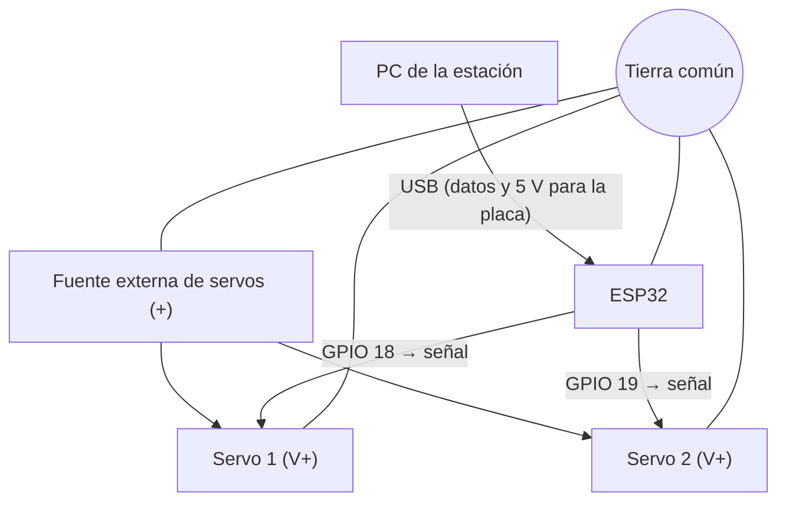
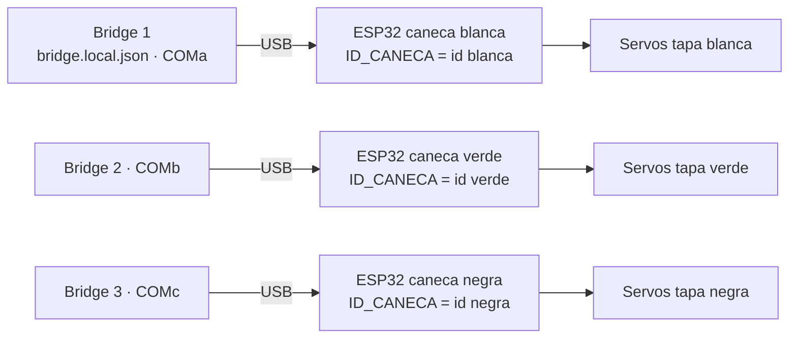

# ESP32 y servomotores para principiantes — preparación de la fase de hardware
> **Histórico (piloto de una caneca).** La estación actual tiene tres canecas, un servo por tapa: **BLANCA 1093 → GPIO 19**, **NEGRA 1401 → GPIO 18**, **VERDE 1400 → GPIO 23**, con el firmware `hardware/estacion_tres_canecas/`. No existe caneca azul. Ver `docs/hardware/INTEGRACION_FINAL_TRES_CANECAS_QR.md`.

EcoAccess P3 · Jorge Gutierrez Thomas y Heyder Canchila. **Esta guía no se ejecutó con hardware**: prepara la siguiente fase.
Para cargar, calibrar y validar paso a paso se usa después `GUIA_VALIDACION_ESP32.md` (10 pasos, ya existente).

## 1. Cómo se conecta todo

El ESP32 **no** se conecta a Oracle ni a Internet: solo habla por USB con el bridge. Cada orden lleva firma HMAC, un
desafío nuevo y una vigencia; el ESP32 la guarda antes de mover nada, abre, espera `ABIERTO_MS` (10 000 ms), cierra solo y
envía dos recibos. Si se cae Internet o Telegram, el cierre ocurre igual porque lo hace el firmware.

## 2. Componentes

| Componente | Cantidad hoy (1 caneca) | Nota |
|---|---|---|
| Placa ESP32 (núcleo ESP32 clásico, por ejemplo ESP32-DevKitC) | 1 | El firmware compila para `esp32:esp32:esp32` |
| Servomotor (señal PWM 50 Hz) | 2 | Mueven **la misma tapa** |
| Fuente externa para los servos | 1 | Tensión según la hoja de datos del servo; **corriente por medir** (§4) |
| Cable USB de datos (no solo de carga) | 1 | Para el puerto COM |
| Cables y protoboard o bornera | — | Tierra común obligatoria |
| Condensador electrolítico cerca de los servos | Recomendado | Amortigua los picos de arranque; valor según medición |

## 3. Cableado actual (una caneca, dos servos, una tapa)

Reglas: los servos **nunca** se alimentan desde el pin de 3,3 V del ESP32; la tierra de la fuente, de los servos y del ESP32
se une; la señal va directa al GPIO (los pines 18 y 19 están fijados en `servosecoacces.ino`).

## 4. Medir antes de elegir la fuente

`hardware/README.md` deja claro que **una fuente de 5 V y 1 A no está validada**. Antes de recomendar una fuente definitiva
se mide con multímetro o pinza amperimétrica, con los dos servos montados en la tapa real:

1. Corriente en reposo.
2. Pico de arranque al abrir (lo más exigente) y al cerrar.
3. Corriente con el servo bloqueado un instante (tope mecánico).
4. Caída de tensión de la fuente durante el arranque (no debe reiniciar el ESP32).

La fuente debe superar con margen la suma de los picos de todos los servos que se muevan a la vez. Registrar los
valores en el paso 5 de `GUIA_VALIDACION_ESP32.md`.

## 5. Software en el PC

1. Instalar **Arduino IDE 2**.
2. En *Preferencias → URL adicionales del gestor de placas* agregar el índice oficial de Espressif y, en el gestor de placas,
   instalar **esp32 de Espressif Systems, versión 3.x**.
3. No hacen falta bibliotecas adicionales: `Preferences`, `cJSON` y `mbedtls` vienen con el paquete del ESP32.
4. Abrir `hardware/servosecoacces/servosecoacces.ino`.
5. Copiar `configuracion_ejemplo.h` como `configuracion_privada.h` (Git lo excluye) y escribir `DISPOSITIVO`, `ID_CANECA`
   (el id de Oracle de la caneca: hoy la piloto es la 1093), `VERSION_CLAVE` y `CLAVE_BASE64` del archivo privado del
   bridge. Dejar `CALIBRACION_VERIFICADA = false` hasta calibrar.
6. Conectar el ESP32, elegir la placa y **el puerto COM que aparezca** (Administrador de dispositivos o
   `scripts/instalacion/Validar-Entorno.ps1`). No se fija COM5 ni otro número.
7. Cargar. Abrir el monitor serie a **115200**: sin calibración el firmware no mueve los motores.

Después: calibración sin tapa, primera orden sin tapa, prueba con tapa y verificación de eventos en Oracle, en ese orden,
según `GUIA_VALIDACION_ESP32.md`. Con el ESP32 listo, en `bridge.local.json` se agrega `"PuertoSerial": "COMx"` y el bot se
inicia con `--bridge` y `--dispositivo-serial` (sin `--dispositivo-simulado` a la vez). Mientras no exista esa
configuración, el bot sigue en **modo software** y no emite órdenes.

## 6. Seguridad

- Al encender o reiniciar, los motores no se mueven.
- Una orden repetida, vencida o con firma inválida no mueve la tapa.
- Si el ESP32 se reinicia a mitad de un ciclo queda bloqueado hasta revisión física (`RECUPERACION_MANUAL_VERIFICADA`).
- Un recibo confirma la orden PWM, **no** la posición de la tapa ni que entró un residuo: sin sensor, el depósito queda
  pendiente de verificación.
- No se desactiva ninguna de estas protecciones para que una demostración funcione.

## 7. Diseño futuro: tres canecas (blanca, verde, negra) — no existe todavía

En Oracle cada caneca es un `contenedor` con su estación, su QR, sus materiales admitidos y su estado; las órdenes y eventos
se guardan por caneca. Agregar canecas es configuración, no código nuevo por color.

Opción recomendada: **un ESP32 por caneca** con el mismo firmware y otra `configuracion_privada.h` (otro `DISPOSITIVO`,
`ID_CANECA` y clave), así no se duplica lógica y una falla no bloquea las otras tapas. Hace falta: dos placas y cuatro
servos más, fuentes dimensionadas con las mediciones del §4 para cada tapa, una instancia de bridge por placa (cada una
con su `bridge.local.json` y su puerto COM) y registrar en Oracle las canecas verde y negra con sus materiales. Hasta que
existan físicamente, solo se prueban con el simulador y nunca se les envía una orden.
