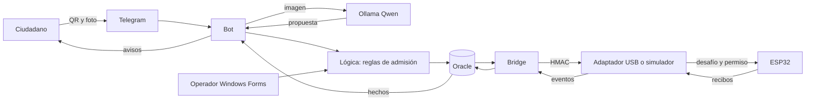

# 09. Integración

## Principios

- La respuesta del modelo nunca llega a los servomotores: pasa por las reglas de Logica y por una orden persistida.
- El bridge consulta la vigencia de la orden antes de actuar; las órdenes duplicadas o vencidas no mueven la tapa.
- Los avisos al ciudadano leen hechos de Oracle: no se anuncia una apertura solo por haber enviado la orden.

## Varias canecas

Cada contenedor tiene identificador, QR, ubicación, estado, materiales admitidos y un dispositivo asociado por configuración. La exclusión de órdenes es por contenedor. Agregar una caneca es:

1. Registrarla y generar su QR en la aplicación.
2. Crear su archivo privado de dispositivo con su identificador y clave.
3. Grabar su firmware con esos datos.

`ICanalDispositivo` permite otros transportes sin tocar la lógica de negocio.

## Ecopuntos

El bot registra la solicitud y los eventos. Los puntos se acreditan después de una verificación independiente, con la tarifa vigente, por unidad verificada y una sola vez.