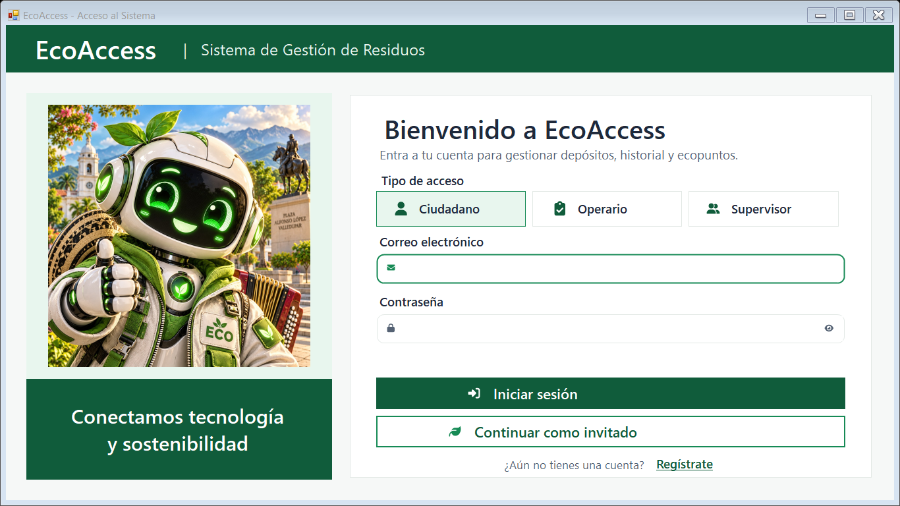
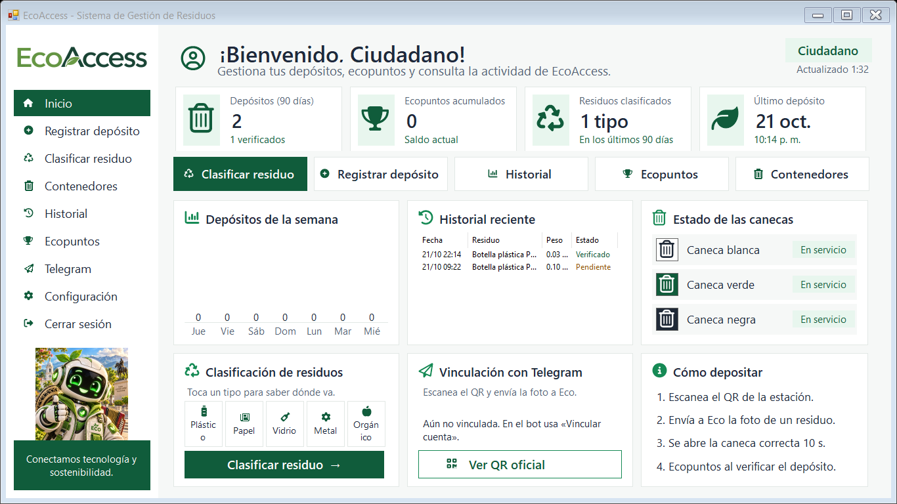
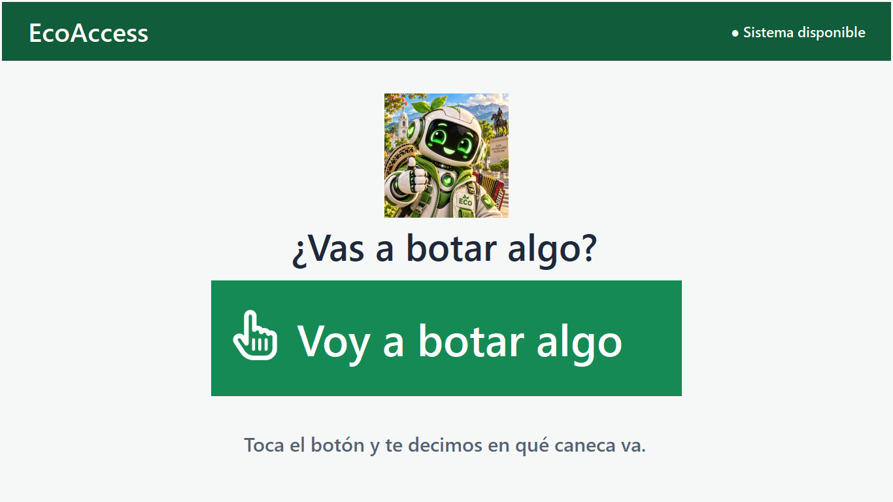
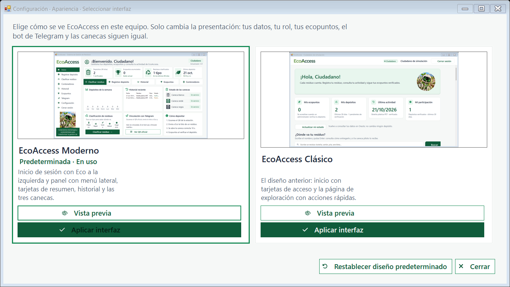
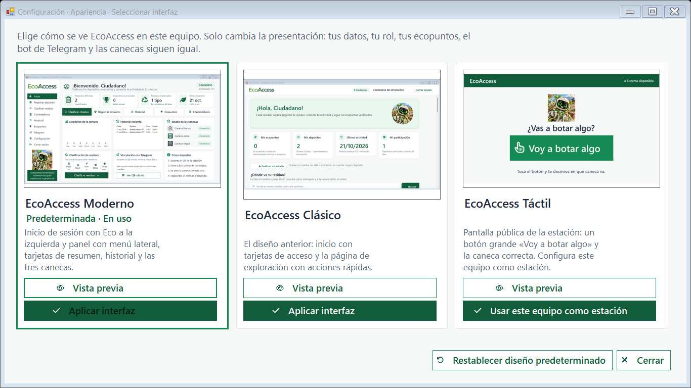

# Selección y personalización de interfaces EcoAccess

EcoAccess tiene **varios diseños intercambiables**. Cambiar de diseño solo cambia la presentación y la navegación. **No cambia:**
- la base Oracle;
- los usuarios ni los roles;
- los ecopuntos;
- el bot de Telegram;
- el QR oficial;
- la comunicación con las canecas.

## 1. Diseños disponibles

| Diseño | Para quién | Qué es |
|---|---|---|
| **EcoAccess Moderno** (predeterminado) | invitado, ciudadano, operario y supervisor | Inicio de sesión con Eco a la izquierda (primera imagen aprobada) y panel del ciudadano con menú lateral, indicadores, historial y las tres canecas (segunda imagen aprobada) |
| **EcoAccess Clásico** | invitado, ciudadano, operario y supervisor | El diseño anterior: inicio con tarjetas de acceso y página de exploración con acciones rápidas |
| **EcoAccess Táctil** | solo el supervisor lo configura | Convierte el equipo en la **pantalla pública de la estación**: un botón grande «Voy a botar algo» y la caneca correcta |

En operario y supervisor, los dos diseños abren por ahora el mismo menú de gestión; lo único que cambia es el inicio de sesión. El rediseño de esos paneles está pendiente: ver la sección 8.

| Inicio Moderno | Panel Moderno (ciudadano) | Estación táctil |
|---|---|---|
|  |  |  |

Las capturas son reales, a 1366×768, y usan el ciudadano de **simulación** 4470 (`@simulacion.ecoaccess.invalid`); no aparece ninguna persona real.

### Diferencias con las imágenes de referencia

- **Canecas:** son las tres del prototipo (blanca, verde y negra). La imagen mostraba azul y amarilla.
- **Llenado:** no se muestra porcentaje, porque las canecas no tienen sensor de nivel. Se muestra si están en servicio.
- **Panel del ciudadano:** no tiene el bloque «Sistema y base de datos» ni el botón «Base de datos», porque el ciudadano no debe ver información interna.
- **Números:** todos salen de Oracle; nada de «+20 %» ni valores de ejemplo. Los depósitos se cuentan en los últimos 90 días, el máximo que permite el servicio de estadísticas personales.

## 2. Cómo entrar al selector

**Configuración → Apariencia → Seleccionar interfaz**:

| Diseño | Dónde está la opción |
|---|---|
| Moderno | menú lateral → **Configuración** |
| Clásico, ciudadano o invitado | acción rápida **Apariencia** |
| Operario o supervisor | menú → **Apariencia** |



Cada tarjeta muestra:
- el nombre del diseño;
- una vista previa (captura real);
- una descripción breve;
- la marca **Predeterminada** y la marca **En uso**;
- los botones **Vista previa** y **Aplicar interfaz**.

Abajo están **Restablecer diseño predeterminado** y **Cerrar**.

## 3. Ver, aplicar y restablecer

1. **Vista previa:** abre la captura del diseño en grande. No cambia nada.
2. **Aplicar interfaz:** guarda la preferencia y cierra el panel. EcoAccess lo reabre con el diseño nuevo **con la misma sesión y el mismo rol**, sin pedir otra vez la contraseña.
3. **Restablecer diseño predeterminado:** borra tu preferencia y vuelve a EcoAccess Moderno.

El cambio de diseño no consulta ni modifica Oracle. Si hay una ventana de depósito abierta, el selector no se puede abrir hasta cerrarla, así que el cambio nunca interrumpe una operación.

## 4. Dónde se guarda la preferencia

En `%LOCALAPPDATA%\EcoAccessP3\apariencia.txt`, un archivo de texto del perfil de Windows. **No se guarda en Oracle:** una preferencia estética no justifica cambiar el esquema.

| Preferencia | Clave | Quién la cambia |
|---|---|---|
| De cada cuenta en este equipo | `usuario.<id>=moderno` | la propia persona |
| Del invitado en este equipo | `invitado=clasico` | el invitado |
| Del inicio de sesión del equipo | `equipo=moderno` | se actualiza con el último diseño aplicado |
| Modo estación | `estacion=1` | **solo el supervisor**, desde el diseño EcoAccess Táctil |

**Reglas de seguridad:**
- Si el archivo falta, está dañado o pide un diseño que no existe o que no corresponde al perfil, se usa el predeterminado. Una preferencia **nunca impide abrir EcoAccess**.
- Solo se aceptan identificadores de letras, dígitos y guiones. Un archivo editado a mano no puede inyectar nada en la interfaz.

## 5. Diseños según el rol

- **El rol nunca sale del diseño.** Lo valida Oracle al iniciar sesión (`ServicioAutenticacion` y `AreasAcceso.Elegir`), y el selector solo muestra lo que permite ese rol.
- **Ciudadano:** Moderno o Clásico. No ve el modo táctil ni opciones administrativas.
- **Operario:** Moderno o Clásico. El diseño no le da acceso a funciones de supervisor.
- **Supervisor:** Moderno o Clásico, y además **EcoAccess Táctil** para convertir el equipo en estación.
- **Invitado:** Moderno por defecto. Su preferencia es local y no requiere registro.
- **Estación táctil:** no muestra menús, inicio de sesión ni opciones administrativas. Se cierra con `Esc`.
  - Para volver al escritorio en un equipo configurado como estación, abre EcoAccess con `--escritorio`, entra como supervisor y elige «Quitar modo estación».
  - En cualquier equipo se puede abrir la estación con `EcoAccess.P3.Presentacion.exe --estacion`.



**El diseño no interviene en Telegram.** El ciudadano usa el QR oficial y el bot sin configurar nada en el escritorio. La apariencia de Telegram la decide Telegram, no EcoAccess.

## 6. Cómo agregar un diseño nuevo sin duplicar reglas

1. **Registrarlo** en `CatalogoApariencias.Todos` (`src/EcoAccess.P3.Logica/Servicios/CatalogoApariencias.cs`), con identificador, nombre, descripción y perfiles permitidos.
2. **Crear sus ventanas** en `EcoAccess.P3.Presentacion`:
   - el inicio de sesión implementa `IVentanaAcceso`;
   - el panel implementa `IPanelConApariencia`.
3. **Usar solo los servicios que ya existen**, es decir los de `ServiciosAplicacion`, como `ServicioPanelCiudadano`, `ServicioCatalogoAmbiental` o `ServicioEcopuntos`. **Nunca SQL en la interfaz** ni copias de reglas de ecopuntos, autenticación o canecas. Las pruebas de arquitectura lo exigen.
4. **Conectarlo** en `Program.CrearVentanaAcceso` y `Program.AbrirPaneles`.
5. **Agregar su vista previa** en `assets/interfaces/<id>.png`, incrustada en `EcoAccess.P3.Presentacion.csproj`.
6. **Probarlo** con `tests/herramientas/EcoAccess.P3.RecorridoInterfaces`, añadiendo sus pasos.

**Cómo se reparten las piezas:**

```
FormAccesoModerno ─┐                           ┌─ ServicioAutenticacion ─┐
FormInicioSesion  ─┤ IVentanaAcceso            │                         │
FormPanelCiudadano ┤                           ├─ ServicioPanelCiudadano ├─► Repositorios Oracle ─► Oracle Cloud
FormExplorarEco…  ─┤ IPanelConApariencia ──────┤  ServicioEcopuntos      │   (sin cambios)
FormPrincipal     ─┘                           ├─ ServicioCatalogoAmbiental
FormEstacionTactil ── GuiaEstacionTactil ──────┘  ResolutorDestino (mismo que Telegram)
CatalogoApariencias + PreferenciasApariencia (Lógica, sin Oracle) ◄── AlmacenApariencia (archivo local)
```

## 7. Pruebas realizadas (18/11/2026)

**Pruebas unitarias:** 2189 correctas, 0 fallidas, 1 omitida. Incluyen:
- 13 de `CatalogoAparienciasTests`: predeterminado, preferencia inexistente o dañada, permisos por rol, guardar y leer, restablecer, identificadores inválidos;
- 6 de `GuiaEstacionTactilTests`, con los 40 materiales reales de Oracle.

**Recorrido automático** con los formularios reales y Oracle Cloud, a 1366×768 y 1920×1080: **47 de 47 pasos correctos**. El informe está en [recorrido_interfaces_20261118.txt](recorrido_interfaces_20261118.txt).

| Escenario pedido | Resultado |
|---|---|
| La aplicación abre con el inicio de sesión predeterminado | OK: Moderno sin preferencia |
| El ciudadano ve el panel de la segunda imagen | OK, con saldo, depósitos, historial y las tres canecas reales |
| Consultar los diseños, ver la vista previa y aplicar otro | OK |
| El diseño nuevo mantiene las funciones permitidas | OK: Clásico abre con la misma sesión, con «Mis ecopuntos» y «Apariencia» |
| La preferencia sobrevive a un reinicio | OK: se relee del archivo |
| Restablecer vuelve al predeterminado | OK |
| El cambio no altera Oracle, los ecopuntos, Telegram ni las canecas | OK: conteos de Oracle idénticos antes y después (ver abajo) |
| El ciudadano no ve opciones administrativas | OK, en el panel y en el selector |
| Un archivo de apariencia dañado no impide iniciar | OK |
| El modo táctil sigue siendo sencillo | OK: un botón, seis grupos, el residuo y la caneca |

**Conteos de Oracle:** antes y después del recorrido fueron idénticos (`usuario=76 interaccion=123 orden_apertura=115 evento_dispositivo=376 deposito=113 operacion_ecop=0 movimiento_ecop=0 vinculo_tg=0 credencial=24`). Evidencia en `oracle_conteos_antes.txt` y `oracle_conteos_despues.txt`.

**Telegram:** el bot siguió en marcha durante todo el trabajo (el mismo proceso desde el 17/11, 8:40 p. m.), porque los diseños no lo tocan.

**Prueba con el ratón real:** en la estación, «Voy a botar algo» se tocó con el ratón y abrió los grupos. Esta prueba encontró un fallo: la vista cambiaba durante el propio clic. Se corrigió diferiendo el cambio de vista con `BeginInvoke`.

## 8. Si un diseño presenta problemas

| Síntoma | Qué hacer |
|---|---|
| El diseño no cambia o aparece otro | Revisa `apariencia.txt`. Si tiene un valor no válido, EcoAccess usa el Moderno. Puedes borrar el archivo sin riesgo. |
| Un equipo abre siempre la estación táctil | Está en modo estación. Abre EcoAccess con `--escritorio` y quita el modo desde el selector como supervisor. |
| La estación dice «Sin conexión» | Oracle no respondió. Reintenta sola cada 30 s; revisa la red o el wallet. |
| Ocurre un error inesperado | Queda anotado en `%LOCALAPPDATA%\EcoAccessP3\errores.log`, con el tipo y la pila del error, sin datos de conexión. |

**Pendiente:**
- rediseñar los paneles del operario y del supervisor con el estilo Moderno (hoy usan el menú de gestión existente);
- probar con escalado de Windows de 125 % y 150 %;
- probar la pantalla táctil física, cuando el equipo la consiga.
