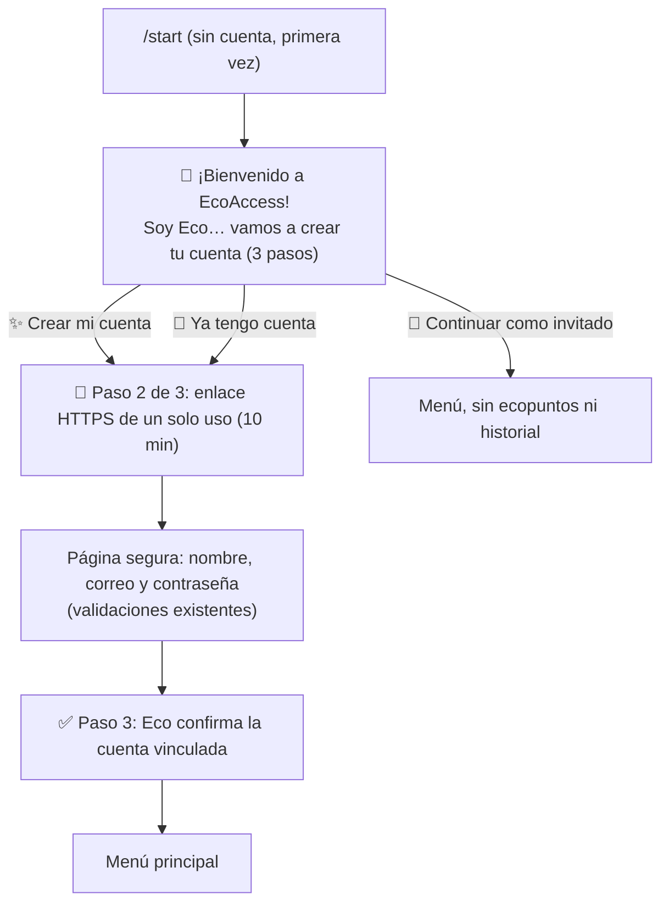

# Telegram: registro, menú y mensajes (misión nocturna, 12/11/2026)

**Estado: implementado y probado en software** (pruebas unitarias con Telegram simulado). **Falta probarlo en el Telegram
real:** el bot que corría anoche es una compilación anterior y no se reinició.

Respetamos lo que Telegram permite de verdad: mensajes con emojis, botones *inline* y el enlace a la página HTTPS. No se usó
una Mini App: el registro ya tiene una página segura propia y otra tecnología no aportaba.

## Flujo de primera vez

**Qué no cambió, a propósito:**
- No se piden datos ni contraseñas en el chat.
- La página de registro conserva sus validaciones existentes:
  - correo único;
  - contraseña ciudadana de 6 a 20 caracteres con PBKDF2;
  - enlace de un solo uso que vence;
  - vínculo por el identificador de Telegram, nunca por el nombre de usuario.
- Un enlace abandonado vence solo y no deja un registro a medias. Pedir otro enlace reinicia el flujo.

**Usuario existente:** si la cuenta de Telegram ya está vinculada, `/start` no ofrece el registro. Saluda y muestra el menú
(prueba `UnUsuarioRegistradoNoVuelveARegistrarse`).

## Menú principal (8 opciones)

| Botón | Hace |
|---|---|
| 📸 Clasificar residuo | Pide una foto. Una foto enviada directamente también se procesa, sin pasar por el menú |
| 📱 Escanear estación | Explica cómo escanear el QR de la estación |
| 📜 Mis depósitos | `/depositos` |
| 🪙 Mis ecopuntos | `/ecopuntos` (y desde allí «Mi actividad») |
| 👤 Mi cuenta | Estado del vínculo, o el registro si no hay cuenta |
| ♻️ Materiales y reciclaje | Guía de colores (Resolución 2184 de 2019) |
| ❓ Ayuda | Ayuda corta y la lista de comandos |
| 🌎 Acerca de EcoAccess | Presentación del proyecto |

Se quitaron «Próximamente» y «Menú» dentro del menú. Todos los comandos anteriores siguen funcionando.

## Ejemplos de mensajes

**Primera vez:**

> 🌱 ¡Bienvenido a EcoAccess!
>
> Soy Eco, tu asistente inteligente de reciclaje. Te ayudaré a identificar tus residuos y a depositarlos correctamente.
>
> Para comenzar, vamos a crear tu cuenta: son 3 pasos y tus datos se escriben en una página segura, nunca en este chat.
>
> [✨ Crear mi cuenta] [🔗 Ya tengo cuenta] [🌱 Continuar como invitado]

**Un residuo, con descripción concreta:**

> 🍎 Identifiqué una manzana verde.
> 🌱 Si son restos que deseas desechar, puedo orientarte hacia la caneca verde.

**Varios residuos (solo orienta):**

> ♻️ Identifiqué 3 residuos:
> 📦 Una caja de cartón limpia → ⬜ BLANCA
> 🧻 Una servilleta usada → ⬛ NEGRA
> 🍌 Una cáscara de banano → 🟩 VERDE
>
> 📸 Para depositarlos, envíame una foto de cada residuo, de uno en uno: así abro solo la caneca que corresponde.

**Residuo especial:**

> 🔋 Una pila → ⚠️ RECOLECCIÓN ESPECIALIZADA
> ℹ️ Una pila: Requiere recolección especializada: no va en ninguna caneca de EcoAccess.

Eco nunca dice que una tapa se abrió si solo se generó una solicitud. Los mensajes de simulación empiezan por
«🧪 PRUEBA SIMULADA — no se movió ninguna tapa» y solo existen en pruebas y evaluaciones: no se envían a personas reales.
