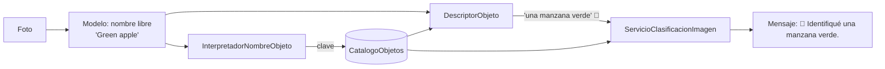
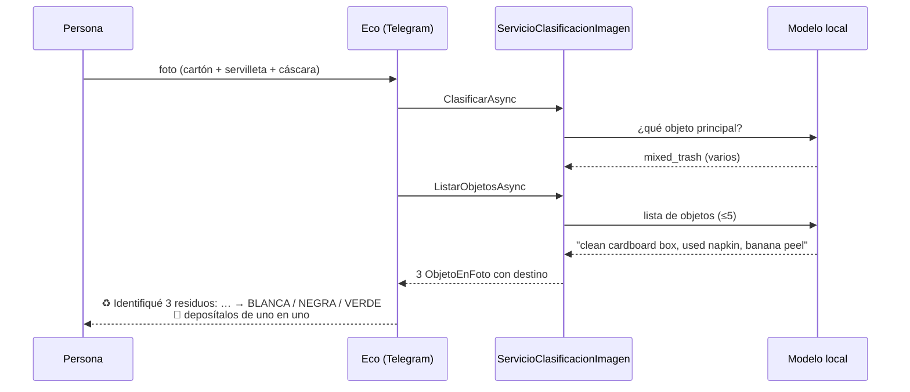
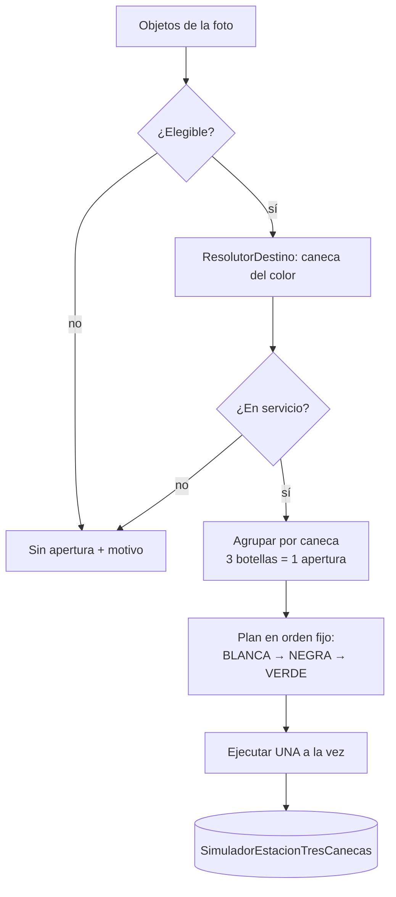
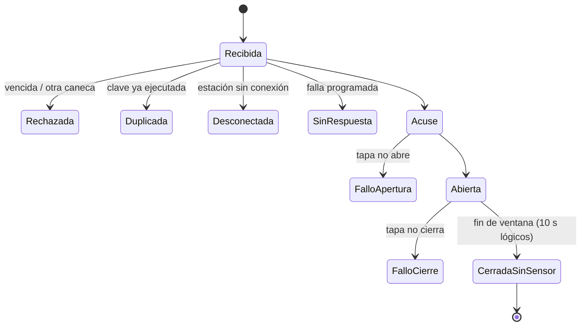

# Reconocimiento concreto, varios residuos y coordinador de aperturas (misión nocturna, 12/11/2026)

| Componente | Estado |
|---|---|
| Descripción concreta («una manzana verde») | Implementado y probado en software |
| Catálogo ampliado (11 claves) | Implementado y probado en software |
| Varios residuos en Telegram | Implementado y probado en software. **Solo orienta**, no abre |
| Coordinador de aperturas múltiples | Implementado y probado **solo con el simulador** |
| Apertura física de 2 o 3 canecas | **Pendiente de prueba física supervisada**. El código la impide |

## 1. Del nombre libre a la frase concreta

El modelo local (`lfm3-vl`) primero nombra lo que ve, en inglés y en pocas palabras. Ese texto **nunca se muestra a nadie**:
- `InterpretadorNombreObjeto` lo traduce a una clave cerrada de `CatalogoObjetos`;
- `DescriptorObjeto` arma la frase en español, solo con palabras de una lista cerrada (unos 80 sustantivos y 18 adjetivos
  visibles), y concuerda el género y el número.

**Regla de seguridad:** la descripción solo se usa si su sustantivo pertenece a la **misma clave** ya decidida. Una
«orange plastic bottle» es una botella, no «una naranja». Además, la descripción no cambia el destino, la admisión ni la
apertura, y si el sujeto es una persona o un animal se descarta.

## 2. Catálogo ampliado

| Clave | Ejemplo | Destino | Abre en la estación |
|---|---|---|---|
| `styrofoam` | bandeja o vaso de icopor | NEGRA | Solo si Oracle admite `ICOPOR_CONTAMINADO` en la negra (antes se trataba como envase plástico y solo orientaba) |
| `cigarette_butt` | colilla | NEGRA | Solo si Oracle admite `COLILLA` en la negra |
| `greasy_paper` | caja de pizza, papel con grasa | NEGRA | No (sin código: solo orienta) |
| `thermal_paper` | recibo | NEGRA | No |
| `disposable_cutlery` | tenedor o pitillo plástico | NEGRA | No |
| `mirror_or_ceramic` | espejo, taza de cerámica | NEGRA, envuelto | No |
| `wood` | tabla, madera | no aprovechable | No |
| `broken_glass` | vidrio roto | recolección especializada | Nunca |
| `aerosol` | aerosol | recolección especializada | Nunca |
| `chemical_container` | cloro, pintura, solvente | recolección especializada | Nunca |
| `cooking_oil` | aceite usado | recolección especializada | Nunca |

> **Cambio de comportamiento que hay que verificar físicamente:** con el QR vigente, una foto de icopor o de una colilla
> puede abrir ahora la caneca NEGRA si Oracle la admite allí. Es su destino correcto, pero antes no abría nada. Está en el
> paso 4 de `docs/operacion/GUIA_PRUEBAS_SUPERVISADAS_13-11-2026.md`.

**El estado visible cambia la clave:**
- `foam` convierte un envase o un vaso en icopor;
- `greasy` o `stained` convierten el papel y el cartón en papel con grasa;
- `broken glass` es vidrio roto.

Así «cartón» no significa siempre BLANCA ni «plástico» siempre aprovechable.

## 3. Foto con varios residuos

Garantías:
- La lista se pide **solo al modelo local**: `SelectorVision` nunca la envía a Groq.
- En Telegram esa foto **no crea solicitudes, órdenes ni aperturas**.

Reglas de destino (`AnalisisMultiobjeto.Destino`):

| Situación | Destino |
|---|---|
| Aprovechable limpio | BLANCA |
| Aprovechable con estado `dirty`, `used`, `greasy`, `stained`, `wet`… | NEGRA |
| Restos de comida, cáscaras | VERDE |
| Fruta o comida entera | VERDE, **solo si la persona confirma** que la desecha; no es elegible para abrir |
| Sanitario (servilleta usada, tapabocas…) | NEGRA |
| Pilas, electrónicos, medicamentos, aerosoles, vidrio roto | RECOLECCIÓN ESPECIALIZADA |
| Envase o bolsa plástica (puede ser icopor o metalizado) | orienta; no es elegible para abrir |
| Persona, animal, planta viva | no es residuo |

## 4. Coordinador de aperturas (simulado)

- **Clave de idempotencia:** `operación:COLOR`. Un mensaje repetido de Telegram no vuelve a abrir, ni siquiera después de un
  reinicio del ESP32 simulado: se comporta como la reserva NVS del firmware.
- **Fallo parcial:** si la negra no abre, la blanca y la verde siguen; cada caneca tiene su propio resultado.
- **Solo simulador:** el constructor lanza `InvalidOperationException` si `IEjecutorAperturas.EsSimulado` es falso.

### Estados de una apertura simulada

## 5. Barrera de hardware (`GuardiaHardware`)

El software llega a la estación por dos caminos:
- el puerto COM (`EnlacePuertoSerial`);
- el HTTP hacia un bridge (`CanalDispositivoHttp`).

Ambos preguntan a la guardia antes de actuar. El proceso queda **bloqueado sin vuelta atrás** si:
- corre en un ejecutor de pruebas (MSTest, xUnit, NUnit o testhost), lo que se detecta solo;
- `ECOACCESS_SIN_HARDWARE=1`;
- el bot arrancó en un modo distinto de `--polling`, `--webhook`, `--bridge` o `--dispositivo-serial`, como las evaluaciones o
  `--simulado`.

Bloqueado:
- no se abre ningún COM;
- un comando HTTP solo puede ir a un puerto que escucha **el mismo proceso**, como un bridge de prueba.

Pruebas: `GuardiaHardwareTests`, que intenta COM1, COM3 y COM4 y los puertos 8182, 8183 y 8283.

## 6. Pruebas

| Archivo | Casos |
|---|---|
| `MultiobjetoTests` | 13 descripciones, 11 destinos del catálogo ampliado, no contradicción, los 6 casos de la misión, cantidades, canecas fuera de servicio |
| `CoordinadorAperturasMultiplesTests` | las 7 combinaciones, la negra (1401, GPIO 18 informado), fallo parcial, 3 tipos de falla, duplicados tras reinicio, desconexión y reconexión, órdenes vencidas o ajenas, 126 operaciones concurrentes con fallas sin dos tapas a la vez |
| `TelegramMultiobjetoTests` | tres residuos en la conversación sin órdenes, la pila, la lista inútil, la lista solo local |
| `GuardiaHardwareTests` | COM y bridges de otro proceso bloqueados |

**Una prueba con el simulador no verifica nada mecánico:** ángulos, GPIO reales, fuente o fricción de las tapas.
